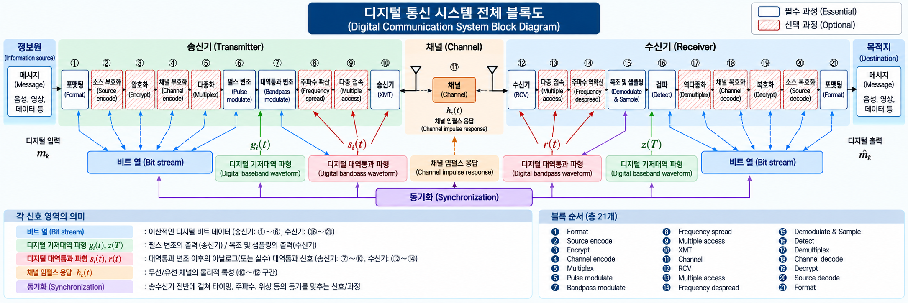

# Learning Roadmap

[TOC]

정보원 → 송신기(1~10) → 채널(11) → 수신기(12~21) → 목적지 순서로 읽는다. 목차의 번호도 아래 블록도와 동일하다.

**필수·선택 표시는 첨부 블록도의 구분을 따른다.** 실제 시스템에서는 목적과 환경에 따라 선택 과정을 사용하거나 일부 기능을 통합한다. 상세 글이 없는 블록은 전체 구조 글의 해당 설명으로 연결한다.

## Transmitter · 01–10

| 블록 | 과정 | 구분 |
| --- | --- | --- |
| 01 | [Format](blocks/format-input.md) | 필수 |
| 02 | [Source Encode](blocks/source-encoding.md) | 선택 |
| 03 | [Encrypt](blocks/encryption.md) | 선택 |
| 04 | [Channel Encode](blocks/channel-encoding.md) | 선택 |
| 05 | [Multiplex](blocks/multiplexing.md) | 선택 |
| 06 | [Pulse Modulate](blocks/pulse-modulation.md) | 필수 |
| 07 | [Bandpass Modulate](blocks/bandpass-modulation.md) | 필수 |
| 08 | [Frequency Spread](blocks/frequency-spreading.md) | 선택 |
| 09 | [Multiple Access](blocks/multiple-access-transmit.md) | 선택 |
| 10 | [XMT](blocks/transmitter.md) | 필수 |

## Channel · 11

| 블록 | 과정 | 구분 |
| --- | --- | --- |
| 11 | [Channel](blocks/channel.md) | 필수 |

## Receiver · 12–21

| 블록 | 과정 | 구분 |
| --- | --- | --- |
| 12 | [RCV](blocks/receiver.md) | 필수 |
| 13 | [Multiple Access](blocks/multiple-access-receive.md) | 선택 |
| 14 | [Frequency Despread](blocks/frequency-despreading.md) | 선택 |
| 15 | [Demodulate & Sample](blocks/demodulation-and-sampling.md) | 필수 |
| 16 | [Detect](blocks/detection.md) | 필수 |
| 17 | [Demultiplex](blocks/demultiplexing.md) | 선택 |
| 18 | [Channel Decode](blocks/channel-decoding.md) | 선택 |
| 19 | [Decrypt](blocks/decryption.md) | 선택 |
| 20 | [Source Decode](blocks/source-decoding.md) | 선택 |
| 21 | [Format](blocks/format-output.md) | 필수 |

## Synchronization

[동기화: 송수신 전반의 타이밍·주파수·위상 기준 맞추기](blocks/synchronization.md)

## Destination & Applications

[Bio/Implant Communication으로 연결하기](applications/bio-implant/bio-and-implant-communication.md)

## 개념 지도

블록도의 순서를 가지별로 따라가며 개념을 누르면 해당 단계로 이동한다. 화면보다 크면 좌우로 스크롤할 수 있다.

<nav class="handbook-concept-map" aria-label="개념별 관련 문서" tabindex="0"><ul><li><a href="theory/foundations/communication-system-overview.md">Digital Communication System</a><ul><li><a href="blocks/format-input.md">Transmitter · 01–10</a><ul><li><a href="blocks/format-input.md">01. Format</a></li><li><a href="blocks/source-encoding.md">02. Source Encode</a></li><li><a href="blocks/encryption.md">03. Encrypt</a></li><li><a href="blocks/channel-encoding.md">04. Channel Encode</a></li><li><a href="blocks/multiplexing.md">05. Multiplex</a></li><li><a href="blocks/pulse-modulation.md">06. Pulse Modulate</a></li><li><a href="blocks/bandpass-modulation.md">07. Bandpass Modulate</a></li><li><a href="blocks/frequency-spreading.md">08. Frequency Spread</a></li><li><a href="blocks/multiple-access-transmit.md">09. Multiple Access</a></li><li><a href="blocks/transmitter.md">10. XMT</a></li></ul></li><li><a href="blocks/channel.md">Channel → Receiver → Destination</a><ul><li><a href="blocks/channel.md">11. Channel</a></li><li><a href="blocks/receiver.md">Receiver · 12–21</a><ul><li><a href="blocks/receiver.md">12. RCV</a></li><li><a href="blocks/multiple-access-receive.md">13. Multiple Access</a></li><li><a href="blocks/frequency-despreading.md">14. Frequency Despread</a></li><li><a href="blocks/demodulation-and-sampling.md">15. Demodulate & Sample</a></li><li><a href="blocks/detection.md">16. Detect</a></li><li><a href="blocks/demultiplexing.md">17. Demultiplex</a></li><li><a href="blocks/channel-decoding.md">18. Channel Decode</a></li><li><a href="blocks/decryption.md">19. Decrypt</a></li><li><a href="blocks/source-decoding.md">20. Source Decode</a></li><li><a href="blocks/format-output.md">21. Format</a></li></ul></li><li><a href="applications/bio-implant/bio-and-implant-communication.md">Destination & Applications</a></li><li><a href="blocks/synchronization.md">Synchronization</a></li></ul></li></ul></li></ul></nav>
