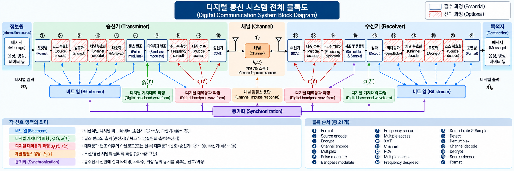
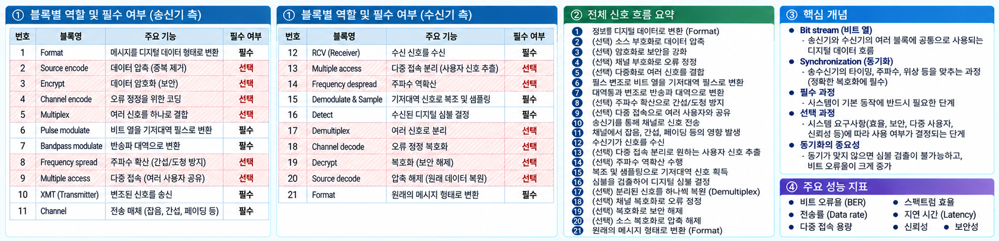
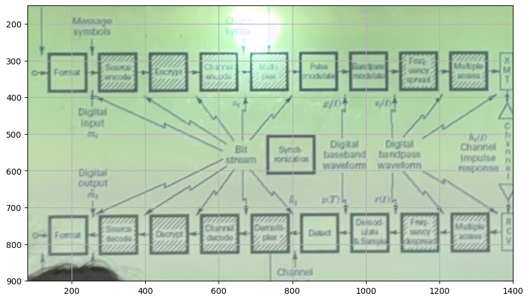

# 디지털 통신의 전체 구조와 핵심 개념

[TOC]

디지털 통신을 공부하다 보면 변조(Modulation), 대역폭(Bandwidth), 채널(Channel), BER, SNR, 다중화(Multiplexing) 등 수많은 개념이 등장한다.

하지만 이 개념들은 서로 독립적으로 존재하는 것이 아니다.

디지털 통신의 본질은 다음의 한 문장으로 정리할 수 있다.

> **송신단의 정보를 불완전한 물리적 채널을 거쳐 수신단에서 최대한 정확하고 효율적으로 복원하는 과정이다.**

따라서 개별 기술을 공부하기 전에 먼저 **정보가 어떤 과정을 거쳐 신호가 되고, 채널을 지나 다시 정보로 복원되는지 전체 구조를 이해하는 것**이 중요하다.

---


## 1. 정보(Information)와 신호(Signal)

통신을 이해하기 위해 가장 먼저 구분해야 하는 것은 **정보(Information)**와 **신호(Signal)**이다.

| 구분 | 정보(Information) | 신호(Signal) |
| --- | --- | --- |
| 본질 | 전달하려는 내용 | 정보를 전달하기 위한 물리적 표현 |
| 영역 | 논리적·추상적 | 물리적 |
| 예시 | 문자, 이미지, 음성 데이터, 비트열 | 전압, 전류, 전자기파, 빛 |
| 역할 | 무엇을 전달할 것인가 | 어떻게 전달할 것인가 |

예를 들어 다음과 같은 비트열이 있다고 하자.


```text
10110010
```


이것은 **디지털 정보(Digital Information)**를 표현하는 비트열이다.

하지만 `1`과 `0`이라는 추상적인 값 자체가 공기 중을 날아가거나 케이블을 따라 이동하는 것은 아니다.

따라서 실제 통신에서는 이를

- 전압의 높낮이
- 전류
- 전자기파의 진폭
- 주파수
- 위상
- 광 펄스

등의 물리적 형태로 표현해야 한다.

이렇게 정보를 실제 물리량의 변화로 표현한 것이 **신호(Signal)**이다.

즉 통신의 가장 기본적인 흐름은 다음과 같다.


```text
Information
     ↓
Signal
     ↓
Physical Channel
     ↓
Signal
     ↓
Information
```


  




---

## 2. 아날로그 신호와 디지털 신호

신호는 크게 **아날로그 신호(Analog Signal)**와 **디지털 신호(Digital Signal)**로 구분할 수 있다.

| 구분 | 아날로그 신호 | 디지털 신호 |
| --- | --- | --- |
| 값의 표현 | 연속적인 값 | 정해진 여러 상태 |
| 대표적인 형태 | 음성, 온도, 압력 | 디지털 데이터의 전기적 표현 |
| 잡음 발생 시 | 파형 자체가 변형됨 | 일정 범위에서는 원래 상태를 다시 판정 가능 |
| 처리 방식 | 연속적인 물리량 처리 | 디지털 회로 및 DSP를 이용한 처리 가능 |

자연계에서 발생하는 대부분의 물리량은 본질적으로 연속적이다.

예를 들어

- 사람의 목소리
- 온도
- 압력
- 빛의 세기
- 생체 전위
- 신경세포의 전기적 활동

등은 시간에 따라 연속적으로 변화한다.

반면 컴퓨터와 디지털 시스템에서는 이러한 정보를 유한한 상태로 표현한다.

가장 대표적인 것이 두 개의 상태를 사용하는 **Binary 표현**이다.


```text
0
1
```


디지털 시스템에서는 이러한 논리적 상태를 실제 회로에서 High/Low 전압 등의 물리적 신호로 표현한다.

---

## 3. 왜 현대 통신은 디지털 방식을 사용하는가?

현대의 많은 통신 시스템이 디지털 방식을 사용하는 이유는 단순히 컴퓨터가 `0`과 `1`을 사용하기 때문만은 아니다.

디지털 방식은 통신 시스템을 설계할 때 여러 장점을 가진다.

---


### 3.1 신호 재생(Regeneration)

아날로그 신호는 전송 과정에서 Noise가 추가되면 원래 파형 자체가 변형된다.


```text
Original Signal
      ↓
Noise
      ↓
Distorted Signal
```


단순히 증폭기를 사용하면 원하는 신호뿐만 아니라 Noise도 함께 증폭될 수 있다.

반면 디지털 시스템에서는 수신된 값을 일정한 **문턱값(Threshold)**을 기준으로 판정할 수 있다.


```text
수신 신호
   ↓
Threshold Decision
   ↓
0 또는 1
```


Noise가 판정 가능한 범위를 크게 벗어나지 않는다면 원래의 Digital State를 다시 복원할 수 있다.

---


### 3.2 다양한 정보를 동일한 Bit 형태로 표현할 수 있다

음성, 영상, 문자, 센서 데이터는 원래 서로 다른 형태의 정보이다.

하지만 디지털화하면 모두 Bit Stream으로 표현할 수 있다.


```text
Voice ─────┐
Image ─────┤
Sensor ────┼──> Digital Bits ──> Communication System
Text ──────┘
```


따라서 데이터 종류마다 완전히 다른 통신 시스템을 만들 필요가 없다.

하나의 디지털 시스템 안에서

- 저장
- 압축
- 암호화
- 오류 정정
- 다중화
- 신호 처리

등을 공통적으로 수행할 수 있다.

---


### 3.3 오류를 검출하고 복구할 수 있다

디지털 데이터에는 원본 데이터 외에 추가적인 Bit를 넣을 수 있다.

이를 이용하는 대표적인 기술이 **채널 코딩(Channel Coding)**이다.


```text
Original Data
     ↓
Add Redundancy
     ↓
Transmission
     ↓
Error Detection / Correction
```


전송 도중 일부 Bit에 오류가 발생하더라도 추가된 정보를 이용하여 오류를 검출하거나 일정 범위 내에서 정정할 수 있다.

따라서 디지털 통신에서는 단순히 신호를 전달하는 것뿐 아니라 **전송 오류를 체계적으로 관리할 수 있다.**

---


### 3.4 Hardware와 Software를 유연하게 결합할 수 있다

디지털 통신 시스템의 상당 부분은

- DSP
- FPGA
- ASIC
- Microprocessor
- Software Algorithm

등으로 구현할 수 있다.

따라서 동일한 Hardware에서도


```text
Modulation
Channel Coding
Filtering
Signal Processing
Protocol
```


등을 Software 또는 Firmware 변경을 통해 수정할 수 있다.

이러한 개념은 이후 **Software Defined Radio(SDR)**와도 연결된다.

---


## 4. 디지털 통신 시스템의 전체 구조

디지털 통신 시스템의 가장 단순한 구조는 다음과 같다.


```text
[ Information Source ]
          │
          ▼
     [ Transmitter ]
          │
          ▼
  [ Physical Channel ]
     + Noise / Fading
          │
          ▼
      [ Receiver ]
          │
          ▼
     [ Destination ]
```


조금 더 세분화하면 다음과 같이 표현할 수 있다.


```text
[ Information Source ]
          │
          ▼
[ Source Encoder ]
          │
          ▼
[ Channel Encoder ]
          │
          ▼
[ Modulator ]
          │
          ▼
========================
    Physical Channel
 + Noise / Interference
       / Fading
========================
          │
          ▼
[ Demodulator ]
          │
          ▼
[ Channel Decoder ]
          │
          ▼
[ Source Decoder ]
          │
          ▼
[ Destination ]
```


디지털 통신 과목에서 배우는 대부분의 내용은 사실 이 Block Diagram의 **어느 한 부분을 깊게 공부하는 것**이라고 볼 수 있다.

하지만 실제 통신 시스템을 조금 더 자세하게 보면 다음과 같은 여러 처리 단계로 구성된다.

위 상세 Block Diagram을 왼쪽에서 오른쪽으로 따라가면 전체 흐름은 다음과 같다.


```text
Message
  ↓
Formatting
  ↓
Source Encoding
  ↓
Encryption
  ↓
Channel Encoding
  ↓
Multiplexing
  ↓
Pulse Modulation
  ↓
Bandpass Modulation
  ↓
Channel
  ↓
Frequency Selective Filter
  ↓
Demodulation
  ↓
Detection
  ↓
Channel Decoding
  ↓
Source Decoding
  ↓
Formatting
  ↓
Message
```


중요한 것은 각각의 Block을 따로 암기하는 것이 아니다.

전체적으로

> **정보가 Digital Data와 Bit Stream으로 변하고, Bit Stream이 실제 Waveform으로 변환되어 Channel을 통과한 뒤 다시 정보로 복원되는 과정**

으로 이해하는 것이 핵심이다.

---


## 5. 송신기(Transmitter)의 상세 처리 과정

송신기의 목적은 원본 Message를 **물리적인 Channel을 통해 전달할 수 있는 Signal로 변환하는 것**이다.

상세 Block Diagram을 기준으로 송신부의 주요 흐름은 다음과 같다.


```text
Message
  ↓
Formatting
  ↓
Source Encoding
  ↓
Encryption
  ↓
Channel Encoding
  ↓
Multiplexing
  ↓
Pulse Modulation
  ↓
Bandpass Modulation
  ↓
Transmit Signal s(t)
```


---


### 5.1 Formatting

Formatting은 Information Source에서 발생한 정보를 디지털 통신 시스템이 처리할 수 있는 형태로 만드는 과정이다.

원본이 Analog Signal이라면 일반적으로


```text
Analog Signal
     ↓
Sampling
     ↓
Quantization
     ↓
Digital Data
```


와 같은 과정이 필요하다.

예를 들어 음성 신호를 디지털 통신 시스템에서 처리하려면 연속적인 음성 파형을 Sampling하고 Quantization하여 Digital Data로 변환해야 한다.

---


### 5.2 Source Encoding

Source Encoding의 핵심 목적은 **불필요한 중복(Redundancy)을 제거하여 전송해야 할 데이터의 양을 줄이는 것**이다.


```text
Original Information
       ↓
Remove Redundancy
       ↓
Compressed Data
```


즉


```text
Redundancy ↓
Data Size ↓
Transmission Efficiency ↑
```


를 목표로 한다.

대표적인 예로는 음성, 영상, 이미지 등에 사용되는 Compression 기술을 생각할 수 있다.

---


### 5.3 Encryption

Encryption은 통신 내용의 기밀성을 확보하기 위해 데이터를 암호화하는 과정이다.


```text
Original Data
     ↓
Encryption
     ↓
Encrypted Data
```


인가되지 않은 사용자가 전송 데이터를 가로채더라도 원래 내용을 쉽게 해석할 수 없도록 한다.

Encryption은 시스템의 보안 요구사항에 따라 선택적으로 사용될 수 있는 Block이다.

수신단에서는 필요한 경우 대응되는 **Decryption** 과정을 수행한다.

---


### 5.4 Channel Encoding

Channel Encoding은 Source Encoding과 반대되는 관점에서 이해하면 쉽다.


```text
Source Encoding
→ 불필요한 Redundancy 제거
→ 효율성 향상

Channel Encoding
→ 필요한 Redundancy 추가
→ 신뢰성 향상
```


전송 과정에서는 Noise, Fading, Interference 등에 의해 Bit Error가 발생할 수 있다.

따라서 Channel Encoder는 수신단에서 오류를 검출하거나 정정할 수 있도록 추가 Bit를 삽입한다.


```text
Information Bits
       ↓
Channel Encoder
       ↓
Information Bits
+
Redundant Bits
```


즉 Channel Encoding의 목적은 **통신의 신뢰성(Reliability)을 높이는 것**이다.

---


### 5.5 Multiplexing

Multiplexing은 여러 개의 Signal 또는 Data Stream을 하나의 전송 경로를 통해 전달할 수 있도록 결합하는 기술이다.


```text
Stream A ─┐
Stream B ─┼─→ Multiplexer → Shared Transmission Path
Stream C ─┘
```


대표적인 방식에는


```text
TDM
FDM
WDM
```


등이 있다.

Multiplexing의 핵심 목적은 한정된 통신 자원을 여러 신호가 효율적으로 공유하도록 하는 것이다.

시스템 구조에 따라 수신부에서는 대응되는 **Demultiplexing** 과정이 수행될 수 있다.

---


### 5.6 Pulse Modulation

이 단계는 Bit와 실제 Signal의 관계를 이해할 때 매우 중요하다.

앞 단계까지의 Digital Data는 개념적으로


```text
101100101...
```


과 같은 **Bit Stream**으로 생각할 수 있다.

하지만 논리적인 `0`과 `1` 자체만으로는 Physical Channel을 통과할 수 없다.

상세 Block Diagram에서 Pulse Modulation으로 표현된 단계에서는 Bit Stream을 시간에 따라 변화하는 **Digital Baseband Waveform**으로 변환한다.


```text
Bit Stream
    ↓
Pulse Modulation
    ↓
Digital Baseband Waveform
```


즉 추상적인 Bit 정보가 실제 전압이나 전류 등의 시간적 변화로 표현되기 시작하는 단계이다.

Line Coding이나 Pulse Shaping과도 밀접하게 연결되는 부분이다.

---


### 5.7 Bandpass Modulation

무선 통신과 같이 특정 주파수 대역을 이용해야 하는 경우 Baseband Signal을 그대로 보내는 것이 아니라 높은 주파수의 Carrier에 실어 전송한다.


```text
Digital Baseband Waveform
          ↓
Bandpass Modulation
          ↓
Digital Bandpass Waveform
```


대표적인 Digital Modulation 방식에는


```text
ASK
FSK
PSK
QPSK
QAM
```


등이 있다.

이 과정을 통해 생성된 송신 신호를 일반적으로


$$
s(t)
$$


와 같이 표현할 수 있다.

---


## 6. Bit Stream은 언제 실제 신호가 되는가?

디지털 통신을 공부할 때 자주 혼동되는 부분이 다음 질문이다.

> `0`과 `1`은 언제 실제 전기적 신호가 되는가?

전체적인 변화를 보면 다음과 같다.


```text
Message
   ↓
Digital Data
   ↓
Bit Stream
   ↓
Pulse Modulation
   ↓
Digital Baseband Waveform
   ↓
Bandpass Modulation
   ↓
Digital Bandpass Waveform
   ↓
Physical Channel
```


---


### 6.1 Bit Stream

Bit Stream은


```text
1 0 1 1 0 0 1 0 ...
```


처럼 Bit들이 시간적인 순서에 따라 나열된 데이터의 흐름이다.

논리적인 정보 표현의 관점에서는 아직


```text
0
1
```


이라는 Symbol의 나열로 볼 수 있다.

---


### 6.2 Digital Baseband Waveform

Pulse Modulation 이후에는 Bit Stream이 실제 시간축 위의 Pulse 형태로 표현된다.


```text
Bit Stream
    ↓
Pulse Modulation
    ↓
Baseband Waveform
```


이 단계의 Signal은 반송파에 실리기 전의 **Baseband Signal**이다.

개념적으로


$$
g(t)
$$


와 같은 시간 함수로 표현할 수 있다.

---


### 6.3 Digital Bandpass Waveform

Baseband Signal을 Carrier에 실으면 특정 주파수 대역에 위치하는 Bandpass Signal이 된다.


```text
Baseband Waveform
       ↓
Bandpass Modulation
       ↓
Bandpass Waveform
```


이 신호가 실제 Channel을 통해 전달된다.

따라서 디지털 통신에서 중요한 신호 변화는 다음과 같이 정리할 수 있다.


```text
Bit Stream
    ↓
Digital Baseband Waveform
    ↓
Digital Bandpass Waveform
```


---


## 7. 물리 채널(Physical Channel)

Channel은 Signal이 실제로 이동하는 물리적인 경로이다.

예를 들어

- Copper Cable
- Coaxial Cable
- Optical Fiber
- Free Space
- Wireless Channel
- Biological Tissue

등이 Channel이 될 수 있다.

문제는 실제 Channel이 이상적이지 않다는 것이다.

Signal이 Channel을 통과하는 동안


```text
Attenuation
Noise
Interference
Distortion
Fading
```


등의 영향을 받을 수 있다.

송신기에서 만든 신호를


$$
s(t)
$$


라고 하고 수신기에 도착한 신호를


$$
r(t)
$$


라고 하면, 실제 Channel에서는 여러 영향이 추가되기 때문에 일반적으로 수신 신호는 송신 신호와 동일하지 않다.


```text
Transmit Signal s(t)
        ↓
      Channel
        +
 Noise / Interference
 Attenuation / Fading
        ↓
Receive Signal r(t)
```


따라서 통신에서 중요한 문제는

> **불완전한 $r(t)$를 보고 송신기가 무엇을 보냈는지 얼마나 정확하게 추정할 수 있는가?**

이다.

---


### 7.1 Noise

Noise는 원하는 Signal에 추가되는 불필요한 Random Signal이다.

Noise가 커지면 Receiver가 Symbol을 올바르게 판정하기 어려워진다.

이때 Signal과 Noise의 상대적인 크기를 나타내는 대표적인 지표가 **SNR(Signal-to-Noise Ratio)**이다.

---


### 7.2 Interference

실제 환경에는 내가 원하는 송신기의 신호만 존재하지 않는다.

다른 송신기나 전자장치에서 발생한 Signal이 함께 들어올 수 있다.


```text
Desired Signal
       +
Interference
       +
Noise
       ↓
Receiver
```


따라서 Receiver에서는 원하는 Signal을 다른 Signal과 Noise로부터 분리해야 한다.

---


### 7.3 Attenuation

Signal이 Channel을 이동하면서 에너지가 감소하는 현상이다.

전송 거리가 길어질수록 또는 Channel의 특성에 따라 Signal의 크기가 감소할 수 있다.

---


### 7.4 Distortion

Channel의 주파수 특성 등에 의해 원래 Signal의 Waveform이 변형되는 현상이다.

---


### 7.5 Fading

Wireless Channel에서는 여러 경로를 통해 전달된 Signal들이 Receiver에서 서로 합쳐지면서 Signal의 크기와 위상이 시간에 따라 변화할 수 있다.

이러한 현상을 Fading이라고 한다.

특히 이동통신 환경에서는 중요한 Channel 특성 중 하나이다.

---


## 8. 수신기(Receiver)의 상세 처리 과정

Receiver의 목적은 Channel을 거쳐 들어온 손상된 신호로부터 원래의 정보를 복원하는 것이다.

상세 Block Diagram을 기준으로 보면 다음과 같은 과정을 거친다.


```text
Received Signal r(t)
        ↓
Frequency Selective Filter
        ↓
Demodulation
        ↓
Detection
        ↓
Channel Decoding
        ↓
Source Decoding
        ↓
Formatting
        ↓
Recovered Message
```


---


### 8.1 Frequency Selective Filter

수신 신호에는 원하는 Signal뿐 아니라 Noise와 다른 통신 신호도 포함될 수 있다.

따라서 원하는 Frequency Band를 선택하기 위한 Filter가 필요하다.


```text
Received Signal
      ↓
Frequency Selective Filter
      ↓
Desired Frequency Band
```


원하는 대역 이외의 성분을 줄여 이후의 Demodulation과 Detection을 쉽게 만든다.

---


### 8.2 Demodulation

Demodulation은 송신기의 Bandpass Modulation과 대응되는 과정이다.


```text
Digital Bandpass Waveform
          ↓
Demodulation
          ↓
Baseband Waveform
```


즉 Carrier에 실려 있는 정보를 다시 Baseband 영역으로 가져오는 과정이다.

---


### 8.3 Detection

Demodulation과 Detection은 완전히 같은 의미가 아니다.

#### Demodulation


```text
Bandpass Signal
→ Baseband Signal
```


Carrier로부터 원하는 Baseband Signal을 복원한다.

#### Detection


```text
Received Waveform
       ↓
Decision
       ↓
Estimated Symbol / Bit
```


Noise가 섞여 있는 수신 Signal을 보고 송신된 Symbol이 무엇이었는지를 결정한다.

예를 들어 Binary Communication이라면


```text
Received Sample
      ↓
Decision
      ↓
0 or 1
```


과 같은 판단을 수행한다.

이 과정에서 잘못된 Bit가 결정될 수 있으며, 이러한 오류의 비율을 나타내는 대표적인 지표가 **BER(Bit Error Rate)**이다.

---


### 8.4 Channel Decoding

Channel Decoder는 송신기에서 Channel Encoder가 추가했던 Redundant Bit를 이용하여 오류를 검출하거나 정정한다.


```text
Received Bits
      ↓
Channel Decoder
      ↓
Error Detection
      ↓
Error Correction
      ↓
Recovered Bits
```


대표적인 Channel Coding에는

- Block Coding
- Convolutional Coding
- LDPC
- Polar Code

등이 있다.

---


### 8.5 Source Decoding

Channel Decoding이 끝나면 Source Decoder가 송신기에서 압축했던 데이터를 다시 원래 형태로 복원한다.


```text
Compressed Data
      ↓
Source Decoder
      ↓
Recovered Data
```


즉 Source Encoding의 반대 과정이다.

---


### 8.6 Formatting / Reconstruction

마지막으로 복원된 Digital Data를 원래 Message 형태로 변환한다.

예를 들어


```text
Digital Data
    ↓
Audio
Image
Video
Sensor Information
```


등으로 복원할 수 있다.

이렇게 최종 Message가 Destination에 전달된다.

---


## 9. Synchronization은 왜 중요한가?

상세 Block Diagram을 보면 **Synchronization(동기화)** 블록이 송수신기의 여러 부분과 연결되어 있다.

이는 Synchronization이 특정 한 단계에서만 필요한 기능이 아니라 **통신 시스템 전체가 올바르게 동작하기 위한 기준을 맞추는 과정**이기 때문이다.

Receiver는 단순히 Signal을 받는 것만으로 다음 정보를 자동으로 알 수 없다.


```text
언제 Symbol을 Sampling해야 하는가?

Carrier Frequency는 얼마인가?

Carrier Phase는 어디에 맞춰야 하는가?

Frame은 어디에서 시작하는가?
```


따라서 송신기와 수신기의 시간, 주파수, 위상 등의 기준을 맞추는 과정이 필요하다.

---


### 9.1 Carrier Synchronization

수신기가 송신기의 Carrier Frequency와 Phase를 추정하고 맞추는 과정이다.

특히


```text
PSK
QPSK
QAM
```


과 같은 Coherent Detection 방식에서 중요하다.

Carrier Frequency 또는 Phase가 정확하게 맞지 않으면 Constellation Point가 회전하거나 위치가 변하면서 Symbol Detection Error가 증가할 수 있다.

---


### 9.2 Clock / Symbol Synchronization

Receiver가 각 Symbol을 **언제 Sampling해야 하는가**를 결정하는 과정이다.


```text
Received Waveform
        ↓
Correct Sampling Timing
        ↓
Symbol Detection
```


Sampling Timing이 잘못되면 인접 Symbol의 영향을 받거나 잘못된 값을 Sampling할 수 있어 BER이 증가한다.

---


### 9.3 Frame Synchronization

연속적인 Bit Stream에서 하나의 Frame이 어디에서 시작하고 끝나는지를 찾아내는 과정이다.


```text
Bit Stream
      ↓
Frame Boundary Detection
      ↓
Frame Processing
```


Frame의 경계를 알아야 Channel Decoder, Demultiplexer, Protocol Processor 등이 올바른 단위로 데이터를 처리할 수 있다.

결국 디지털 통신에서는


```text
Bit Stream
+
Synchronization
```


을 함께 생각해야 한다.

---


## 10. 송신기와 수신기의 대응 관계

송신기와 수신기의 여러 Block은 서로 대응되는 관계를 가진다.

| 송신기(Transmitter) | 수신기(Receiver) | 목적 |
| --- | --- | --- |
| Formatting | Formatting / Reconstruction | Message ↔ Digital Data |
| Source Encoding | Source Decoding | 압축 ↔ 복원 |
| Encryption | Decryption | 암호화 ↔ 복호화 |
| Channel Encoding | Channel Decoding | 오류 대응 |
| Multiplexing | Demultiplexing | 여러 Signal 결합 ↔ 분리 |
| Pulse Modulation | Baseband 복원 및 Detection 관련 처리 | Bit ↔ Baseband Signal |
| Bandpass Modulation | Demodulation | Baseband ↔ Bandpass |

전체적으로 Receiver는 Transmitter가 수행한 변환을 반대 방향으로 수행하면서 원래 Message를 복원한다.

하지만 실제 Channel에서는


```text
Noise
Interference
Fading
Distortion
```


등이 발생하기 때문에 단순히 송신기의 연산을 역으로 수행하는 것만으로는 충분하지 않다.

따라서 Receiver에서는

- Filtering
- Synchronization
- Detection
- Error Correction

등의 과정이 특히 중요해진다.

---


## 11. 모든 Block이 항상 필요한 것은 아니다

상세 Block Diagram에 등장하는 모든 Block이 모든 통신 시스템에 반드시 존재하는 것은 아니다.

예를 들어 시스템에 따라


```text
Encryption
Multiplexing
```


등은 생략될 수 있다.

또한 실제 구현에서는 여러 기능이 하나의 Hardware 또는 Software Block 안에 통합될 수도 있다.

따라서 Block Diagram은

> **모든 통신 시스템이 반드시 이 순서를 그대로 가져야 한다는 의미가 아니라, 디지털 통신 시스템에서 고려할 수 있는 대표적인 기능을 구조적으로 나타낸 것**

이라고 이해하면 된다.

---


## 12. 디지털 통신에서 결국 해결해야 하는 문제

앞의 전체 구조를 보면 디지털 통신에서 등장하는 수많은 기술이 사실 몇 가지 핵심 문제를 해결하기 위한 것임을 알 수 있다.

---


### 12.1 전송률을 높이고 싶다

가능한 한 짧은 시간에 많은 데이터를 보내고 싶다.


```text
Transmission Rate ↑
```


하지만 전송률을 높이려면 일반적으로 더 많은 Bandwidth나 더 높은 SNR, 더 복잡한 Modulation이 필요할 수 있다.

---


### 12.2 오류율을 낮추고 싶다

Receiver에서 송신 데이터를 최대한 정확하게 복원하고 싶다.


```text
BER ↓
```


이를 위해

- 송신 전력 증가
- Channel Coding
- Diversity
- Noise에 강한 Modulation
- 향상된 Detection Algorithm

등을 사용할 수 있다.

하지만 이에 따라 전력, Bandwidth 또는 계산 복잡도가 증가할 수 있다.

---


### 12.3 대역폭을 적게 사용하고 싶다

주파수 자원은 한정되어 있다.

따라서 가능한 적은 Bandwidth로 많은 정보를 전달하는 것이 중요하다.

이를 평가하는 대표적인 지표가 **Spectral Efficiency**이다.


$$
\text{Spectral Efficiency} = \frac{\text{Bit Rate}}{\text{Bandwidth}}
$$


단위는 일반적으로


```text
bit/s/Hz
```


로 나타낸다.

---


### 12.4 전력을 적게 사용하고 싶다

특히

- IoT
- Wearable Device
- Implantable Device
- Bio Sensor

등에서는 송신 전력이 매우 중요한 제약이 된다.

전력이 제한된 시스템에서는 단순히 송신 출력을 높이는 방법을 사용할 수 없기 때문에 효율적인 Modulation, Coding, Hardware Architecture가 필요하다.

---


### 12.5 시스템을 단순하게 만들고 싶다

복잡한 Modulation, Coding, Detection Algorithm을 사용하면 성능을 향상시킬 수 있다.

하지만 동시에

- 연산량
- Chip Area
- 소비 전력
- Processing Delay
- Cost

등이 증가할 수 있다.

따라서 통신 시스템에서는 단순히 최고의 성능을 만드는 것이 아니라 **주어진 조건에서 적절한 Trade-off를 찾는 것**이 중요하다.

---


## 13. 디지털 통신의 핵심 Trade-off

디지털 통신 시스템은 여러 목표를 동시에 고려해야 한다.


```text
전송률            ↑
Spectrum Efficiency ↑

BER               ↓
Bandwidth         ↓
Required Power    ↓
Complexity        ↓
Latency           ↓
```


하지만 이러한 목표를 동시에 모두 최적화하기는 어렵다.

---


### 고차 변조의 예

QPSK보다 더 많은 Symbol State를 사용하는 QAM을 생각해보면


```text
Higher-order Modulation
        ↓
Symbol당 Bit 수 증가
        ↓
Spectral Efficiency 증가
```


라는 장점이 있다.

하지만 Constellation Point 사이의 거리가 상대적으로 가까워지므로 동일한 조건에서 Noise에 더 민감해질 수 있다.


```text
Higher-order Modulation
        ↓
Symbol 간 판정 여유 감소
        ↓
필요한 SNR 증가
```


---


### Channel Coding의 예

Channel Coding을 강화하면


```text
Error Correction 능력 ↑
       ↓
BER ↓
Reliability ↑
```


의 장점이 있다.

하지만


```text
Redundant Bit ↑
Decoder Complexity ↑
Latency ↑
```


와 같은 비용이 발생할 수 있다.

결국 디지털 통신 시스템 설계의 핵심 질문은 다음과 같다.

> **한정된 Bandwidth, Power, Hardware Resource 안에서 얼마나 빠르고 정확하게 정보를 전달할 것인가?**

---


## 14. 앞으로 배우는 개념들은 어디에 위치하는가?

앞으로 등장할 개념들을 전체 시스템에 위치시키면 다음과 같다.


```text
Information
   │
   ├─ Sampling
   ├─ Quantization
   └─ Source Coding
          │
          ▼
       Bit Stream
          │
   ├─ Channel Coding
   ├─ Multiplexing
   ├─ Line Coding
   └─ Pulse Shaping
          │
          ▼
Digital Baseband Waveform
          │
   └─ Bandpass Modulation
          │
          ▼
Digital Bandpass Waveform
          │
          ▼
        Channel
   ├─ AWGN
   ├─ Fading
   ├─ Interference
   └─ Multipath
          │
          ▼
       Receiver
   ├─ Filtering
   ├─ Synchronization
   ├─ Demodulation
   ├─ Detection
   └─ Channel Decoding
          │
          ▼
    Recovered Bits
```


그리고 시스템 전체를 확장하면


```text
Bandwidth
SNR
BER
Shannon Capacity
Multiplexing
Multiple Access
OFDM
MIMO
Adaptive Modulation
```


등의 개념으로 이어진다.

따라서 앞으로 새로운 개념을 공부할 때는

> **이 개념은 전체 Digital Communication System의 어디에 위치하는가?**

를 먼저 생각하는 것이 좋다.

---


## 15. 이 시리즈의 전체 흐름

이 Block Diagram을 기준으로 현재 `Digital Communication & Signal Systems` 시리즈의 내용을 연결하면 다음과 같다.


```text
디지털 통신의 전체 구조와 핵심 개념
                │
                ▼
① 아날로그 정보가 디지털 전송 파형이 되기까지
   │
   ├─ Sampling
   ├─ Quantization
   ├─ Bit Stream
   └─ Baseband Waveform
                │
                ▼
② 디지털 변조와 신호자리표: Bit에서 QAM까지
   │
   ├─ Symbol
   ├─ Carrier
   ├─ PSK
   └─ QAM
                │
                ▼
③ 채널·잡음·BER와 Shannon Capacity
   │
   ├─ Noise
   ├─ SNR
   ├─ BER
   ├─ Fading
   └─ Channel Capacity
                │
                ▼
④ 다중화와 다중 접속
   │
   ├─ Multiplexing
   └─ Multiple Access
                │
                ▼
⑤ 통신 시스템의 하드웨어 설계
   │
   ├─ ADC / DAC
   ├─ Filter
   ├─ RF Front-End
   └─ DSP / FPGA
                │
                ▼
⑥ Bio/Implant Communication으로 연결하기
```


즉 이 글은 이후의 모든 글을 이해하기 위한 **Digital Communication System의 전체 지도**라고 볼 수 있다.

---


## 16. Living Hybrid Chip 관점에서 바라보기

Living Hybrid Chip과 같은 생체-전자 시스템에서도 기본적인 통신 구조는 동일한 관점으로 생각할 수 있다.

예를 들어 신경세포의 전기적 활동을 측정하여 외부 시스템으로 전달한다고 가정하면 다음과 같은 구조를 생각할 수 있다.


```text
Neural Activity
      ↓
Electrode / Sensor
      ↓
Analog Front-End
      ↓
ADC
      ↓
Digital Data
      ↓
Encoding
      ↓
Modulation
      ↓
Physical / Biological Channel
      ↓
External Receiver
      ↓
Signal Processing
      ↓
AI / Analysis
```


여기에서도 결국


```text
Information
     ↓
Signal
     ↓
Channel
     ↓
Signal
     ↓
Information
```


이라는 기본 구조는 동일하다.

하지만 체내 또는 초소형 Bioelectronic System에서는 일반적인 통신 시스템보다 훨씬 강한 제약이 존재할 수 있다.

대표적으로

- Power Consumption
- Chip Area
- Heat Generation
- Data Rate
- Channel Environment
- ADC Power
- Communication Circuit Complexity

등이 있다.

따라서 단순히 가장 빠른 Communication Technology를 사용하는 것이 아니라 **전체 시스템 조건에 맞는 통신 구조를 설계하는 것**이 중요하다.

---


## 17. 생각해볼 질문

이 글에서 중요한 것은 Block의 이름을 단순히 암기하는 것이 아니라 다음 질문에 답할 수 있는가이다.

1. **Information과 Signal은 무엇이 다른가?**
2. **왜 추상적인 Bit만으로는 실제 Physical Channel을 통해 통신할 수 없는가?**
3. **Source Encoding과 Channel Encoding은 왜 반대되는 작업을 하는가?**
4. **Bit Stream은 어떤 과정을 거쳐 Baseband Waveform이 되는가?**
5. **Baseband Waveform과 Bandpass Waveform의 차이는 무엇인가?**
6. **Channel에서는 어떤 원인으로 Signal이 손상되는가?**
7. **Demodulation과 Detection은 무엇이 다른가?**
8. **Receiver는 어떤 근거로 송신된 Symbol을 추정하는가?**
9. **Synchronization이 맞지 않으면 왜 통신이 불가능해지는가?**
10. **왜 Transmission Rate, BER, Bandwidth, Power, Complexity를 동시에 최적화하기 어려운가?**
11. **초저전력 Bio/Implant System에서는 어떤 조건을 우선적으로 고려해야 하는가?**

---


## 핵심 정리

Digital Communication System의 전체 흐름은 다음과 같이 정리할 수 있다.


```text
Information Source
        ↓
Formatting
        ↓
Source Encoding
        ↓
Channel Encoding
        ↓
Bit Stream
        ↓
Pulse Modulation
        ↓
Digital Baseband Waveform
        ↓
Bandpass Modulation
        ↓
Digital Bandpass Waveform
        ↓
Physical Channel
        ↓
Noise / Interference / Fading
        ↓
Filtering
        ↓
Demodulation
        ↓
Detection
        ↓
Recovered Bit Stream
        ↓
Channel Decoding
        ↓
Source Decoding
        ↓
Formatting
        ↓
Destination
```


이 전체 과정에서 중요한 연결은 다음과 같다.


```text
Information
      ↓
Bit
      ↓
Baseband Waveform
      ↓
Bandpass Waveform
      ↓
Channel
      ↓
Bandpass Waveform
      ↓
Baseband Waveform
      ↓
Bit
      ↓
Information
```


또한 Receiver가 이 과정을 정확하게 수행하기 위해서는


```text
Carrier Synchronization
Clock / Symbol Synchronization
Frame Synchronization
```


과 같은 **Synchronization**이 필수적이다.

결국 디지털 통신 시스템의 핵심은 다음의 Trade-off를 해결하는 것이다.


```text
높은 Transmission Rate
높은 Spectral Efficiency
낮은 BER
낮은 Power Consumption
낮은 Complexity
낮은 Latency
```


이 목표들은 서로 영향을 주기 때문에 모든 조건을 동시에 최대로 만들 수는 없다.

---


## 한 문장으로 정리

디지털 통신 시스템은 **원본 정보를 Digital Data와 Bit Stream으로 표현하고, 이를 Baseband 및 Bandpass Waveform으로 변환하여 불완전한 Physical Channel을 통해 전달한 뒤, Receiver에서 Filtering·Synchronization·Demodulation·Detection·Decoding 과정을 거쳐 원래의 Information을 최대한 정확하고 효율적으로 복원하는 시스템**이다.

---

다음: [아날로그 정보가 디지털 전송 파형이 되기까지](analog-information-to-digital-waveforms.md)
