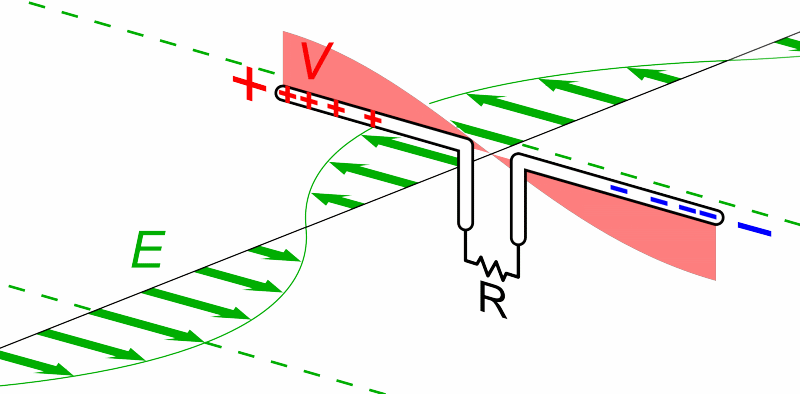
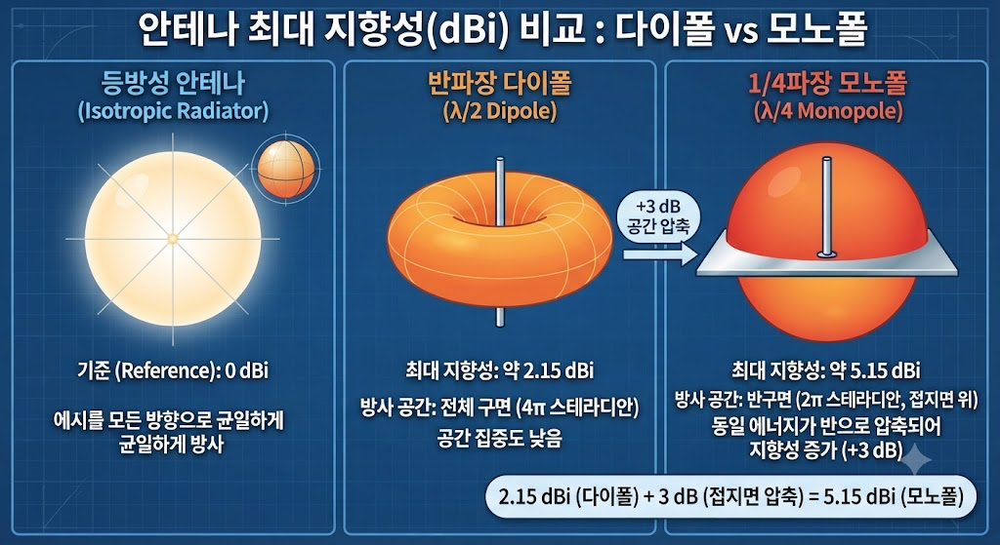
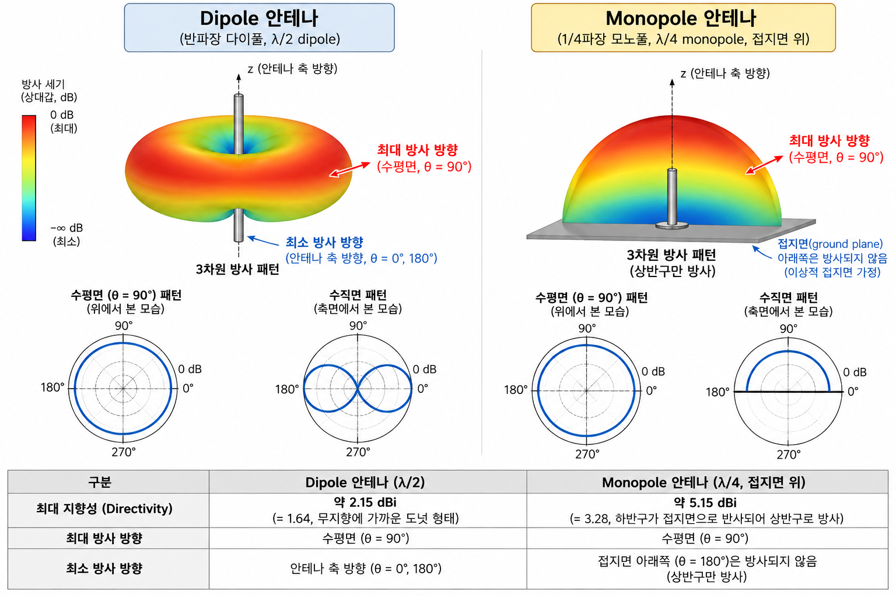
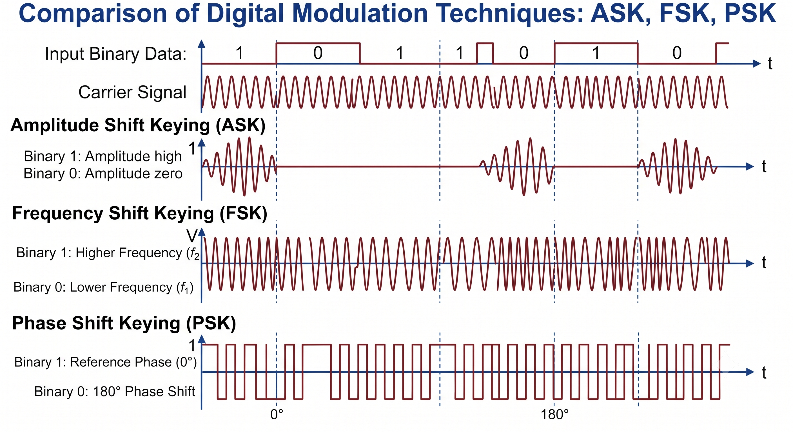
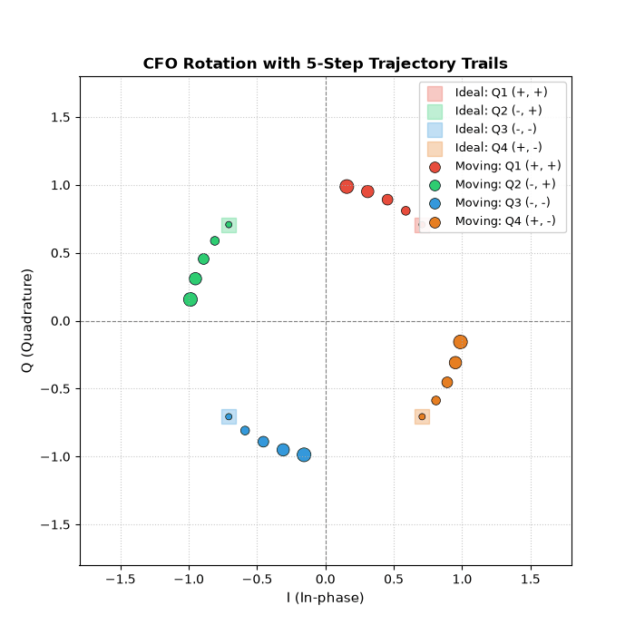
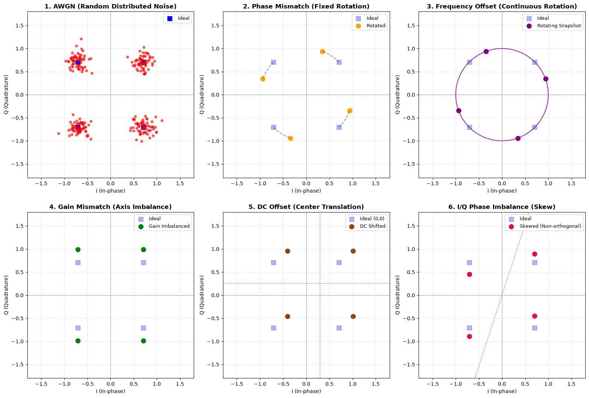

# 디지털 대역통과 변조와 신호공간: 안테나·동기 검파·BPSK·QPSK 완전 정리

[TOC]

디지털 통신 시스템에서는 정보를 Bit Stream으로 변환하는 것만으로 통신이 완성되지 않는다.

정보를 실제 통신 채널을 통해 전송하려면 Bit Stream을 물리적인 전송 파형으로 변환해야 한다.

특히 무선 통신에서는 정보를 고주파 반송파(Carrier)에 실어 전송하는 **대역통과 변조(Bandpass Modulation)** 과정이 필요하다.

그렇다면 왜 변조가 필요할까?

또한 송신기는 어떻게 신호를 생성하고, 수신기는 잡음이 포함된 신호에서 원래의 정보를 복원할까?

이 글에서는 디지털 대역통과 변조와 신호공간의 핵심 개념을 다음 순서로 살펴본다.

1. Bandpass Modulation의 개념과 필요성
2. Dipole과 Monopole 안테나의 차이
3. M-ary Symbol과 Signal Transmission Encoder
4. ASK, PSK, FSK의 기본 원리
5. AWGN 채널과 수신기 구조
6. Coherent / Non-Coherent Detection
7. Orthogonal Basis Function과 Signal Space
8. BPSK의 수학적 유도
9. QPSK와 I/Q Signal
10. Phase Mismatch, Frequency Offset, Gain Mismatch, DC Offset
11. Synchronization과 SDR

특히 핵심은 **시간에 따라 변화하는 전송 신호를 직교 기저함수로 표현하고, 수신기에서 다시 신호 벡터를 추출하는 과정**이다.

---


## 1. 디지털 통신 시스템에서 Bandpass Modulation의 위치

디지털 통신 시스템은 크게 다음 세 부분으로 나눌 수 있다.


$$
\boxed{ \text{Transmitter} \rightarrow \text{Communication Channel} \rightarrow \text{Receiver} }
$$


각 부분의 역할은 다음과 같다.

- **Transmitter:** 정보를 전송 가능한 파형으로 변환한다.
- **Communication Channel:** 전송 신호가 전달되는 물리적인 경로이다.
- **Receiver:** 수신된 파형을 처리하여 원래 정보를 추정한다.

디지털 통신 시스템의 주요 처리 과정은 다음과 같다.


```text
Information Source
        ↓
Formatting
        ↓
Source Encoding
        ↓
Encryption
        ↓
Channel Encoding
        ↓
Multiplexing
        ↓
Pulse Modulation
        ↓
Digital Baseband Waveform
        ↓
Bandpass Modulation
        ↓
Digital Bandpass Waveform
        ↓
Frequency Spreading
        ↓
Multiple Access
        ↓
Transmitter
        ↓
Communication Channel
        ↓
Receiver
        ↓
Frequency Despreading
        ↓
Demodulation & Sampling
        ↓
Detection
        ↓
Demultiplexing
        ↓
Channel Decoding
        ↓
Decryption
        ↓
Source Decoding
        ↓
Information Destination
```


위 구조에서 Source Encoding, Encryption, Channel Encoding, Multiplexing, Frequency Spreading 등은 시스템에 따라 선택적으로 사용된다.

또한 Synchronization은 하나의 블록에서만 이루어지는 것이 아니라 송신과 수신의 여러 단계에 걸쳐 필요하다.

이하에서는 이 전체 구조 중 **Bandpass Modulation과 Demodulation**을 중심으로 설명한다.

---

### 1.1 Baseband Signal이란?

Baseband Signal은 정보가 담긴 신호의 스펙트럼이 일반적으로 0 Hz 근처를 포함하는 저주파 영역에 위치하는 신호이다.

이를


$$
m(t)
$$


라고 표현하자.

예를 들어 음성 신호나 디지털 정보를 표현하는 저주파 파형 등이 Baseband Signal이 될 수 있다.

하지만 이러한 신호를 무선 채널을 통해 직접 전송하려면 여러 물리적인 문제가 발생한다.

따라서 Baseband Signal을 전송에 적합한 주파수 대역으로 변환해야 한다.

---


### 1.2 Bandpass Modulation이란?

Bandpass Modulation은 **메시지 신호에 따라 반송파의 특정 특성을 변화시켜 정보를 전달하는 과정**이다.

일반적인 정현파 반송파는 다음과 같이 표현한다.


$$
\boxed{ c(t)=A\cos(2\pi f_ct+\theta) }
$$


여기서

- $A$: Amplitude
- $f_c$: Carrier Frequency
- $\theta$: Phase

이다.

변조에서는 메시지에 따라 다음 중 하나 이상의 값을 변화시킬 수 있다.

- Amplitude
- Frequency
- Phase

예를 들어 가장 간단한 형태의 진폭 변조 신호를 다음과 같이 표현할 수 있다.


$$
s(t)=m(t)\cos(2\pi f_ct)
$$


이때 Baseband Signal의 스펙트럼은 반송파 주파수 $f_c$ 주변으로 이동한다.

---

## 2. 왜 변조(Modulation)가 필요한가?

1. 지정된 주파수 대역 사용
2. 안테나 크기의 소형화
3. Frequency Division Multiplexing
4. 잡음과 간섭이 적은 대역의 선택

이 중 특히 **주파수 대역의 규제와 안테나 크기 문제**에 집중해보고자 한다.

---


### 2.1 지정된 주파수 대역에서 통신하기 위해

무선 통신에서는 모든 사용자가 원하는 주파수를 자유롭게 사용할 수 없다.

주파수 스펙트럼은 여러 서비스가 공유하는 제한된 자원이기 때문이다.

예를 들어 다음과 같은 서비스들은 각각 정해진 주파수 대역을 사용한다.

- 이동통신
- Wi-Fi
- 방송
- 항공 통신
- 위성 통신
- 군용 통신

만약 서로 다른 서비스가 동일한 주파수 대역을 무분별하게 사용하면 심각한 간섭이 발생할 수 있다.

따라서 국가별 주파수 관리 기관은 주파수의 용도와 사용 조건을 규정한다.

그렇다면 특정 서비스에 할당된 주파수 대역으로 신호를 이동시키려면 어떻게 해야 할까?

이때 사용하는 것이 **Bandpass Modulation**이다.

예를 들어 Baseband Signal이 낮은 주파수에 존재하더라도, 이를 지정된 반송파 주파수로 이동시켜 전송할 수 있다.


$$
\boxed{ \text{Baseband Signal} \xrightarrow{\text{Modulation}} \text{Allocated Frequency Band} }
$$


즉 변조의 중요한 목적 중 하나는 **통신 시스템이 사용해야 하는 주파수 대역으로 신호를 이동시키는 것**이다.

---


### 2.2 안테나 크기의 소형화

무선 통신에서 안테나의 크기는 전송하는 전자기파의 파장과 밀접하게 관련된다.

파장은 다음과 같다.


$$
\boxed{ \lambda=\frac{c}{f} }
$$


여기서

- $\lambda$: Wavelength [m]
- $c$: 빛의 속도, 약 $3\times10^8\,\mathrm{m/s}$
- $f$: Frequency [Hz]

이다.

이 식을 보면 주파수가 높아질수록 파장은 짧아진다.


$$
f\uparrow \Rightarrow \lambda\downarrow
$$


반대로 주파수가 낮아지면 파장이 길어진다.


$$
f\downarrow \Rightarrow \lambda\uparrow
$$


대표적인 공진 안테나의 길이는 다음과 같다.

**Half-Wavelength Dipole Antenna**


$$
L\approx\frac{\lambda}{2}
$$


**Quarter-Wavelength Monopole Antenna**


$$
L\approx\frac{\lambda}{4}
$$


따라서 주파수가 낮은 신호를 직접 전송하려면 매우 큰 안테나가 필요할 수 있다.

---


### 2.3 예제: 3 kHz 음성 신호

음성 신호의 주파수가 다음과 같다고 가정하자.


$$
f=3\,\mathrm{kHz}
$$


파장은


$$
\lambda = \frac{3\times10^8}{3\times10^3}
$$


$$
= 10^5\,\mathrm{m}
$$


이다.

따라서


$$
\boxed{ \lambda=100\,\mathrm{km} }
$$


이다.

이 주파수에서 Quarter-Wavelength Monopole Antenna를 사용한다고 하면


$$
L=\frac{\lambda}{4}
$$


$$
=\frac{100}{4}
$$


$$
\boxed{ L=25\,\mathrm{km} }
$$


이다.

즉, 3 kHz 신호에 맞춘 이상적인 1/4 파장 모노폴 안테나는 약 25 km의 길이가 필요하다.

실용적인 휴대용 무선 통신 시스템에서는 구현하기 어려운 크기이다.

---


### 2.4 고주파 반송파를 사용하면?

이번에는 동일한 정보를 900 MHz 반송파에 실어 전송한다고 하자.


$$
f_c=900\,\mathrm{MHz}
$$


파장은


$$
\lambda = \frac{3\times10^8}{900\times10^6}
$$


$$
\approx0.333\,\mathrm{m}
$$


이다.

따라서 1/4 파장 모노폴의 길이는


$$
L=\frac{0.333}{4}
$$


$$
\boxed{ L\approx8.3\,\mathrm{cm} }
$$


이다.

이제 안테나를 휴대용 전자기기에도 구현할 수 있는 크기로 줄일 수 있다.

같은 방식으로 2.4 GHz에서는


$$
\lambda = \frac{3\times10^8}{2.4\times10^9}
$$


$$
=0.125\,\mathrm{m}
$$


이므로


$$
\boxed{ L\approx3.1\,\mathrm{cm} }
$$


이다.

#### 주파수와 안테나 길이 비교

| Frequency | Wavelength | Dipole $\lambda/2$ | Monopole $\lambda/4$ |
| --- | --- | --- | --- |
| 3 kHz | 100 km | 50 km | 25 km |
| 900 MHz | 33.3 cm | 16.7 cm | 8.3 cm |
| 1 GHz | 30 cm | 15 cm | 7.5 cm |
| 2.4 GHz | 12.5 cm | 6.25 cm | 3.1 cm |

이 값들은 자유공간 파장을 이용한 이상적인 기준이다.

실제 안테나의 물리적 길이는 유전체, 도체 구조, 접지면, 임피던스 매칭 등에 따라 달라질 수 있다.

**여기서 중요한 것은 저주파 전파가 불가능하다는 의미가 아니라, 저주파에서는 실용적인 크기의 안테나로 효율적인 방사를 구현하기 어려울 수 있다는 점이다.**

---


## 3. Dipole Antenna와 Monopole Antenna

이번에는 dipole antenna와 monopole antenna, 두 안테나 구조를 비교해보자.

- Half-Wavelength Dipole Antenna
- Quarter-Wavelength Monopole Antenna

두 안테나는 구조와 필요한 길이, Ground Plane의 사용 여부에서 차이가 있다.

---


### 3.1 Dipole Antenna

Dipole Antenna는 일반적으로 두 개의 도체 소자가 급전점을 중심으로 반대 방향으로 배치된 구조이다.

대표적인 반파장 다이폴의 길이는


$$
\boxed{ L_{\mathrm{dipole}}\approx\frac{\lambda}{2} }
$$


이다.


```text
     λ/4           λ/4

──────────┐   ┌──────────
          │   │
          └─ ─┘
         Feed Point
```


대표적인 특징은 다음과 같다.

- 두 개의 도체 소자를 사용한다.
- 일반적으로 Balanced Antenna 구조이다.
- 별도의 대형 Ground Plane이 필수인 구조는 아니다.
- 자유공간의 이상적인 반파장 다이폴 입력 저항은 약 $73\,\Omega$이다.

Dipole Antenna는 모든 방향으로 균일하게 방사하는 안테나는 아니다.

이상적인 반파장 다이폴은 안테나 축에 수직인 방향으로 강하게 방사하고, 안테나 축 방향으로는 방사가 거의 없는 특성을 가진다.

따라서 3차원 방사 패턴은 도넛 형태에 가깝다.  
  
출처: <https://en.wikipedia.org/wiki/Dipole_antenna>

---


### 3.2 Monopole Antenna

Monopole Antenna는 일반적으로 하나의 방사 소자와 Ground Plane으로 구성된다.

대표적인 1/4 파장 모노폴의 길이는


$$
\boxed{ L_{\mathrm{monopole}}\approx\frac{\lambda}{4} }
$$


이다.


```text
       Radiator
          │
          │
          │  λ/4
          │
──────────┴──────────
       Ground Plane
```


모노폴을 이해할 때 중요한 개념은 **Image Theory(영상 이론)** 이다.

이상적인 도체 Ground Plane 위의 모노폴에서는 Ground Plane 아래에 가상의 대칭 소자가 존재하는 것과 유사한 전자기장 분포가 형성된다.

따라서 1/4 파장 모노폴은 이상적인 조건에서 반파장 다이폴과 밀접한 관계를 가진다.

이상적인 무한 Ground Plane 위의 1/4 파장 모노폴 입력 저항은 약


$$
36.5\,\Omega
$$


이다.

이는 이상적인 반파장 다이폴의 입력 저항 약 $73\,\Omega$의 절반이다.

---


### 3.3 Monopole의 첫 번째 장점: 크기

Dipole과 Monopole의 대표적인 길이를 비교하면


$$
L_{\mathrm{dipole}}=\frac{\lambda}{2}
$$


$$
L_{\mathrm{monopole}}=\frac{\lambda}{4}
$$


이다.

따라서


$$
\boxed{ L_{\mathrm{monopole}} \approx \frac{1}{2}L_{\mathrm{dipole}} }
$$


이다.

예를 들어 1 GHz에서는


$$
\lambda=30\,\mathrm{cm}
$$


이므로

- Dipole: 약 15 cm
- Monopole: 약 7.5 cm

이다.

물리적인 방사 소자의 길이가 절반으로 줄어든다는 점에서 Monopole은 소형화에 유리하다.

---


### 3.4 Monopole의 두 번째 장점: 방사 방향

동일한 방사 전력을 기준으로 Dipole과 Monopole의 방사 방향을 비교해 보자.

이상적인 자유공간 다이폴은 위쪽과 아래쪽 공간 모두에 전자기파를 방사한다.

반면 이상적인 무한 Ground Plane 위의 모노폴은 Ground Plane 위쪽 반공간으로 전자기파를 방사한다.

이러한 차이로 인해 모노폴은 특정 방향으로 방사 에너지를 더 집중시킬 수 있다.

#### Directivity 비교

이상적인 안테나의 최대 Directivity는 대략 다음과 같다.

| Antenna | Maximum Directivity |
| --- | --- |
| Half-Wavelength Dipole | 약 2.15 dBi |
| Quarter-Wavelength Monopole | 약 5.15 dBi |

차이는


$$
5.15-2.15=3\,\mathrm{dB}
$$


이다.

전력 비율로 환산하면


$$
10^{3/10}\approx2
$$


이다.

따라서 이상적인 조건에서 최대 Directivity가 약 두 배 차이 날 수 있다.

#### 주의할 점

여기서 약 3 dB의 차이는 **동일한 방사 전력을 기준으로 방사 패턴의 집중도를 비교한 결과**이다.

모노폴이 추가적인 전력을 생성하거나 전체 전력을 두 배로 증가시키는 것은 아니다.

또한 실제 Gain은 방사 효율과 손실, 임피던스 매칭 및 Ground 구조의 영향을 받는다.

따라서


$$
\boxed{ \text{Directivity}\neq\text{Radiation Efficiency} }
$$


라는 점을 구분해야 한다.

  


---


### 3.5 Monopole에는 왜 Ground Plane이 필요한가?

Monopole의 중요한 설계 조건은 Ground Plane이다.

이론적으로는 별도의 Ground Plane을 구성해야 한다는 점이 단점처럼 보일 수 있다.

하지만 실제 전자제품에는 이미 다음과 같은 도체 구조물이 존재하는 경우가 많다.

- PCB Ground Layer
- 자동차 차체
- 금속 프레임
- 금속 하우징

이러한 구조물은 적절하게 설계하면 안테나의 Ground 또는 Counterpoise로 활용할 수 있다.

예를 들어 자동차용 안테나는 차체를 이용할 수 있다.

PCB 기반 RF 장치에서는 PCB Ground 구조가 안테나의 방사 특성에 관여할 수 있다.

다만 회로의 GND가 존재한다는 사실만으로 **이상적인 RF Ground Plane이 자동으로 완성되는 것은 아니다.**

Ground Plane의 크기와 형상은 다음 특성에 영향을 준다.

- Resonant Frequency
- Input Impedance
- Radiation Pattern
- Radiation Efficiency
- Impedance Matching

따라서 실제 RF 설계에서는 안테나 소자뿐 아니라 Ground 구조까지 함께 설계해야 한다.

#### Dipole과 Monopole 비교 정리

| 구분 | Dipole | Monopole |
| --- | --- | --- |
| 대표 구조 | 두 개의 방사 소자 | 한 개의 방사 소자 + Ground |
| 대표 길이 | $\lambda/2$ | $\lambda/4$ |
| 이상적인 입력 저항 | 약 $73\,\Omega$ | 약 $36.5\,\Omega$ |
| Ground Plane | 필수 아님 | 필요 |
| 최대 Directivity | 약 2.15 dBi | 약 5.15 dBi |
| 주요 장점 | 대칭 구조 | 소형화 및 Ground 활용 |
| 설계 고려사항 | 급전 및 균형 | Ground 크기와 형상 |

---


## 4. Frequency Division Multiplexing(FDM)

변조의 또 다른 목적은 여러 신호가 서로 다른 주파수 대역을 사용하도록 만드는 것이다.

이를 **Frequency Division Multiplexing(FDM)** 이라고 한다.

예를 들어 여러 사용자가 동일한 통신 매체를 사용한다고 하자.

모든 사용자의 신호가 같은 주파수 대역에 겹치면 수신기에서 구별하기 어려울 수 있다.

이를 해결하는 한 가지 방법은 서로 다른 반송파 주파수를 할당하는 것이다.


```text
Frequency →

|--- User A ---|

                  |--- User B ---|

                                     |--- User C ---|
```


각 사용자의 신호를 서로 다른 주파수 대역으로 이동시키면 하나의 전송 매체를 주파수별로 나누어 사용할 수 있다.

다만 실제 FDM에서는 인접 채널 간 간섭을 줄이기 위해 필터 특성과 Guard Band 등을 고려해야 한다.

---


## 5. 왜 실제 무선 통신에서는 Cosine Carrier를 사용하는가?

Baseband Signal의 주파수 이동은 Fourier Transform의 Frequency Shifting Property로 설명할 수 있다.  
Fourier Transform의 Frequency Shifting Property는 다음과 같다.


$$
\boxed{ x(t)e^{j2\pi f_ct} \longleftrightarrow X(f-f_c) }
$$


즉 시간 영역에서 복소 지수함수를 곱하면 주파수 영역에서 스펙트럼이 이동한다.

하지만 실제 무선 송신 안테나에 인가하는 전압과 전류는 실수 물리량이다.

따라서 복소수 표현을 실제 송신 파형으로 변환해야 한다.

Euler's Formula에 따르면


$$
e^{j\theta} = \cos\theta+j\sin\theta
$$


이다.

따라서


$$
\boxed{ \cos\theta = \frac{e^{j\theta}+e^{-j\theta}}{2} }
$$


이다.

즉 실수 Cosine Carrier는 양의 주파수와 음의 주파수에 해당하는 복소 지수 성분으로 표현할 수 있다.

예를 들어


$$
s(t)=m(t)\cos(2\pi f_ct)
$$


라면


$$
s(t) = \frac{m(t)}{2} \left[ e^{j2\pi f_ct} + e^{-j2\pi f_ct} \right]
$$


이다.

따라서 Fourier Transform은


$$
\boxed{ S(f) = \frac{1}{2} \left[ M(f-f_c)+M(f+f_c) \right] }
$$


이다.

즉 Baseband Spectrum이


$$
+f_c
$$


와


$$
-f_c
$$


를 중심으로 이동한다.

이는 실수 대역통과 신호의 양·음 주파수 스펙트럼이 대칭적으로 나타나는 이유와 연결된다.

> 복소 지수함수는 신호를 수학적으로 표현하고 처리하는 데 매우 유용하지만, 실제 RF 파형은 실수 전압과 전류로 구현된다는 점을 구분해야 한다.

---


## 6. Message Source와 M-ary Symbol

Message Source는 전송할 정보를 심벌(Symbol) 형태로 제공한다.

사용 가능한 심벌의 개수가 총 $M$개라면


$$
m_1,m_2,\cdots,m_M
$$


으로 표현할 수 있다.

이처럼 $M$개의 심벌을 사용하는 구조를 **M-ary Signaling**이라고 한다.

---


### 6.1 M-ary의 의미

Bit는 두 가지 상태를 가진다.


$$
0,\ 1
$$


따라서 1 Bit로 표현할 수 있는 경우의 수는


$$
2^1=2
$$


이다.

2 Bit를 사용하면


$$
00,\ 01,\ 10,\ 11
$$


로 네 가지 경우를 표현할 수 있다.

따라서


$$
2^2=4
$$


이다.

3 Bit를 사용하면


$$
2^3=8
$$


가지 경우를 표현할 수 있다.

일반적으로 $k$개의 Bit를 하나의 심벌로 묶는다면


$$
\boxed{ M=2^k }
$$


이다.

따라서


$$
\boxed{ k=\log_2M }
$$


이다.

#### 예제

| Modulation Order $M$ | Bits per Symbol |
| --- | --- |
| 2 | 1 |
| 4 | 2 |
| 8 | 3 |
| 16 | 4 |
| 32 | 5 |
| 64 | 6 |

예를 들어 QPSK는 네 개의 심벌을 사용하므로


$$
M=4
$$


이다.

따라서


$$
k=\log_2 4=2
$$


이고, 하나의 심벌로 2 Bit를 표현할 수 있다.

---


### 6.2 Symbol Rate와 Bit Rate

하나의 심벌이 전송되는 시간을 $T_s$라고 하자.

그러면 Symbol Rate는


$$
\boxed{ R_s=\frac{1}{T_s} }
$$


이다.

한 심벌이 $k$개의 Bit를 표현한다면 Bit Rate는


$$
R_b=kR_s
$$


이다.

따라서


$$
\boxed{ R_b=R_s\log_2M }
$$


이다.

이 식은 부호화나 프레이밍 등의 추가 Overhead를 제외한 변조 심벌과 Bit 사이의 관계이다.

예를 들어 같은 Symbol Rate를 사용한다면

- BPSK: 1 Bit/Symbol
- QPSK: 2 Bits/Symbol

이다.

따라서 같은 Symbol Rate에서 QPSK는 BPSK보다 두 배의 Bit를 매핑할 수 있다.

다만 실제 통신 시스템의 순수 정보 전송률은 채널 코딩과 프로토콜 Overhead 등에 따라 달라진다.

---


### 6.3 Message Probability

각 심벌이 같은 확률로 발생한다고 가정하면


$$
P(m_1)=P(m_2)=\cdots=P(m_M)
$$


이고


$$
\boxed{ P(m_i)=\frac{1}{M} }
$$


이다.

이를 Equiprobable Symbols라고 한다.

실제 통신 시스템에서 모든 심벌이 반드시 동일한 확률로 발생하는 것은 아니지만, 수신기 판정 규칙을 유도할 때 자주 사용되는 가정이다.

---


## 7. Transmitter의 기본 구조

송신기를 단순화하면 다음과 같이 표현이 가능하다.


```text
Message Source
       ↓
Signal Transmission Encoder
       ↓
Signal Vector
       ↓
Modulator
       ↓
Transmitted Signal
```


이 구조에서 두 개의 역할을 구분해야 한다.

**Signal Transmission Encoder**

입력 심벌을 신호 벡터로 변환한다.

**Modulator**

신호 벡터를 실제 전송 파형으로 변환한다.

---


### 7.1 Signal Transmission Encoder

입력 심벌 $m_i$에 대응하는 신호 벡터를


$$
\mathbf{s}_i
$$


라고 하자.

이 벡터는 다음과 같이 표현된다.


$$
\boxed{ \mathbf{s}_i = \begin{bmatrix} s_{i1}\\ s_{i2}\\ \vdots\\ s_{iN} \end{bmatrix} }
$$


여기서

- $i$: 몇 번째 심벌인지 나타내는 Index
- $N$: 신호공간의 차원 수
- $s_{ij}$: $i$번째 심벌의 $j$번째 좌표

이다.

즉 Message Source가 어떤 심벌을 전송할지 결정하면 Signal Transmission Encoder는 해당 심벌에 대응하는 좌표들을 생성한다.

---


### 7.2 Modulator

Modulator는 Signal Transmission Encoder가 생성한 신호 벡터를 실제 전송 파형으로 변환한다.

$i$번째 심벌에 대응하는 전송 파형을


$$
s_i(t)
$$


라고 하면, 각 심벌의 전송 시간 $T$ 동안 신호가 출력된다.


$$
0\le t\le T
$$


전송 신호의 에너지는 다음과 같다.


$$
\boxed{ E_i = \int_0^T s_i^2(t)\,dt }
$$


이다.

이 에너지는 이후 신호 검출과 오류 확률을 분석할 때 중요하게 사용된다.

---


## 8. 디지털 변조 방식: ASK, PSK, FSK

일반적인 정현파 반송파를 다시 살펴보자.


$$
c(t)=A\cos(2\pi ft+\theta)
$$


반송파에는 세 가지 주요 Parameter가 있다.

- Amplitude $A$
- Frequency $f$
- Phase $\theta$

디지털 변조에서는 입력 심벌에 따라 이 값들을 변화시킨다.

---


### 8.1 ASK: Amplitude Shift Keying

ASK는 반송파의 진폭을 변화시켜 정보를 표현한다.


$$
\boxed{ s_i(t)=A_i\cos(2\pi f_ct) }
$$


여기서 심벌에 따라


$$
A_i
$$


가 달라진다.

Binary ASK에서는 두 개의 진폭 상태를 사용한다.

특히 Bit 0일 때 반송파를 끄고 Bit 1일 때 반송파를 켜는 형태를 **OOK(On-Off Keying)** 이라고 한다.

#### 특징

- 진폭을 이용해 정보 전달
- 비교적 단순한 구현 가능
- 진폭 잡음이나 채널 이득 변화에 민감할 수 있음

---


### 8.2 PSK: Phase Shift Keying

PSK는 반송파의 위상을 변화시켜 정보를 표현한다.


$$
\boxed{ s_i(t) = A\cos(2\pi f_ct+\theta_i) }
$$


여기서 심벌에 따라


$$
\theta_i
$$


가 달라진다.

대표적인 방식은 다음과 같다.

- BPSK
- QPSK
- 8-PSK

예를 들어 BPSK에서는 두 가지 위상을 사용한다.


$$
0,\ \pi
$$


QPSK에서는 네 가지 위상을 사용한다.

---


### 8.3 FSK: Frequency Shift Keying

FSK는 반송파의 주파수를 변화시켜 정보를 표현한다.


$$
\boxed{ s_i(t) = A\cos(2\pi f_it+\theta_i) }
$$


여기서


$$
f_i
$$


가 심벌에 따라 달라진다.

Binary FSK에서는 서로 다른 두 주파수를 이용해 0과 1을 구분할 수 있다.

---


### 8.4 ASK, PSK, FSK 비교

| Modulation | 변화하는 Parameter | 대표 특징 |
| --- | --- | --- |
| ASK | Amplitude | 진폭으로 정보 표현 |
| PSK | Phase | 위상으로 정보 표현 |
| FSK | Frequency | 주파수로 정보 표현 |
| QAM | Amplitude + Phase | 진폭과 위상을 함께 활용 |

이후 BPSK와 QPSK를 Signal Space 관점에서 자세히 살펴본다.  


---


## 9. Communication Channel과 AWGN

송신기에서 생성한 신호는 통신 채널을 통과한다.

하지만 실제 통신 채널에는 잡음과 간섭이 존재한다.

따라서 수신 신호는 송신 신호와 완전히 같지 않다.

디지털 변조와 검출을 분석할 때는 기본적인 채널 모델인 **AWGN Channel**을 자주 사용한다.

---


### 9.1 AWGN Channel Model

AWGN 채널에서는 수신 신호를 다음과 같이 표현한다.


$$
\boxed{ x(t)=s_i(t)+w(t) }
$$


여기서

- $s_i(t)$: Transmitted Signal
- $w(t)$: Additive Noise
- $x(t)$: Received Signal

이다.

AWGN은 다음을 의미한다.

#### Additive

잡음이 송신 신호에 더해진다.

#### White

이상적인 모델에서 잡음의 Power Spectral Density가 주파수에 대해 일정하다.

#### Gaussian

잡음이 Gaussian Probability Distribution을 따른다.

#### Noise

신호에 영향을 주는 무작위 잡음 성분이다.

일반적으로 실수 AWGN의 양측 Power Spectral Density는


$$
\boxed{ \frac{N_0}{2} }
$$


로 표현한다.

AWGN 모델은 채널 왜곡이나 Fading 등을 생략하여 변조와 검출의 기본 원리를 분석하기 쉽게 만든 모델이다.

---


### 9.2 실제 채널에서는 어떤 문제가 추가될까?

실제 무선 채널에서는 AWGN 외에도 다음 현상이 발생할 수 있다.

- Path Loss
- Multipath Propagation
- Fading
- Interference
- Delay Spread
- Frequency Offset

예를 들어 Fading Channel에서는 전송 신호의 진폭과 위상이 시간에 따라 변화할 수 있다.

따라서 실제 시스템에서는 단순한 AWGN 모델보다 복잡한 채널 모델을 고려해야 한다.

---


## 10. Receiver의 역할

송신기에서 생성한 신호는 채널을 통과하면서 잡음이 포함된다.

수신기는 이를 관측하여 원래 어떤 심벌이 전송되었는지 추정한다.

수신기의 기본 구조는 다음과 같다.


```text
Received Signal x(t)
        ↓
Detector
        ↓
Observation Vector
        ↓
Signal Transmission Decoder
        ↓
Estimated Symbol
```


---


### 10.1 Detector

Detector는 수신 신호를 관측하여 신호 판정에 필요한 값을 생성한다.

이때 수신 신호를 기저함수와 곱한 뒤 적분하는 방식 등을 사용할 수 있다.

이러한 관측값을 모으면 다음과 같은 벡터가 된다.


$$
\boxed{ \mathbf{x} = \begin{bmatrix} x_1\\ x_2\\ \vdots\\ x_N \end{bmatrix} }
$$


이를 Observation Vector라고 한다.

---


### 10.2 Signal Transmission Decoder

Decoder는 Observation Vector를 이용하여 실제 전송된 심벌을 추정한다.

추정된 심벌을


$$
\hat{m}
$$


이라고 하자.

수신기가 최소화하려는 값은 평균 심벌 오류 확률이다.


$$
\boxed{ P_e = \sum_{i=1}^{M} P(\hat{m}\neq m_i\mid m_i)P(m_i) }
$$


이다.

등확률 심벌이라면


$$
P(m_i)=\frac{1}{M}
$$


이므로


$$
\boxed{ P_e = \frac{1}{M} \sum_{i=1}^{M} P(\hat{m}\neq m_i\mid m_i) }
$$


이다.

이 식은 각 심벌이 전송되었을 때 오류가 발생할 확률을 평균한 것이다.

---


## 11. Coherent Detection과 Non-Coherent Detection

수신기의 검파 방식은 크게 다음 두 가지로 구분할 수 있다.

- Coherent Detection
- Non-Coherent Detection

두 방식의 핵심 차이는 **송신 반송파의 위상 정보를 검출에 사용하는지**이다.

---


### 11.1 Coherent Detection

Coherent Detection은 송신 반송파의 위상 정보를 추정하거나 복원하여 검출에 사용하는 방식이다.

수신기는 송신 신호에 맞는 Local Carrier를 생성한다.

예를 들어 송신 신호가


$$
s(t)=m(t)\cos(2\pi f_ct+\theta)
$$


라면 수신기에서도 이에 대응하는 위상 기준을 생성해야 한다.

이를 위해 다음 기술이 사용될 수 있다.

- PLL
- Carrier Recovery
- Costas Loop
- Pilot-based Synchronization

#### 특징

- 반송파 위상 정보를 활용한다.
- BPSK, QPSK, 일반적인 QAM 수신에서 중요하다.
- 위상과 주파수 동기화가 필요하다.
- 동기화 회로와 알고리즘으로 인해 구현이 복잡해질 수 있다.

---


### 11.2 Non-Coherent Detection

Non-Coherent Detection은 송신 반송파의 절대 위상을 정확하게 복원하지 않고 심벌을 검출하는 방식이다.

변조 방식에 따라 다음과 같은 검출 방법을 사용할 수 있다.

- Envelope Detection
- Energy Detection
- Non-Coherent FSK Detection
- Differential Detection

#### 특징

- 절대 반송파 위상 복구가 필요하지 않을 수 있다.
- 특정 변조 방식에서는 수신기 구성을 단순화할 수 있다.
- 같은 조건에서 최적 Coherent Detection보다 오류 성능이 떨어질 수 있다.

단, Non-Coherent Detection이 항상 일정한 dB만큼 성능이 나쁜 것은 아니다.

성능 차이는 변조 방식과 검출 알고리즘에 따라 달라진다.

---


### 11.3 Coherent와 Non-Coherent 비교

| 구분 | Coherent | Non-Coherent |
| --- | --- | --- |
| 반송파 위상 정보 | 사용 | 절대 위상 복구 불필요 |
| Carrier Recovery | 일반적으로 필요 | 방식에 따라 불필요 |
| 구현 복잡도 | 상대적으로 높음 | 방식에 따라 낮음 |
| 오류 성능 | 일반적으로 우수 | 방식에 따라 성능 손실 |
| 대표 예시 | BPSK, QPSK, QAM | OOK, Non-Coherent FSK, Differential Detection |

여기서 중요한 점은 **Non-Coherent Detection도 모든 동기화가 필요 없는 것은 아니라는 것**이다.

반송파의 절대 위상을 모르더라도 심벌 타이밍과 프레임 경계 등을 맞추는 과정은 여전히 필요할 수 있다.

---


## 12. Coherent Detector의 수학적 원리

수신 신호에 반송파를 곱한 뒤 Low-Pass Filter를 통과시키는 과정을 수학적으로 유도해 보자.

수신 신호를 다음과 같이 가정하자.


$$
r(t)=m(t)\cos(2\pi f_ct+\theta)
$$


수신기에서 생성하는 Local Carrier를


$$
c_{\mathrm{LO}}(t) = \cos(2\pi f_ct+\hat{\theta})
$$


라고 하자.

두 신호를 곱하면


$$
r(t)c_{\mathrm{LO}}(t)
$$


$$
= m(t) \cos(2\pi f_ct+\theta) \cos(2\pi f_ct+\hat{\theta})
$$


이다.

삼각함수 항등식


$$
\boxed{ \cos A\cos B = \frac{1}{2} \left[ \cos(A-B)+\cos(A+B) \right] }
$$


을 적용하면


$$
= \frac{m(t)}{2} \left[ \cos(\theta-\hat{\theta}) + \cos(4\pi f_ct+\theta+\hat{\theta}) \right]
$$


이다.

따라서 두 개의 성분이 생성된다.

1. Baseband 성분
2. 약 $2f_c$의 고주파 성분

이후 Low-Pass Filter를 통과시키면 고주파 성분이 제거된다.

따라서


$$
\boxed{ y(t) = \frac{1}{2} m(t)\cos(\theta-\hat{\theta}) }
$$


를 얻는다.

---


### 12.1 위상이 정확하게 일치하면?

수신기의 위상 추정이 정확하면


$$
\hat{\theta}=\theta
$$


이다.

따라서


$$
\cos(\theta-\hat{\theta})=1
$$


이고


$$
\boxed{ y(t)=\frac{1}{2}m(t) }
$$


이다.

복조 과정에서 발생한 $\frac12$의 계수는 Gain 보상을 통해 복원할 수 있다.

즉 원래의 Message Signal을 얻을 수 있다.

---


### 12.2 위상이 일치하지 않으면?

위상 오차를


$$
\Delta\theta=\theta-\hat{\theta}
$$


라고 하자.

그러면


$$
\boxed{ y(t) = \frac12m(t)\cos(\Delta\theta) }
$$


이다.

예를 들어


$$
\Delta\theta=90^\circ
$$


라면


$$
\cos90^\circ=0
$$


이므로


$$
\boxed{ y(t)=0 }
$$


이다.

즉 단일 경로의 동기 복조에서는 위상 오차 때문에 원하는 신호 성분이 사라질 수 있다.

이것이 **Carrier Synchronization이 중요한 이유**이다.

---


## 13. Signal Space Representation

디지털 통신의 핵심 개념 중 하나는 **시간 영역의 신호를 기하학적으로 표현하는 방법**이다.

일반적으로 신호는


$$
s_i(t)
$$


처럼 시간에 따라 변화하는 함수로 표현한다.

하지만 통신 이론에서는 이를 벡터로 표현하면 신호의 에너지, 거리, 오류 확률 등을 훨씬 쉽게 분석할 수 있다.

이를 **Signal Space Representation**이라고 한다.

---


### 13.1 직교 기저함수(Orthogonal Basis Function)

신호를 표현하기 위해 다음과 같은 기저함수들을 사용한다.


$$
\phi_1(t),\phi_2(t),\cdots,\phi_N(t)
$$


이하에서는 기저함수들이 서로 정규직교(Orthonormal)한다고 가정한다.

정규직교 조건은


$$
\boxed{ \int_0^T \phi_i(t)\phi_j(t)\,dt = \begin{cases} 1,&i=j\\ 0,&i\neq j \end{cases} }
$$


이다.

즉 다음 두 성질을 만족한다.

**Orthogonal**

서로 다른 기저함수의 내적은 0이다.


$$
\int_0^T \phi_i(t)\phi_j(t)\,dt=0 \qquad(i\neq j)
$$


**Normalized**

각 기저함수의 에너지는 1이다.


$$
\int_0^T \phi_i^2(t)\,dt=1
$$


따라서 각 기저함수를 서로 독립적인 좌표축처럼 사용할 수 있다.

복소 기저함수를 사용하는 경우에는 한쪽 함수에 Complex Conjugate를 적용한다.


$$
\boxed{ \int_0^T \phi_i(t)\phi_j^*(t)\,dt = \delta_{ij} }
$$


이다.

---


### 13.2 왜 직교 기저함수를 사용하는가?

서로 직교하는 기저함수를 이용하면 여러 성분이 합쳐진 신호에서도 **원하는 성분의 계수만 추출할 수 있다.**

예를 들어 다음 신호를 생각하자.


$$
s(t)=a\phi_1(t)+b\phi_2(t)
$$


여기서 $\phi_1(t)$과 $\phi_2(t)$가 정규직교한다고 하자.

첫 번째 계수 $a$를 알고 싶다면 신호에 $\phi_1(t)$를 곱하고 적분한다.


$$
\int_0^T s(t)\phi_1(t)\,dt
$$


대입하면


$$
= \int_0^T \left[ a\phi_1(t)+b\phi_2(t) \right] \phi_1(t)\,dt
$$


이다.

분배하면


$$
= a\int_0^T\phi_1^2(t)\,dt + b\int_0^T\phi_2(t)\phi_1(t)\,dt
$$


이다.

정규직교 조건에 의해


$$
\int_0^T\phi_1^2(t)\,dt=1
$$


이고


$$
\int_0^T\phi_2(t)\phi_1(t)\,dt=0
$$


이다.

따라서


$$
=a(1)+b(0)
$$


이므로


$$
\boxed{ a=\int_0^T s(t)\phi_1(t)\,dt }
$$


이다.

같은 방식으로 두 번째 계수는


$$
\boxed{ b=\int_0^T s(t)\phi_2(t)\,dt }
$$


이다.

즉 하나의 파형에 여러 성분이 섞여 있어도 정규직교 기저함수를 이용하면 각 계수를 분리할 수 있다.

> **직교 기저함수는 서로 간섭하지 않는 독립적인 좌표축을 제공하며, 수신기에서는 Correlator를 이용해 각 좌표의 값을 추출할 수 있다.**

---


### 13.3 여러 신호를 직교 기저함수로 표현하기

이번에는 $M$개의 서로 다른 신호가 존재한다고 하자.

각 신호를 표현하는 데 $N$개의 기저함수가 필요하다면


$$
\boxed{ s_i(t) = \sum_{j=1}^{N} s_{ij}\phi_j(t) }
$$


으로 표현할 수 있다.

여기서

- $i=1,2,\cdots,M$
- $j=1,2,\cdots,N$

이다.

예를 들어 첫 번째 신호는


$$
s_1(t) = s_{11}\phi_1(t) + s_{12}\phi_2(t) +\cdots+ s_{1N}\phi_N(t)
$$


이다.

두 번째 신호는


$$
s_2(t) = s_{21}\phi_1(t) + s_{22}\phi_2(t) +\cdots+ s_{2N}\phi_N(t)
$$


이다.

마지막 신호는


$$
s_M(t) = s_{M1}\phi_1(t) + s_{M2}\phi_2(t) +\cdots+ s_{MN}\phi_N(t)
$$


이다.

모든 신호는 동일한 기저함수를 사용하지만, 각 기저함수에 곱하는 계수가 다르다.

따라서 서로 다른 신호를 생성할 수 있다.

---


### 13.4 신호 벡터(Signal Vector)

각 신호의 계수들을 모으면 다음과 같은 벡터를 만들 수 있다.


$$
\boxed{ \mathbf{s}_i = \begin{bmatrix} s_{i1}\\ s_{i2}\\ \vdots\\ s_{iN} \end{bmatrix} }
$$


예를 들어 $N=2$라면


$$
\mathbf{s}_1 = \begin{bmatrix} s_{11}\\ s_{12} \end{bmatrix}
$$


이고


$$
\mathbf{s}_2 = \begin{bmatrix} s_{21}\\ s_{22} \end{bmatrix}
$$


이다.

따라서 시간 영역의 신호


$$
s_i(t)
$$


를 신호공간의 점


$$
\mathbf{s}_i
$$


로 표현할 수 있다.

---


### 13.5 신호 계수 $s_{ij}$를 구하는 공식 유도

송신기에서 신호를 생성하는 일반적인 표현은 다음과 같다.


$$
s_i(t) = \sum_{k=1}^{N}s_{ik}\phi_k(t)
$$


양변에 $\phi_j(t)$를 곱하고 적분한다.


$$
\int_0^T s_i(t)\phi_j(t)\,dt
$$


$$
= \int_0^T \left[ \sum_{k=1}^{N} s_{ik}\phi_k(t) \right] \phi_j(t)\,dt
$$


적분의 선형성을 이용하면


$$
= \sum_{k=1}^{N} s_{ik} \int_0^T \phi_k(t)\phi_j(t)\,dt
$$


이다.

여기서 정규직교 조건을 적용하면


$$
\int_0^T \phi_k(t)\phi_j(t)\,dt = \begin{cases} 1,&k=j\\ 0,&k\neq j \end{cases}
$$


이다.

따라서 $k=j$인 항만 남는다.

결과적으로


$$
\boxed{ s_{ij} = \int_0^T s_i(t)\phi_j(t)\,dt }
$$


를 얻는다. 이는 수신기에서 신호 계수를 추출하는 원리와 대응한다.

이 식은 신호공간 표현을 실제 수신기의 신호 추출 과정과 연결하는 핵심 공식이다.

#### 의미

송신기에서는 각 좌표값에 해당하는 기저함수를 곱하여 신호를 생성한다.

반대로 수신기에서는 받은 신호에 기저함수를 곱하고 적분하여 좌표값을 추출한다.

즉,


$$
\boxed{ \text{Signal Vector} \rightarrow \text{Waveform} }
$$


과


$$
\boxed{ \text{Waveform} \rightarrow \text{Signal Vector} }
$$


가 서로 대응한다.

---


## 14. Correlator와 Detector

수신기에서는 전송된 신호에 잡음이 더해진 신호를 관측한다.


$$
x(t)=s_i(t)+w(t)
$$


이를 기저함수에 투영하면


$$
x_j = \int_0^T x(t)\phi_j(t)\,dt
$$


이다.

수신 신호를 대입하면


$$
x_j = \int_0^T \left[ s_i(t)+w(t) \right] \phi_j(t)\,dt
$$


이다.

분배하면


$$
= \int_0^T s_i(t)\phi_j(t)\,dt + \int_0^T w(t)\phi_j(t)\,dt
$$


이다.

첫 번째 항은 앞에서 유도한 신호 계수이다.


$$
\int_0^T s_i(t)\phi_j(t)\,dt=s_{ij}
$$


두 번째 항을


$$
w_j = \int_0^T w(t)\phi_j(t)\,dt
$$


라고 정의하면


$$
\boxed{ x_j=s_{ij}+w_j }
$$


이다.

이를 벡터로 표현하면


$$
\boxed{ \mathbf{x} = \mathbf{s}_i+\mathbf{w} }
$$


이다.

여기서

- $\mathbf{x}$: Observation Vector
- $\mathbf{s}_i$: Transmitted Signal Vector
- $\mathbf{w}$: Noise Vector

이다.

---


### 14.1 기하학적으로 이해하기

잡음이 없는 경우에는


$$
\mathbf{x}=\mathbf{s}_i
$$


이다.

따라서 수신된 점이 원래의 신호점에 정확히 위치한다.

하지만 잡음이 존재하면


$$
\mathbf{x}=\mathbf{s}_i+\mathbf{w}
$$


이므로 수신된 점이 원래 위치에서 이동한다.

즉 잡음은 신호공간에서 벡터 형태로 더해진다.


```text
Q
│
│           × Received Point
│          /
│         / Noise Vector
│        /
│       ● Original Signal Point
│
└───────────────────────── I
```


잡음이 작으면 수신된 점은 원래 신호점 주변에 가깝게 분포한다.

잡음이 커지면 수신된 점들이 더 넓게 퍼진다.

이것이 Constellation Diagram에서 잡음이 나타나는 기본적인 원리이다.

---


## 15. 신호 에너지와 벡터의 길이

전송 신호의 에너지는 다음과 같다.


$$
E_i = \int_0^T s_i^2(t)\,dt
$$


앞에서 신호를 기저함수의 합으로 표현하였다.


$$
s_i(t) = \sum_{j=1}^{N} s_{ij}\phi_j(t)
$$


정규직교 조건을 적용하면 서로 다른 기저함수 사이의 교차항은 모두 0이 된다.

따라서


$$
E_i = \sum_{j=1}^{N}s_{ij}^2
$$


이다.

즉,


$$
\boxed{ E_i=\|\mathbf{s}_i\|^2 }
$$


이다.

여기서


$$
\|\mathbf{s}_i\|
$$


는 신호 벡터의 Euclidean Norm이다.

따라서 신호의 에너지를 시간 영역의 적분 대신 신호공간 벡터의 길이로 계산할 수 있다.

---


## 16. 심벌 수 $M$과 신호공간 차원 $N$은 다르다

두 개념은 서로 다른 의미를 가지므로 반드시 구분해야 한다.

**심벌 수 $M$**

서로 구별할 수 있는 신호가 몇 개인지를 나타낸다.

**신호공간 차원 $N$**

그 신호들을 표현하는 데 필요한 독립적인 기저함수가 몇 개인지를 나타낸다.

따라서 두 값은 서로 다른 개념이다.

#### 예제: BPSK

BPSK는 두 개의 심벌을 사용한다.


$$
M=2
$$


그러나 하나의 기저함수만으로 두 신호를 표현할 수 있다.


$$
N=1
$$


따라서


$$
\boxed{ \text{BPSK: }M=2,\ N=1 }
$$


이다.

#### 예제: QPSK

QPSK는 네 개의 심벌을 사용한다.


$$
M=4
$$


하지만 두 개의 직교 기저함수를 사용한다.


$$
N=2
$$


따라서


$$
\boxed{ \text{QPSK: }M=4,\ N=2 }
$$


이다.

#### 예제: 4-PAM

4-PAM은 네 개의 진폭 레벨을 이용하므로


$$
M=4
$$


이다.

하지만 하나의 진폭축 위에 네 개의 신호점을 표현할 수 있으므로


$$
N=1
$$


이다.

#### 정리

| Modulation | Symbols $M$ | Dimension $N$ |
| --- | --- | --- |
| BPSK | 2 | 1 |
| 4-PAM | 4 | 1 |
| QPSK | 4 | 2 |
| 8-PSK | 8 | 2 |
| 16-QAM | 16 | 2 |

따라서

> **심벌의 수는 서로 다른 신호점의 개수이고, 차원은 그 신호점들을 표현하기 위한 독립적인 좌표축의 개수이다.**

---


## 17. BPSK의 수학적 유도

BPSK를 예로 들어 신호공간 좌표를 직접 계산해 보자.

BPSK는 Binary Phase Shift Keying의 약자이다.

두 개의 위상을 사용하므로


$$
\boxed{ M=2 }
$$


이다.

또한 하나의 기저함수로 표현할 수 있으므로


$$
\boxed{ N=1 }
$$


이다.

---


### 17.1 BPSK 신호 정의

BPSK의 두 신호를 다음과 같이 정의하자.


$$
\boxed{ s_1(t) = \sqrt{\frac{2E_b}{T_b}} \cos(2\pi f_ct) }
$$


$$
\boxed{ s_2(t) = -\sqrt{\frac{2E_b}{T_b}} \cos(2\pi f_ct) }
$$


여기서

- $E_b$: Bit Energy
- $T_b$: Bit Duration
- $f_c$: Carrier Frequency

이다.

두 신호는 부호만 다르다.


$$
s_2(t)=-s_1(t)
$$


그런데


$$
-\cos\theta = \cos(\theta+\pi)
$$


이므로 두 신호는 위상이 $180^\circ$ 차이 나는 관계이다.

---


### 17.2 BPSK의 기저함수

BPSK의 기저함수를 다음과 같이 정의하자.


$$
\boxed{ \phi_1(t) = \sqrt{\frac{2}{T_b}} \cos(2\pi f_ct) }
$$


이다.

이 식이 정규화된 기저함수인지 확인해 보자.

기저함수의 에너지는


$$
\int_0^{T_b} \phi_1^2(t)\,dt
$$


이다.

대입하면


$$
= \frac{2}{T_b} \int_0^{T_b} \cos^2(2\pi f_ct)\,dt
$$


이다.

삼각함수 항등식


$$
\cos^2\theta = \frac{1+\cos2\theta}{2}
$$


을 사용하면


$$
= \frac{1}{T_b} \int_0^{T_b} \left[ 1+\cos(4\pi f_ct) \right]dt
$$


이다.

반송파가 심벌 구간에서 정규직교 조건을 만족하도록 설정되었다고 가정하면


$$
\int_0^{T_b} \cos(4\pi f_ct)\,dt=0
$$


이다.

따라서


$$
= \frac{1}{T_b} \int_0^{T_b}1\,dt
$$


$$
=\frac{T_b}{T_b}
$$


이므로


$$
\boxed{ \int_0^{T_b} \phi_1^2(t)\,dt=1 }
$$


이다.

---


### 17.3 첫 번째 BPSK 신호의 좌표

첫 번째 신호의 좌표는 다음과 같다.


$$
s_{11} = \int_0^{T_b} s_1(t)\phi_1(t)\,dt
$$


두 식을 대입하면


$$
s_{11} = \int_0^{T_b} \sqrt{\frac{2E_b}{T_b}} \cos(2\pi f_ct) \sqrt{\frac{2}{T_b}} \cos(2\pi f_ct)\,dt
$$


이다.

상수항을 정리하면


$$
= \frac{2\sqrt{E_b}}{T_b} \int_0^{T_b} \cos^2(2\pi f_ct)\,dt
$$


이다.

정규직교 조건에 의해


$$
\int_0^{T_b} \cos^2(2\pi f_ct)\,dt = \frac{T_b}{2}
$$


이므로


$$
s_{11} = \frac{2\sqrt{E_b}}{T_b} \cdot \frac{T_b}{2}
$$


따라서


$$
\boxed{ s_{11}=+\sqrt{E_b} }
$$


이다.

---


### 17.4 두 번째 BPSK 신호의 좌표

두 번째 신호는 첫 번째 신호와 부호가 반대이다.


$$
s_2(t)=-s_1(t)
$$


따라서


$$
s_{21} = \int_0^{T_b} s_2(t)\phi_1(t)\,dt
$$


$$
= -\int_0^{T_b} s_1(t)\phi_1(t)\,dt
$$


이다.

결국


$$
\boxed{ s_{21}=-\sqrt{E_b} }
$$


이다.

따라서 BPSK의 두 신호 벡터는


$$
\boxed{ \mathbf{s}_1=[+\sqrt{E_b}] }
$$


$$
\boxed{ \mathbf{s}_2=[-\sqrt{E_b}] }
$$


이다.

---


### 17.5 BPSK Constellation

BPSK의 신호공간은 1차원이다.

두 신호점은 하나의 축 위에 놓인다.


```text
              BPSK Signal Space

  Signal 2                       Signal 1
      ●────────────┼────────────●
    -√Eb            0          +√Eb

              Decision Boundary
```


두 신호점 사이의 거리는


$$
d = \sqrt{E_b}-(-\sqrt{E_b})
$$


이므로


$$
\boxed{ d=2\sqrt{E_b} }
$$


이다.

잡음이 없는 경우 수신기는 정확하게


$$
+\sqrt{E_b}
$$


또는


$$
-\sqrt{E_b}
$$


를 관측한다.

잡음이 존재하면 이 값에서 벗어날 수 있다.

---


### 17.6 BPSK의 Decision Rule

두 신호가 등확률로 발생하고 AWGN 채널을 통과한다고 하자.

이 경우 이상적인 판정 경계는 0이다.

수신기의 관측값을 $x$라고 하면


$$
\boxed{ \begin{cases} x\ge0 &\Rightarrow s_1\\ x<0 &\Rightarrow s_2 \end{cases} }
$$


이다.

예를 들어

- $s_1$을 Bit 1
- $s_2$를 Bit 0

으로 매핑한다면


$$
x\ge0\Rightarrow1
$$


$$
x<0\Rightarrow0
$$


이다.

따라서 수신기는 Correlator를 통과한 값의 부호를 이용해 원래 Bit를 복원할 수 있다.

이것이 **BPSK에서 하나의 기저함수만으로 신호를 검출할 수 있는 이유**이다.

---


## 18. QPSK의 기본 원리

QPSK는 Quadrature Phase Shift Keying의 약자이다.

BPSK는 두 개의 위상을 사용하지만 QPSK는 네 개의 위상을 사용한다.

따라서


$$
\boxed{ M=4 }
$$


이다.

한 심벌이 표현할 수 있는 Bit 수는


$$
k=\log_2M
$$


이므로


$$
k=\log_2 4
$$


이다.

따라서


$$
\boxed{ k=2 }
$$


이다.

즉 QPSK는 한 심벌에 2 Bit를 실어 전송할 수 있다.

---


### 18.1 QPSK가 2차원인 이유

QPSK는 서로 직교하는 두 기저함수를 이용한다.

대표적으로 다음과 같이 정의한다.


$$
\boxed{ \phi_1(t) = \sqrt{\frac{2}{T_s}} \cos(2\pi f_ct) }
$$


$$
\boxed{ \phi_2(t) = \sqrt{\frac{2}{T_s}} \sin(2\pi f_ct) }
$$


이다.

여기서 $T_s$는 QPSK Symbol Duration이다.

두 기저함수는 적절한 반송파 및 심벌 구간 조건에서 정규직교한다.

따라서


$$
\int_0^{T_s}\phi_1(t)\phi_2(t)\,dt=0
$$


이다.

이 두 기저함수를 이용하면 하나의 신호를 다음과 같이 표현할 수 있다.


$$
\boxed{ s_i(t) = s_{i1}\phi_1(t) + s_{i2}\phi_2(t) }
$$


여기서

- $s_{i1}$: I축 성분
- $s_{i2}$: Q축 성분

이다.

따라서 QPSK의 신호 벡터는


$$
\boxed{ \mathbf{s}_i = \begin{bmatrix} s_{i1}\\ s_{i2} \end{bmatrix} }
$$


이다.

즉


$$
\boxed{ N=2 }
$$


이다.

---


### 18.2 QPSK의 네 가지 신호점

QPSK의 Symbol Energy를 $E_s$라고 하자.

네 신호점의 좌표를 다음과 같이 설정할 수 있다.


$$
\boxed{ \mathbf{s}_1 = \begin{bmatrix} +\sqrt{E_s/2}\\ +\sqrt{E_s/2} \end{bmatrix} }
$$


$$
\boxed{ \mathbf{s}_2 = \begin{bmatrix} -\sqrt{E_s/2}\\ +\sqrt{E_s/2} \end{bmatrix} }
$$


$$
\boxed{ \mathbf{s}_3 = \begin{bmatrix} -\sqrt{E_s/2}\\ -\sqrt{E_s/2} \end{bmatrix} }
$$


$$
\boxed{ \mathbf{s}_4 = \begin{bmatrix} +\sqrt{E_s/2}\\ -\sqrt{E_s/2} \end{bmatrix} }
$$


이다.

각 신호의 에너지는


$$
E_i=s_{i1}^2+s_{i2}^2
$$


이므로


$$
= \frac{E_s}{2} + \frac{E_s}{2}
$$


이다.

따라서


$$
\boxed{ E_i=E_s }
$$


이다.

즉 이상적인 QPSK에서는 네 신호점이 모두 같은 에너지를 가진다.

---


### 18.3 QPSK Constellation Diagram

QPSK의 네 신호점을 I/Q 평면에 배치하면 다음과 같다.


```text
                   Q
                   │
                   │
        01 ●       │       ● 11
                   │
                   │
───────────────────┼──────────────── I
                   │
                   │
        00 ●       │       ● 10
                   │
                   │
```


위 Bit Mapping은 한 가지 예시이다.

실제 시스템에서는 Bit Mapping 규칙에 따라 각 신호점에 대응하는 Bit 값이 달라질 수 있다.

위 배치에서는 인접한 신호점끼리 한 Bit만 다르도록 구성하였다.

이러한 방식을 **Gray Coding**이라고 한다.

---


### 18.4 QPSK의 신호 에너지와 Bit Energy

QPSK는 한 심벌에 2 Bit를 표현한다.

따라서 동일한 Bit Energy를 기준으로 한다면


$$
\boxed{ E_s=2E_b }
$$


이다.

앞에서 정의한 QPSK 좌표는


$$
\pm\sqrt{\frac{E_s}{2}}
$$


이므로


$$
\pm\sqrt{E_b}
$$


로도 표현할 수 있다.

즉 QPSK의 각 축은 BPSK와 유사한 구조를 가진다.

따라서 이상적인 QPSK는 **서로 직교하는 두 BPSK 성분을 동시에 사용하는 방식**으로 이해할 수 있다.

---


## 19. QPSK Receiver의 동작

QPSK 수신기에서는 두 개의 직교 경로를 사용한다.

- I Path
- Q Path

기본적인 구조는 다음과 같다.


```text
                     ┌─ × φ1(t) ─ ∫ ─ I ─ Decision ─┐
Received Signal ─────┤                             ├─ Bit Mapping
                     └─ × φ2(t) ─ ∫ ─ Q ─ Decision ─┘
```


각 경로는 수신 신호를 해당 기저함수에 투영한다.

I 성분은


$$
\boxed{ x_I = \int_0^{T_s} x(t)\phi_1(t)\,dt }
$$


이다.

Q 성분은


$$
\boxed{ x_Q = \int_0^{T_s} x(t)\phi_2(t)\,dt }
$$


이다.

수신기는 두 값의 부호와 크기를 이용하여 원래 심벌을 추정한다.

---


### 19.1 QPSK Decision Boundary

이상적인 QPSK에서 네 신호점이 각 사분면에 대칭적으로 배치되어 있다고 하자.

이때 판정 경계는


$$
I=0
$$


과


$$
Q=0
$$


이다.

따라서 네 개의 Decision Region이 생성된다.

| I | Q | 영역 |
| --- | --- | --- |
| 양수 | 양수 | 제1사분면 |
| 음수 | 양수 | 제2사분면 |
| 음수 | 음수 | 제3사분면 |
| 양수 | 음수 | 제4사분면 |

수신된 신호가 어느 사분면에 위치하는지 확인하면 해당 심벌을 판정할 수 있다.

예를 들어


$$
x_I>0
$$


이고


$$
x_Q>0
$$


이라면 제1사분면의 신호점으로 판정한다.

---


## 20. Constellation Diagram과 잡음

이상적인 QPSK에서 잡음이 없다면 수신된 신호는 네 개의 신호점에 정확하게 위치한다.

하지만 AWGN이 존재하면 수신 신호는


$$
\mathbf{x} = \mathbf{s}_i+\mathbf{w}
$$


가 된다.

따라서 신호점 주변으로 무작위적인 분포가 발생한다.


```text
                 Q
                 │
          ···    │    ···
         · ● ·   │   · ● ·
          ···    │    ···
─────────────────┼──────────────── I
          ···    │    ···
         · ● ·   │   · ● ·
          ···    │    ···
                 │
```


잡음이 작으면 신호점 주변의 분포가 좁다.

잡음이 커지면 분포가 넓어진다.

즉 Constellation Diagram을 보면 잡음의 크기와 수신 상태를 직관적으로 파악할 수 있다.

잡음이 충분히 커지면 관측점이 Decision Boundary를 넘어갈 수 있다.

이때 Symbol Error가 발생한다.

---


## 21. Synchronization이 중요한 이유

디지털 통신의 안정적인 수신에서 반드시 고려해야 할 개념은 **Synchronization**이다.

수신기는 단순히 신호를 받는 것만으로 정보를 정확하게 복원할 수 없다.

송신기와 수신기 사이의 시간 및 반송파 기준을 적절히 맞추어야 한다.

대표적으로 다음과 같은 동기화가 필요하다.

1. Carrier Synchronization
2. Symbol Timing Synchronization
3. Frame Synchronization

---


### 21.1 Carrier Synchronization

Carrier Synchronization은 수신기의 반송파 주파수와 위상을 수신 신호에 맞추는 과정이다.

송신 반송파가


$$
\cos(2\pi f_ct+\theta)
$$


라면 수신기의 Local Carrier도 이에 맞는 주파수와 위상 기준을 사용해야 한다.

만약 주파수나 위상이 일치하지 않으면 I/Q 성분이 왜곡될 수 있다.

이러한 문제는 Constellation Diagram에서 회전 현상으로 나타날 수 있다.

---


### 21.2 Symbol Timing Synchronization

심벌은 일정한 시간 간격으로 전송된다.

수신기는 각 심벌이 언제 시작되고 언제 끝나는지 알아야 한다.

즉 적절한 Sampling Instant를 찾아야 한다.

샘플링 시점이 잘못되면 원하는 심벌의 값을 정확하게 관측하지 못할 수 있다.

특히 펄스 성형 필터와 채널 특성에 따라 Symbol Timing Error는 ISI(Inter-Symbol Interference)의 영향을 크게 받을 수 있다.

다만 타이밍 오차 자체가 항상 새로운 ISI를 생성하는 것은 아니며, 기존 펄스 응답의 다른 지점을 샘플링함으로써 ISI의 영향을 증가시킬 수 있다.

---


### 21.3 Frame Synchronization

Frame Synchronization은 수신 Bit Stream에서 Frame의 시작과 끝을 식별하는 과정이다.

예를 들어 수신기가 정상적으로 Bit를 검출하더라도 Frame Boundary를 잘못 인식하면 정보를 올바르게 해석하지 못할 수 있다.

따라서 통신 시스템에서는 Preamble, Synchronization Word 등의 정보를 활용하여 Frame Boundary를 찾는다.

---


## 22. Phase Mismatch

Phase Mismatch는 송신 신호와 수신기 Local Carrier 사이에 위상 차이가 발생하는 현상이다.

송신 신호의 위상과 수신기의 기준 위상이 서로 다르면 I/Q 신호의 좌표가 변한다.

복소 Baseband Signal을


$$
z=I+jQ
$$


라고 하자.

위상 오차가 $\Delta\theta$라면 수신 신호는 다음과 같이 표현할 수 있다.


$$
\boxed{ z'=ze^{j\Delta\theta} }
$$


Euler's Formula를 적용하면


$$
z' = (I+jQ) \left[ \cos\Delta\theta +j\sin\Delta\theta \right]
$$


이다.

실수부와 허수부를 정리하면


$$
\boxed{ I' = I\cos\Delta\theta - Q\sin\Delta\theta }
$$


$$
\boxed{ Q' = I\sin\Delta\theta + Q\cos\Delta\theta }
$$


이다.

이는 2차원 회전 행렬로 표현할 수 있다.


$$
\boxed{ \begin{bmatrix} I'\\ Q' \end{bmatrix} = \begin{bmatrix} \cos\Delta\theta&-\sin\Delta\theta\\ \sin\Delta\theta&\cos\Delta\theta \end{bmatrix} \begin{bmatrix} I\\ Q \end{bmatrix} }
$$


즉 Phase Mismatch가 발생하면 Constellation 전체가 일정한 각도만큼 회전한다.

---


### 22.1 Phase Mismatch가 오류를 증가시키는 이유

이상적인 QPSK 성상도에서는 각 심벌이 정해진 사분면에 위치한다.

하지만 위상 오차가 발생하면 신호점들이 회전한다.

이때 수신기가 회전된 신호점을 보정하지 않고 원래 Decision Boundary를 사용하면 심벌을 잘못 판정할 수 있다.

특히 잡음이 더해지면 관측점이 다른 Decision Region으로 넘어갈 가능성이 증가한다.

따라서 Coherent Receiver에서는 Carrier Phase Recovery가 중요하다.

---


## 23. Frequency Offset

Frequency Offset은 송신 신호의 반송파 주파수와 수신기 Local Oscillator의 주파수가 일치하지 않는 현상이다.

송신 주파수를


$$
f_{\mathrm{TX}}
$$


수신기의 기준 주파수를


$$
f_{\mathrm{RX}}
$$


라고 하자.

Carrier Frequency Offset은


$$
\boxed{ \Delta f = f_{\mathrm{TX}}-f_{\mathrm{RX}} }
$$


이다.

---


### 23.1 Frequency Offset이 발생하는 이유

실제 전자회로에서는 발진기의 주파수가 완벽하게 일정하지 않다.

대표적인 원인은 다음과 같다.

- Oscillator의 제조 오차
- 온도 변화
- 기준 주파수의 불안정성
- 송수신기 기준 클록의 차이
- Doppler Shift

특히 발진기나 기준 클록을 구성하는 소자의 특성은 온도에 따라 변할 수 있다.

따라서 송신기와 수신기 사이에 작은 Frequency Offset이 발생할 수 있다.

---


### 23.2 Frequency Offset과 Phase Rotation

송신 신호와 수신기의 주파수가 다르면 시간에 따라 위상 차이가 누적된다.

Frequency Offset이 일정하다고 가정하면


$$
\boxed{ \Delta\theta(t) = 2\pi\Delta f t+\theta_0 }
$$


이다.

여기서 $\theta_0$는 초기 위상 오차이다.

복소 Baseband Signal은 다음과 같이 표현할 수 있다.


$$
\boxed{ z'(t) = z(t)e^{j(2\pi\Delta ft+\theta_0)} }
$$


이다.

Phase Mismatch와 비교하면 중요한 차이가 있다.

**Phase Mismatch**

위상 차이가 일정하므로 성상도가 일정한 각도만큼 회전한다.

**Frequency Offset**

위상 차이가 시간에 따라 증가하므로 성상도가 계속 회전한다.  


---


### 23.3 두 현상의 차이

| 구분 | Phase Mismatch | Frequency Offset |
| --- | --- | --- |
| 원인 | 위상 기준 불일치 | 주파수 기준 불일치 |
| 위상 오차 | 일정한 값으로 근사 가능 | 시간에 따라 누적 |
| 성상도 | 고정된 각도만큼 회전 | 시간에 따라 계속 회전 |
| 대표 보상 | Phase Recovery | Frequency Offset Estimation & Compensation |

따라서 성상도가 일정한 각도로 회전해 있으면 Phase Offset을 의심할 수 있다.

반면 성상도가 시간에 따라 지속적으로 회전하면 Frequency Offset이 존재할 가능성이 있다.

---


## 24. Frequency Offset을 어떻게 보상할까?

Frequency Offset은 송신기와 수신기 양쪽에서 관리할 수 있다.

---


### 24.1 Transmitter에서의 보상

송신기에서는 기준 주파수가 안정적으로 유지되도록 설계한다.

대표적인 방법은 다음과 같다.

#### TCXO

TCXO는 Temperature Compensated Crystal Oscillator의 약자이다.

온도 변화에 따른 주파수 변화를 보상하여 일반적인 수정 발진기보다 높은 주파수 안정도를 얻도록 설계한다.

#### OCXO

OCXO는 Oven Controlled Crystal Oscillator의 약자이다.

수정 발진기의 온도를 일정하게 유지하여 온도 변화에 따른 주파수 변동을 줄인다.

다만 외부 온도 변화의 영향을 완벽히 제거하는 것은 아니며, 크기와 전력 소비 등의 설계상 Trade-off가 있다.

#### PLL과 Frequency Synthesizer

PLL은 기준 신호를 기반으로 원하는 주파수의 반송파를 생성하고 주파수를 제어하는 데 사용된다.

단, PLL 자체가 부정확한 기준 클록을 자동으로 완벽한 절대 주파수로 보정하는 것은 아니다.

따라서 기준 발진기의 안정도 역시 중요하다.

---


### 24.2 Receiver에서의 보상

수신기에서는 송신된 신호를 관측하여 Frequency Offset을 추정하고 보상한다.

대표적인 방법은 다음과 같다.

- AFC
- Carrier Recovery Loop
- Pilot-based CFO Estimation
- Digital Frequency Compensation

예를 들어 수신 신호가


$$
z'(t) = z(t)e^{j2\pi\Delta ft}
$$


라면 Frequency Offset을 추정한 뒤


$$
e^{-j2\pi\widehat{\Delta f}t}
$$


를 곱할 수 있다.

따라서


$$
z_{\mathrm{comp}}(t) = z'(t)e^{-j2\pi\widehat{\Delta f}t}
$$


이다.

만약 추정값이 정확하다면


$$
\widehat{\Delta f}=\Delta f
$$


이므로


$$
\boxed{ z_{\mathrm{comp}}(t)=z(t) }
$$


이다.

즉 주파수 오차로 인해 발생한 시간에 따른 회전을 보상할 수 있다.

---


## 25. Gain Mismatch

Gain Mismatch는 I Path와 Q Path의 Gain이 서로 일치하지 않는 현상이다.

이상적인 QPSK에서는 I와 Q가 동일한 크기 기준을 가진다.

하지만 실제 수신기에서는 두 경로의 Gain이 다를 수 있다.

이를 다음과 같이 표현할 수 있다.


$$
\boxed{ I'=g_I I }
$$


$$
\boxed{ Q'=g_Q Q }
$$


여기서

- $g_I$: I Path Gain
- $g_Q$: Q Path Gain

이다.

이상적인 경우에는


$$
g_I=g_Q
$$


이다.

하지만


$$
g_I\neq g_Q
$$


이면 두 축의 크기가 달라진다.

예를 들어


$$
g_I>g_Q
$$


이면 I축 방향으로 성상도가 더 늘어난다.

따라서 원래 정사각형에 가까운 QPSK 성상도가 직사각형 형태로 변할 수 있다.

---


### 25.1 Gain Mismatch의 영향

Gain Mismatch가 발생하면

- 신호점의 위치 변화
- I/Q Amplitude Balance 붕괴
- Decision Boundary와의 거리 변화
- 잡음 환경에서 Symbol Error 증가

등의 문제가 발생할 수 있다.

이러한 문제는 Gain Calibration 또는 Digital Compensation을 통해 보상할 수 있다.

---


## 26. DC Offset

DC Offset은 I/Q 신호에 일정한 직류 성분이 더해지는 현상이다.

예를 들어


$$
\boxed{ I'=I+I_{\mathrm{DC}} }
$$


$$
\boxed{ Q'=Q+Q_{\mathrm{DC}} }
$$


라고 표현할 수 있다.

여기서

- $I_{\mathrm{DC}}$: I Path DC Offset
- $Q_{\mathrm{DC}}$: Q Path DC Offset

이다.

DC Offset이 발생하면 성상도 전체가 특정 방향으로 평행이동한다.

예를 들어 I축에 양의 DC Offset이 발생하면 성상도 전체가 오른쪽으로 이동한다.

Q축에 양의 DC Offset이 발생하면 성상도 전체가 위쪽으로 이동한다.

---


### 26.1 DC Offset과 Gain Mismatch의 차이

Gain Mismatch는 성상도의 크기나 비율을 변경한다.

반면 DC Offset은 성상도의 중심 위치를 이동시킨다.

즉,


$$
\boxed{ \text{Gain Mismatch} \rightarrow \text{Scaling} }
$$


$$
\boxed{ \text{DC Offset} \rightarrow \text{Translation} }
$$


이다.

DC Offset은 수신기 내부의 회로 특성, LO Leakage, Mixer 특성 등 다양한 원인에 의해 발생할 수 있다.

따라서 실제 수신기에서는 DC Offset Estimation과 Compensation을 수행하기도 한다.

---


## 27. Constellation Diagram을 이용한 문제 진단

Constellation Diagram은 변조 방식을 시각화할 뿐만 아니라 실제 수신 신호의 품질과 시스템 오류를 분석하는 데도 활용된다.

이상적인 QPSK에서는 네 개의 신호점이 정해진 위치에 존재한다.

하지만 실제 수신기에서는 여러 원인으로 인해 성상도가 변형될 수 있다.

대표적인 현상은 다음과 같다.

| 현상 | 성상도에서 나타나는 특징 | 주요 원인 |
| --- | --- | --- |
| AWGN | 신호점 주변으로 무작위 분산 | 잡음 |
| Phase Mismatch | 성상도 전체의 고정 회전 | 위상 동기 오차 |
| Frequency Offset | 시간에 따른 지속적인 회전 | 반송파 주파수 불일치 |
| Gain Mismatch | I/Q축의 크기 불균형 | 경로 간 Gain 차이 |
| DC Offset | 성상도 중심의 평행이동 | 직류 Offset |
| I/Q Phase Imbalance | 성상도의 기하학적 왜곡 | 직교 위상 오차 |



여기서 주의할 점은 실제 수신기에서 여러 문제가 동시에 발생할 수 있다는 것이다.

따라서 성상도 하나의 형태만으로 항상 원인을 유일하게 확정할 수 있는 것은 아니다.

하지만 특정한 왜곡 패턴을 통해 문제의 가능성을 좁혀 갈 수 있다.

---


### 27.1 실제 엔지니어는 성상도를 어떻게 활용할까?

예를 들어 SDR이나 디지털 통신 수신기를 구성했다고 하자.

그런데 수신된 QPSK 성상도가 계속 회전하고 있다.

이 경우 다음과 같이 생각할 수 있다.

> 수신기와 송신기 사이에 Frequency Offset이 존재할 가능성이 있다.

따라서 Carrier Frequency Offset Estimation 알고리즘을 적용해 볼 수 있다.

반대로 성상도가 직사각형으로 늘어났다면

> I/Q Gain이 일치하지 않을 가능성이 있다.

라고 판단할 수 있다.

이 경우 I/Q Gain Calibration을 수행할 수 있다.

즉 성상도는 **수신 신호의 상태를 시각적으로 진단하는 도구**이다.

---


## 28. SDR: Software Defined Radio

이러한 수신기 문제 중 상당수는 소프트웨어 기반 신호 처리로 분석하고 보정할 수 있다.

이와 연결되는 기술이 **SDR(Software Defined Radio)** 이다.

SDR은 전통적으로 전용 하드웨어로 구현하던 무선 통신의 신호 처리 기능 중 상당 부분을 소프트웨어나 프로그래머블 하드웨어로 구현하는 방식이다.

---


### 28.1 전통적인 Radio와 SDR

전통적인 Radio에서는 다음 기능을 전용 하드웨어 회로에 의존하는 경우가 많았다.

- Frequency Conversion
- Filtering
- Modulation
- Demodulation
- Synchronization

반면 SDR에서는 이러한 기능 중 상당 부분을 다음과 같은 디지털 처리 장치에서 구현한다.

- CPU
- DSP
- FPGA
- GPU

따라서 소프트웨어를 수정하여 신호 처리 알고리즘을 변경할 수 있다.

---


### 28.2 SDR Receiver의 기본 구조

대표적인 SDR 수신 구조는 다음과 같다.


```text
Antenna
   ↓
RF Front-End
   ↓
Amplifier / Filter
   ↓
Frequency Conversion
   ↓
ADC
   ↓
Digital Baseband Signal
   ↓
Digital Filtering
   ↓
Synchronization
   ↓
Demodulation
   ↓
Symbol Detection
   ↓
Bit Stream
```


실제 SDR에서는 ADC의 위치와 RF Front-End의 구성 방식이 장치마다 다르다.

따라서 모든 SDR이 안테나 바로 뒤에서 RF 신호를 직접 ADC로 변환하는 것은 아니다.

---


### 28.3 SDR의 장점

#### 유연성

변조 방식이나 필터링 알고리즘을 소프트웨어로 변경할 수 있다.

#### 신속한 프로토타이핑

새로운 디지털 통신 알고리즘을 전용 RF 회로 전체를 다시 제작하지 않고 시험할 수 있다.

#### 동기화 알고리즘 구현

Carrier Recovery, Frequency Offset Compensation, Timing Recovery 등을 디지털 신호 처리로 구현할 수 있다.

#### 시스템 분석

Constellation Diagram과 Spectrum을 실시간으로 관측하면서 신호 품질을 분석할 수 있다.

---


### 28.4 SDR과 수신기 신호 처리의 연결

SDR에서 다룰 수 있는 대표적인 수신기 문제를 정리하면 다음과 같다.


```text
Received Signal
       ↓
ADC
       ↓
Digital Baseband
       ↓
Frequency Offset Compensation
       ↓
Phase Recovery
       ↓
I/Q Gain Compensation
       ↓
DC Offset Compensation
       ↓
Symbol Detection
       ↓
Recovered Bits
```


이러한 과정은 실제 SDR 시스템에서 구현할 수 있는 대표적인 디지털 신호 처리 기능과 연결된다.

다만 각 블록의 실제 순서와 구현 방식은 시스템 구조에 따라 달라질 수 있다.

---


## 29. 전체 개념 연결

지금까지 살펴본 내용을 하나의 흐름으로 연결하면 다음과 같다.

### 29.1 송신 과정

Message Source에서 Bit Stream을 생성한다.

이 Bit Stream을 일정 개수씩 묶어 Symbol을 만든다.

Symbol에 대응하는 Signal Vector를 생성한다.

Signal Vector와 Basis Function을 이용해 전송 파형을 생성한다.

이 파형을 Carrier Frequency 대역으로 변조한다.

이후 안테나를 통해 신호를 송신한다.


```text
Bit Stream
    ↓
M-ary Symbol
    ↓
Signal Vector
    ↓
Basis Function
    ↓
Modulated Waveform
    ↓
RF Carrier
    ↓
Antenna
```


---


### 29.2 채널 통과

전송 신호는 통신 채널을 통과한다.

이 과정에서 Noise, Interference, Fading 등의 영향을 받을 수 있다.

가장 기본적인 AWGN 모델에서는


$$
x(t)=s_i(t)+w(t)
$$


로 표현한다.

---


### 29.3 수신 과정

수신기는 신호를 받은 뒤 적절한 주파수 대역으로 변환한다.

이후 동기화 과정을 수행한다.

수신 신호를 직교 기저함수에 투영하여 Observation Vector를 생성한다.

Decoder는 이 벡터를 이용하여 어떤 심벌이 전송되었는지 판단한다.

마지막으로 심벌을 Bit Stream으로 변환한다.


```text
Antenna
    ↓
RF Front-End
    ↓
Downconversion
    ↓
Carrier / Timing Synchronization
    ↓
Basis Function Projection
    ↓
Observation Vector
    ↓
Symbol Detection
    ↓
Recovered Symbol
    ↓
Recovered Bit Stream
```


---


## 30. 핵심 공식 총정리

### 30.1 파장과 주파수


$$
\boxed{ \lambda=\frac{c}{f} }
$$


### 30.2 M-ary Symbol


$$
\boxed{ M=2^k }
$$


$$
\boxed{ k=\log_2M }
$$


### 30.3 Symbol Rate


$$
\boxed{ R_s=\frac{1}{T_s} }
$$


### 30.4 Bit Rate


$$
\boxed{ R_b=R_s\log_2M }
$$


### 30.5 AWGN Channel


$$
\boxed{ x(t)=s_i(t)+w(t) }
$$


### 30.6 Orthonormal Basis


$$
\boxed{ \int_0^T \phi_i(t)\phi_j(t)\,dt = \delta_{ij} }
$$


### 30.7 Signal Expansion


$$
\boxed{ s_i(t) = \sum_{j=1}^{N} s_{ij}\phi_j(t) }
$$


### 30.8 Signal Coefficient


$$
\boxed{ s_{ij} = \int_0^T s_i(t)\phi_j(t)\,dt }
$$


### 30.9 Signal Energy


$$
\boxed{ E_i = \int_0^T s_i^2(t)\,dt = \sum_{j=1}^{N}s_{ij}^2 }
$$


### 30.10 Observation Vector


$$
\boxed{ \mathbf{x} = \mathbf{s}_i+\mathbf{w} }
$$


### 30.11 BPSK Signal Points


$$
\boxed{ \mathbf{s}_1=[+\sqrt{E_b}] }
$$


$$
\boxed{ \mathbf{s}_2=[-\sqrt{E_b}] }
$$


### 30.12 QPSK


$$
\boxed{ M=4,\qquad N=2 }
$$


### 30.13 Phase Offset


$$
\boxed{ z'=ze^{j\Delta\theta} }
$$


### 30.14 Frequency Offset


$$
\boxed{ \Delta\theta(t) = 2\pi\Delta ft+\theta_0 }
$$


---


## 31. 최종 정리

Bandpass Modulation을 중심으로 디지털 통신 시스템의 송신과 수신 과정을 정리하였다.

먼저 변조가 필요한 이유를 확인하였다.

무선 통신에서는 지정된 주파수 대역을 사용해야 하며, 저주파 신호를 직접 전송할 경우 안테나 크기 문제가 발생할 수 있다.

따라서 Baseband Signal을 Carrier Frequency 대역으로 이동시키는 Bandpass Modulation이 필요하다.

또한 Dipole과 Monopole 안테나를 비교하면서 주파수, 파장, 안테나 크기 및 방사 특성의 관계를 확인하였다.

이후 M-ary Symbol과 Signal Transmission Encoder를 통해 디지털 정보를 신호 벡터로 표현하는 방법을 살펴보았다.

특히 Orthogonal Basis Function을 이용하면 시간 영역의 신호를 벡터로 표현할 수 있다는 점이 중요하다.

송신기에서는


$$
\boxed{ s_i(t) = \sum_{j=1}^{N} s_{ij}\phi_j(t) }
$$


를 이용하여 전송 신호를 생성한다.

반면 수신기에서는


$$
\boxed{ s_{ij} = \int_0^T s_i(t)\phi_j(t)\,dt }
$$


를 이용하여 각 신호의 좌표를 추출할 수 있다.

이러한 신호공간 표현을 통해 BPSK와 QPSK를 기하학적으로 이해할 수 있다.

BPSK에서는


$$
M=2,\qquad N=1
$$


이고 QPSK에서는


$$
M=4,\qquad N=2
$$


이다.

즉 **Symbol의 개수와 Signal Space의 차원은 서로 다르다.**

마지막으로 실제 수신기에서는 잡음과 동기화 오차가 발생할 수 있다는 점을 확인하였다.

Phase Mismatch는 성상도의 고정된 회전으로, Frequency Offset은 시간에 따른 지속적인 회전으로 나타날 수 있다.

Gain Mismatch는 I/Q축의 크기 불균형을 일으키고, DC Offset은 성상도 전체를 평행이동시킬 수 있다.

이러한 특성을 분석하면 Constellation Diagram을 통해 수신기의 문제를 진단할 수 있다.

또한 SDR을 이용하면 이러한 문제를 해결하는 다양한 디지털 신호 처리 알고리즘을 소프트웨어로 구현할 수 있다.

---


### 한 문장으로 정리

> **디지털 대역통과 변조는 정보를 전송에 적합한 주파수 대역으로 이동시키는 과정이며, 송신기는 직교 기저함수를 이용해 신호 벡터를 전송 파형으로 변환하고, 수신기는 동기화와 신호공간 검출을 통해 잡음이 포함된 신호에서 원래의 심벌을 복원한다.**

---


### 다음 글에서 다룰 내용

이어지는 글에서는 BPSK와 QPSK의 실제 구현을 보다 자세히 다룬다.

특히 다음 주제들을 확장하여 살펴볼 수 있다.

- I/Q Modulation의 실제 수학적 구조
- QPSK Transmitter / Receiver
- Matched Filter
- Symbol Detection
- QPSK의 BER와 SER
- 고차 PSK 및 QAM
- Constellation과 Euclidean Distance

Orthogonal Basis Function, Signal Vector, Coherent Detection은 이러한 내용을 이해하기 위한 기초가 된다.

---

블록도 기준: [07. Bandpass Modulate](../../blocks/bandpass-modulation.md) · [전체 로드맵](../../roadmap.md)
