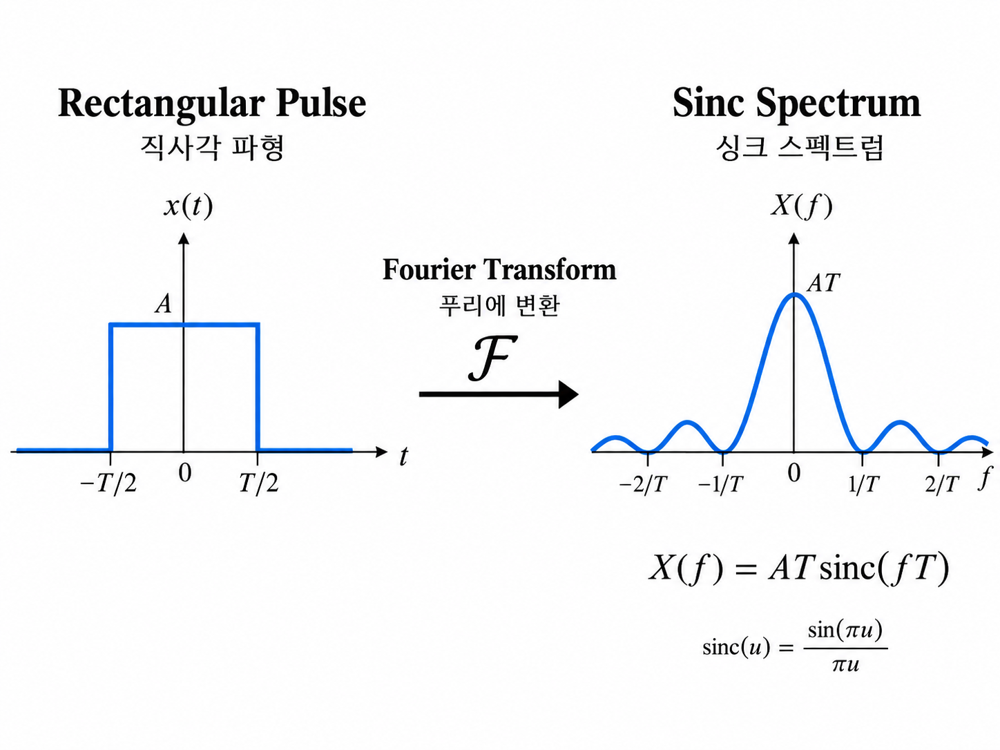
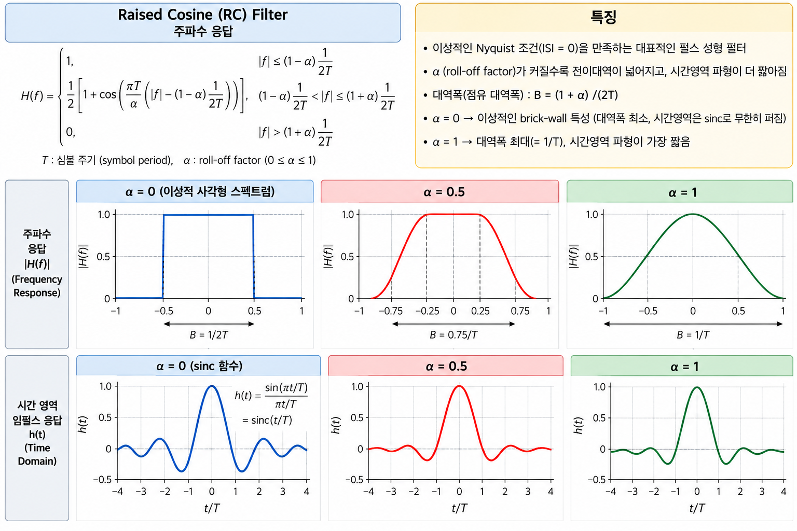

# 디지털 통신의 대역폭 효율과 I/Q 변조: Raised Cosine부터 직교 신호 복원까지

[TOC]

디지털 통신에서는 정보를 얼마나 빠르게 전송하는지도 중요하지만, **제한된 주파수 대역을 얼마나 효율적으로 사용하는가** 역시 중요한 문제이다.

예를 들어 동일한 대역폭을 사용하는 두 통신 시스템이 있다고 하자.

한 시스템은 초당 1 Mbps를 전송하고, 다른 시스템은 초당 2 Mbps를 전송한다면 두 번째 시스템이 주파수 자원을 더 효율적으로 사용한다고 볼 수 있다.

이러한 성능을 나타내는 개념이 **대역폭 효율(Spectral Efficiency)** 이다.

또한 실제 통신 시스템에서는 디지털 데이터를 사각파 형태로 그대로 전송하기보다, **Pulse Shaping Filter**를 사용하여 신호의 주파수 특성을 조절한다.

대표적인 필터가 Raised Cosine Filter이다.

한편, 정보를 반송파에 실어 전송하는 과정에서는 I(In-phase)와 Q(Quadrature)라는 두 개의 직교 성분을 사용한다.

이 글에서는 다음 내용을 살펴본다.

1. Bit Rate와 Symbol Rate
2. M-ary Modulation과 데이터 전송률
3. Symbol Duration과 Bandwidth의 관계
4. Raised Cosine Filter와 Roll-off Factor
5. Baseband Bandwidth와 Bandpass Bandwidth
6. Spectral Efficiency
7. Real Signal의 Fourier Conjugate Symmetry
8. Bandpass Signal의 Amplitude-Phase 표현
9. I/Q Signal과 Complex Baseband
10. Orthogonality를 이용한 I/Q 신호 복원
11. QPSK와 실제 송수신기 구조의 연결

---

## 1. Bit Rate와 Symbol Rate

디지털 통신에서 데이터 전송 속도를 나타내는 대표적인 두 개념이 있다.

- **Bit Rate**
- **Symbol Rate**

두 개념은 서로 관련되어 있지만 같은 의미는 아니다.

### 1.1 Bit Rate

Bit Rate는 **1초 동안 전송하는 비트의 개수**를 의미한다.

일반적으로 다음과 같이 표현한다.


$$
\boxed{R_b}
$$


단위는


$$
\mathrm{bits/s}
$$


또는


$$
\mathrm{bps}
$$


이다.

예를 들어 1초 동안 1,000개의 비트를 전송한다면


$$
R_b=1000\,\mathrm{bps}
$$


이다.

1초 동안 $10^6$개의 비트를 전송한다면


$$
R_b=1\,\mathrm{Mbps}
$$


이다.

비트 하나를 전송하는 데 필요한 시간을 $T_b$라고 하면


$$
\boxed{ R_b=\frac{1}{T_b} }
$$


이다.

여기서 $T_b$는 Bit Duration이다.

---


### 1.2 Symbol Rate

Symbol Rate는 **1초 동안 전송하는 심벌(Symbol)의 개수**를 의미한다.

일반적으로 다음과 같이 표현한다.


$$
\boxed{R_s}
$$


단위는 다음과 같다.

- Symbols per Second
- Symbols/s
- Baud

즉,


$$
1\,\mathrm{Baud}=1\,\mathrm{Symbol/s}
$$


이다.

하나의 심벌을 전송하는 데 필요한 시간을 $T_s$라고 하면


$$
\boxed{ R_s=\frac{1}{T_s} }
$$


이다.

여기서 $T_s$는 Symbol Duration이다.

#### Bit Rate와 Symbol Rate의 차이

| 구분 | Bit Rate | Symbol Rate |
| --- | --- | --- |
| 기호 | $R_b$ | $R_s$ |
| 의미 | 초당 전송 비트 수 | 초당 전송 심벌 수 |
| 단위 | bps | Baud |
| 관련 시간 | $T_b$ | $T_s$ |
| 기본 관계 | $R_b=1/T_b$ | $R_s=1/T_s$ |

**중요한 점은 하나의 심벌이 반드시 하나의 비트만 나타내는 것은 아니라는 것이다.**

---


## 2. M-ary Modulation과 Bit Rate의 관계

M-ary Modulation은 총 $M$개의 서로 다른 심벌을 사용하는 변조 방식이다.

각 심벌에 $k$개의 비트를 매핑한다면


$$
\boxed{ M=2^k }
$$


이다.

따라서


$$
\boxed{ k=\log_2M }
$$


이다.

즉 하나의 심벌에 포함되는 비트 수는 $\log_2M$이다.

### 2.1 Bit Rate와 Symbol Rate의 관계식

1초 동안 전송하는 심벌의 수가


$$
R_s
$$


이고, 하나의 심벌에 포함되는 비트 수가


$$
k
$$


라면 1초 동안 전송하는 비트 수는


$$
R_b=R_s\times k
$$


이다.

여기에


$$
k=\log_2M
$$


을 대입하면


$$
\boxed{ R_b=R_s\log_2M }
$$


이다.

이 식은 디지털 통신에서 데이터 전송률을 계산할 때 사용되는 중요한 관계식이다.

단, 여기서 $R_b$는 심벌에 매핑된 비트의 전송률을 의미하며, 채널 코딩이나 프레임 구조에 따른 추가 오버헤드는 고려하지 않는다.

---


### 2.2 BPSK의 경우

BPSK(Binary Phase Shift Keying)는 두 개의 심벌을 사용한다.

따라서


$$
M=2
$$


이다.

하나의 심벌에 포함되는 비트 수는


$$
k=\log_2 2=1
$$


이다.

따라서


$$
R_b=R_s\log_2 2
$$


이므로


$$
\boxed{ R_b=R_s }
$$


이다.

즉 BPSK는 **심벌 하나를 전송할 때 비트 하나를 전송한다.**

예를 들어


$$
R_s=1000\,\mathrm{Baud}
$$


라면


$$
R_b=1000\,\mathrm{bps}
$$


이다.

---


### 2.3 QPSK의 경우

QPSK(Quadrature Phase Shift Keying)는 네 개의 심벌을 사용한다.

따라서


$$
M=4
$$


이다.

하나의 심벌에 포함되는 비트 수는


$$
k=\log_2 4=2
$$


이다.

따라서


$$
R_b=R_s\log_2 4
$$


이므로


$$
\boxed{ R_b=2R_s }
$$


이다.

즉 QPSK는 **심벌 하나를 전송할 때 비트 두 개를 전송한다.**

예를 들어


$$
R_s=1000\,\mathrm{Baud}
$$


라면


$$
R_b=2000\,\mathrm{bps}
$$


이다.

#### BPSK와 QPSK 비교

| 구분 | BPSK | QPSK |
| --- | --- | --- |
| 심벌 개수 $M$ | 2 | 4 |
| Bits/Symbol | 1 | 2 |
| Symbol Rate | $R_s$ | $R_s$ |
| Bit Rate | $R_s$ | $2R_s$ |

따라서 동일한 Symbol Rate를 기준으로 비교하면 QPSK는 BPSK보다 두 배의 비트를 전송할 수 있다.

---


### 2.4 심벌을 여러 개 전송하는 경우

예를 들어 8-ary Modulation을 사용한다고 하자.


$$
M=8
$$


이므로


$$
k=\log_2 8=3
$$


이다.

즉 하나의 심벌이 3 Bit를 나타낸다.

따라서 5개의 심벌을 전송하면


$$
5\times3=15
$$


이므로 총 15 Bit를 전송한다.

이를 일반화하면


$$
\boxed{ N_b=N_s\log_2M }
$$


이다.

여기서

- $N_b$: 전송한 비트 수
- $N_s$: 전송한 심벌 수

이다.

---


## 3. Bit Duration과 Symbol Duration

앞에서 다음 관계식을 확인하였다.


$$
R_b=R_s\log_2M
$$


여기서


$$
k=\log_2M
$$


이라고 하면


$$
R_b=kR_s
$$


이다.

또한


$$
R_b=\frac{1}{T_b}
$$


이고


$$
R_s=\frac{1}{T_s}
$$


이다.

따라서


$$
\frac{1}{T_b} = k\frac{1}{T_s}
$$


이다.

양변을 정리하면


$$
\boxed{ T_s=kT_b }
$$


이다.

즉 $k$개의 비트를 하나의 심벌로 묶어 전송하면, 동일한 Bit Rate를 유지하는 조건에서 하나의 심벌에 할당되는 시간은 비트 시간의 $k$배이다.

#### 예제: QPSK

QPSK에서는


$$
k=2
$$


이다.

따라서


$$
\boxed{ T_s=2T_b }
$$


이다.

#### 예제: 8-ary Modulation

8-ary Modulation에서는


$$
k=3
$$


이다.

따라서


$$
\boxed{ T_s=3T_b }
$$


이다.

이 관계는 이후 대역폭을 이해할 때 중요하다.

---


## 4. Symbol Rate와 Bandwidth의 관계

대역폭(Bandwidth)은 통신 신호가 차지하는 주파수 범위를 의미한다.

일반적으로 신호의 시간적 길이와 주파수 영역에서의 확산 정도는 밀접한 관계가 있다.

예를 들어 시간 영역에서 매우 짧은 펄스를 만들면 주파수 영역에서는 넓은 스펙트럼이 나타난다.

반대로 시간 영역에서 펄스가 길어지면 주파수 영역에서는 상대적으로 좁은 스펙트럼을 얻을 수 있다.

이를 간단히 나타내면 다음과 같다.


$$
\boxed{ \text{짧은 Pulse} \longleftrightarrow \text{넓은 Frequency Spectrum} }
$$


$$
\boxed{ \text{긴 Pulse} \longleftrightarrow \text{좁은 Frequency Spectrum} }
$$


이러한 관계는 Fourier Transform의 Scaling Property로 이해할 수 있다.

---


### 4.1 Symbol Duration과 Symbol Rate

Symbol Rate는 다음과 같다.


$$
R_s=\frac{1}{T_s}
$$


따라서 Symbol Duration이 짧아지면


$$
T_s\downarrow
$$


Symbol Rate는 증가한다.


$$
R_s\uparrow
$$


반대로 Symbol Duration이 길어지면 Symbol Rate는 감소한다.

일반적인 선형 디지털 변조에서 Pulse Shape가 동일하다면 필요한 대역폭은 Symbol Rate에 비례한다.

따라서


$$
\boxed{ B\propto R_s }
$$


라고 표현할 수 있다.

다만 정확한 대역폭은 사용하는 Pulse Shaping Filter와 대역폭의 정의에 따라 달라진다.

---


## 5. 디지털 사각파를 그대로 전송하면 발생하는 문제

디지털 데이터는 종종 시간 영역에서 사각파(Rectangular Waveform)처럼 표현된다.

예를 들어 Bit Stream이 다음과 같다고 하자.


$$
0,\ 1,\ 0,\ 1
$$


디지털 회로에서는 각 구간에 대응하는 전압 레벨을 유지하는 형태로 신호를 표현할 수 있다.

하지만 이러한 사각형 펄스를 그대로 무선 통신에 사용하면 주파수 영역에서 문제가 발생할 수 있다.

---


### 5.1 Rectangular Pulse의 Fourier Transform

폭이 $T$인 사각 펄스를 다음과 같이 정의하자.


$$
p(t)= \begin{cases} 1,&|t|\le T/2\\ 0,&\text{otherwise} \end{cases}
$$


이 신호의 Fourier Transform은


$$
P(f) = \int_{-T/2}^{T/2} e^{-j2\pi ft}\,dt
$$


이다.

적분하면


$$
P(f) = \frac{\sin(\pi fT)}{\pi f}
$$


이다.

따라서


$$
\boxed{ P(f)=T\operatorname{sinc}(fT) }
$$


이다.

여기서 정규화된 Sinc Function은


$$
\operatorname{sinc}(x) = \frac{\sin(\pi x)}{\pi x}
$$


이다.

즉,


$$
\boxed{ \text{Rectangular Pulse} \xleftrightarrow{\mathcal{F}} \text{Sinc Spectrum} }
$$


이다.  


---


### 5.2 Sinc Spectrum의 문제점

Sinc Function은 중심 주파수에서 가장 큰 값을 가지지만, 양쪽으로 Side Lobe가 계속 존재한다.

즉 스펙트럼이 무한한 주파수 범위에 걸쳐 퍼져 있다.

따라서 신호를 특정 주파수 대역에만 완전히 제한하기 어렵다.

특히 서로 다른 사용자에게 인접한 주파수 대역이 할당된 경우, 이러한 스펙트럼 성분이 인접 대역에 영향을 줄 수 있다.

이를 줄이기 위해 Pulse Shaping이 필요하다.

---


## 6. Pulse Shaping이란?

Pulse Shaping은 디지털 심벌에 대응하는 파형의 모양을 조절하는 과정이다.

주요 목적은 다음과 같다.

1. 전송 신호의 대역폭 조절
2. 인접 채널에 대한 간섭 감소
3. 심벌 간 간섭(ISI) 제어
4. 제한된 주파수 자원의 효율적인 사용

대표적인 Pulse Shaping Filter는 다음과 같다.

**Raised Cosine Filter**

Raised Cosine Filter의 시간 영역과 주파수 영역 특성을 비교하면 Pulse Shaping이 필요한 이유를 보다 명확하게 이해할 수 있다.

---


## 7. Raised Cosine Filter

Raised Cosine Filter는 디지털 통신에서 사용하는 대표적인 Pulse Shaping Filter이다.

이 필터는 주파수 영역에서 특정 대역 밖의 응답이 0이 되도록 설계할 수 있다.

또한 이상적인 조건에서는 심벌 샘플링 시점에서 ISI가 발생하지 않도록 설계할 수 있다.

Raised Cosine Filter에서 중요한 Parameter는


$$
\boxed{\alpha}
$$


이다.

이를 **Roll-off Factor**라고 한다.

일반적으로


$$
\boxed{ 0\le\alpha\le1 }
$$


의 범위를 사용한다.

---


### 7.1 Roll-off Factor의 의미

Roll-off Factor는 주파수 응답의 천이 구간이 얼마나 넓은지를 나타낸다.

즉 주파수 응답이 통과 대역에서 차단 대역으로 변화하는 형태를 결정한다.

#### $\alpha=0$

주파수 응답이 이상적인 직사각형 형태가 된다.

필요한 대역폭이 가장 작다.

하지만 시간 영역에서는 Sinc 형태의 긴 Tail이 나타난다.

#### $\alpha=0.5$

주파수 응답의 천이 구간이 발생한다.

필요한 대역폭은 $\alpha=0$보다 증가한다.

시간 영역의 Pulse는 일반적으로 더 빠르게 감소하는 Tail을 가진다.

#### $\alpha=1$

주파수 응답의 천이 구간이 가장 넓어진다.

필요한 대역폭도 증가한다.

반면 시간 영역에서는 펄스의 Tail이 상대적으로 더 빠르게 감소한다.  


---


### 7.2 시간 영역과 주파수 영역의 관계

Roll-off Factor에 따른 특성을 비교하면 다음과 같다.

| Roll-off Factor | Frequency Domain | Time Domain |
| --- | --- | --- |
| $\alpha=0$ | 가장 좁은 대역폭 | 긴 Sinc Tail |
| $\alpha=0.5$ | 중간 대역폭 | Tail이 더 빠르게 감소 |
| $\alpha=1$ | 가장 넓은 대역폭 | 상대적으로 빠른 Tail 감소 |

즉 Roll-off Factor를 증가시키면 시간 영역의 펄스가 더 국소화되는 대신 주파수 대역을 더 많이 사용하게 된다.

이것이 Raised Cosine Filter의 중요한 Trade-off이다.


$$
\boxed{ \text{Narrow Bandwidth} \longleftrightarrow \text{Longer Time-Domain Tail} }
$$


---


## 8. Raised Cosine Filter의 주파수 응답

Raised Cosine Filter의 주파수 응답은 다음과 같이 표현할 수 있다.


$$
H_{\mathrm{RC}}(f)= \begin{cases} T_s, & |f|\le\frac{1-\alpha}{2T_s} \\[6pt] \frac{T_s}{2} \left[ 1+ \cos\left( \frac{\pi T_s}{\alpha} \left( |f|-\frac{1-\alpha}{2T_s} \right) \right) \right], & \frac{1-\alpha}{2T_s} < |f| \le \frac{1+\alpha}{2T_s} \\[6pt] 0, & |f|>\frac{1+\alpha}{2T_s} \end{cases}
$$


위 표현에서 $\alpha=0$일 때는 극한을 취한 직사각형 주파수 응답으로 해석한다.

이 식에서 중요한 부분은 주파수 응답이 0이 되는 경계이다.


$$
\boxed{ |f|=\frac{1+\alpha}{2T_s} }
$$


이다.

Symbol Rate가


$$
R_s=\frac{1}{T_s}
$$


이므로


$$
\boxed{ |f|=\frac{(1+\alpha)R_s}{2} }
$$


이다.

따라서 Raised Cosine Filter의 One-sided Baseband Bandwidth는 다음과 같다.


$$
\boxed{ B_{\mathrm{BB}} = \frac{(1+\alpha)R_s}{2} }
$$


이다.

이 식은 Baseband와 Bandpass 대역폭을 구분할 때 사용한다.

---


## 9. Raised Cosine Filter의 시간 영역 응답

Raised Cosine Pulse의 시간 영역 응답은 다음과 같이 표현할 수 있다.


$$
\boxed{ h_{\mathrm{RC}}(t) = \operatorname{sinc} \left( \frac{t}{T_s} \right) \frac{ \cos\left( \frac{\pi\alpha t}{T_s} \right) }{ 1-\left( \frac{2\alpha t}{T_s} \right)^2 } }
$$


분모가 0이 되는 지점은 극한값을 이용해 정의한다.

여기서 $\alpha=0$이면


$$
h_{\mathrm{RC}}(t) = \operatorname{sinc} \left( \frac{t}{T_s} \right)
$$


가 된다.

즉 Roll-off Factor가 0일 때 시간 영역의 Pulse는 이상적인 Sinc Function이 된다.

반면 $\alpha$가 증가하면 Sinc Function에 추가적인 형태 조절이 이루어져 Tail의 감소 특성이 달라진다.

---


## 10. Raised Cosine Filter와 ISI

여기서 중요한 질문이 발생한다.

> 디지털 데이터가 원래 사각파였는데, Raised Cosine Filter를 사용하여 파형을 부드럽게 바꾸면 원래 비트 정보를 잃어버리는 것이 아닐까?

이 질문은 Pulse Shaping을 이해할 때 반드시 짚어야 할 부분이다.

예를 들어 다음 Bit Stream을 생각하자.


$$
0,\ 1,\ 0,\ 1
$$


이 데이터를 사각형 파형으로 표현할 수도 있고, Raised Cosine Pulse를 이용해 표현할 수도 있다.

두 파형은 시간 영역에서 서로 다른 형태를 가진다.

하지만 수신기는 파형 전체가 사각형으로 유지되는지 확인하는 것이 아니라, **정해진 심벌 샘플링 시점에서 신호 값을 판정한다.**

---


### 10.1 Zero ISI 조건

이상적인 Raised Cosine Pulse는 다음 조건을 만족한다.


$$
\boxed{ h_{\mathrm{RC}}(nT_s) = \begin{cases} 1,&n=0\\ 0,&n\neq0 \end{cases} }
$$


여기서 $n$은 정수이다.

즉 펄스의 중심에서는 원하는 값이 나타나고, 다른 심벌의 샘플링 시점에서는 해당 펄스의 값이 0이 된다.

---


### 10.2 여러 심벌이 중첩되면?

전송할 심벌을


$$
a_0,a_1,a_2,\cdots
$$


라고 하자.

Pulse Shaping을 거친 신호는 다음과 같이 표현할 수 있다.


$$
\boxed{ x(t) = \sum_k a_k h_{\mathrm{RC}}(t-kT_s) }
$$


이다.

여기서 $k$번째 심벌의 샘플링 시점은


$$
t=kT_s
$$


이다.

이를 $n$번째 심벌의 샘플링 시점에서 관측하면


$$
x(nT_s) = \sum_k a_k h_{\mathrm{RC}}((n-k)T_s)
$$


이다.

Zero ISI 조건에 의해


$$
h_{\mathrm{RC}}((n-k)T_s) = 0 \qquad(n\neq k)
$$


이다.

따라서 $k=n$인 항만 남는다.

결과적으로


$$
\boxed{ x(nT_s)=a_n }
$$


이다.

즉 여러 심벌의 펄스가 시간 영역에서 서로 겹치더라도, **올바른 심벌 샘플링 시점에서는 원래 심벌 값을 복원할 수 있다.**

---


### 10.3 Rectangular Waveform과 Raised Cosine Waveform 비교

Rectangular Waveform과 Raised Cosine Pulse Shaping을 비교하면 다음과 같은 차이를 확인할 수 있다.

- Rectangular Waveform은 각 심벌을 일정한 전압 레벨로 표현한다.
- Raised Cosine Waveform은 여러 심벌의 펄스가 시간 영역에서 중첩되는 형태로 표현된다.
- 이상적인 심벌 샘플링 시점에서는 두 방식 모두 동일한 심벌 값을 나타낼 수 있다.

Pulse Shaping 이후에는 전체 파형의 모양이 달라진다.

하지만 이상적인 샘플링 시점에서는 같은 심벌 값을 얻을 수 있다.

따라서 전체 파형을 사각형으로 유지하지 않아도 디지털 정보를 전송할 수 있다.

다만 실제 통신에서는 채널 왜곡, 타이밍 오차, 필터 구현 오차 등에 의해 ISI가 발생할 수 있다.

또한 실제 송수신기에서는 송신기와 수신기에 Root Raised Cosine(RRC) Filter를 나누어 적용하고, 두 필터의 전체 응답이 Raised Cosine 형태가 되도록 설계하는 경우가 많다.

---


## 11. Baseband Bandwidth와 Bandpass Bandwidth

Raised Cosine Filter의 대역폭을 설명할 때 다음 두 식이 등장할 수 있다.


$$
B=\frac{(1+\alpha)R_s}{2}
$$


$$
B=(1+\alpha)R_s
$$


겉으로 보면 서로 다른 식처럼 보인다.

하지만 **어떤 대역폭을 정의하는지**에 따라 두 식이 모두 사용된다.

---


### 11.1 Baseband Bandwidth

Raised Cosine Filter의 주파수 응답은 0 Hz를 중심으로 양쪽에 존재한다.

주파수 응답이 존재하는 구간은


$$
-\frac{(1+\alpha)R_s}{2} \le f\le \frac{(1+\alpha)R_s}{2}
$$


이다.

따라서 0 Hz에서 양의 주파수 방향으로 측정한 One-sided Baseband Bandwidth는


$$
\boxed{ B_{\mathrm{BB}} = \frac{(1+\alpha)R_s}{2} }
$$


이다.

예를 들어


$$
R_s=1\,\mathrm{MSymbol/s}
$$


이고


$$
\alpha=0.5
$$


라면


$$
B_{\mathrm{BB}} = \frac{(1+0.5)\times10^6}{2}
$$


이므로


$$
\boxed{ B_{\mathrm{BB}}=750\,\mathrm{kHz} }
$$


이다.

즉 Baseband Spectrum은 이상적으로


$$
-750\,\mathrm{kHz} \le f\le +750\,\mathrm{kHz}
$$


범위에 존재한다.

---


### 11.2 Bandpass Bandwidth

이제 Baseband Signal을 Carrier Frequency $f_c$ 주변으로 이동시킨다고 하자.

Bandpass Signal의 양의 주파수 영역에서는 스펙트럼이 $f_c$를 중심으로 형성된다.

따라서 주파수 범위는


$$
f_c-B_{\mathrm{BB}} \le f\le f_c+B_{\mathrm{BB}}
$$


이다.

이때 양의 주파수 대역에서 실제로 차지하는 대역폭은


$$
B_{\mathrm{BP}} = (f_c+B_{\mathrm{BB}}) - (f_c-B_{\mathrm{BB}})
$$


이다.

따라서


$$
B_{\mathrm{BP}}=2B_{\mathrm{BB}}
$$


이다.

여기에 Baseband Bandwidth를 대입하면


$$
B_{\mathrm{BP}} = 2\left( \frac{(1+\alpha)R_s}{2} \right)
$$


이다.

따라서


$$
\boxed{ B_{\mathrm{BP}}=(1+\alpha)R_s }
$$


이다.

---


### 11.3 Baseband와 Bandpass 대역폭 비교

| 구분 | 대역폭 |
| --- | --- |
| One-sided Baseband Bandwidth | $\displaystyle\frac{(1+\alpha)R_s}{2}$ |
| Positive-frequency Bandpass Bandwidth | $(1+\alpha)R_s$ |

위 식은 이상적인 Raised Cosine Pulse Shaping을 사용하는 선형 변조 시스템을 기준으로 한다.

주의할 점은 복소 Baseband Spectrum의 전체 폭을 정의할 경우에는 $2B_{\mathrm{BB}}$가 된다는 것이다.

따라서 **Baseband라는 용어만으로 1/2 계수를 결정하는 것이 아니라, One-sided Bandwidth인지 전체 주파수 폭인지 확인해야 한다.**

---


## 12. Real Signal의 Fourier Conjugate Symmetry

Baseband와 Bandpass의 주파수 스펙트럼을 이해하기 위해서는 Real Signal의 Fourier Transform 성질을 알아야 한다.

이를 Fourier Series 계수에서 유도해 보자.

---


### 12.1 Fourier Series 계수

주기가 $T_0$인 신호 $x(t)$를 생각하자.

Fundamental Frequency는


$$
f_0=\frac{1}{T_0}
$$


이다.

복소 Fourier Series 계수는 다음과 같다.


$$
\boxed{ X[k] = \frac{1}{T_0} \int_{T_0} x(t)e^{-j2\pi kf_0t}\,dt }
$$


이다.

여기서 적분 구간은 길이가 $T_0$인 임의의 한 주기이다.

---


### 12.2 $x(t)$가 Real Signal이라면?

신호가 실수이면


$$
x(t)=x^*(t)
$$


이다.

Fourier Series 계수의 Complex Conjugate를 취하면


$$
X^*[k] = \left[ \frac{1}{T_0} \int_{T_0} x(t)e^{-j2\pi kf_0t}\,dt \right]^*
$$


이다.

Complex Conjugate를 적분 내부로 적용하면


$$
X^*[k] = \frac{1}{T_0} \int_{T_0} x^*(t)e^{j2\pi kf_0t}\,dt
$$


이다.

$x(t)$는 Real Signal이므로


$$
x^*(t)=x(t)
$$


이다.

따라서


$$
X^*[k] = \frac{1}{T_0} \int_{T_0} x(t)e^{j2\pi kf_0t}\,dt
$$


이다.

그런데


$$
e^{j2\pi kf_0t} = e^{-j2\pi(-k)f_0t}
$$


이므로


$$
X^*[k] = \frac{1}{T_0} \int_{T_0} x(t)e^{-j2\pi(-k)f_0t}\,dt
$$


이다.

오른쪽 식은 $X[-k]$이다.

따라서


$$
\boxed{ X[-k]=X^*[k] }
$$


이다.

또는


$$
\boxed{ X[k]=X^*[-k] }
$$


이다.

이 성질을 **Conjugate Symmetry**라고 한다.

---


### 12.3 Magnitude Spectrum은 대칭이다

복소수는 Magnitude와 Phase로 표현할 수 있다.


$$
X[k] = |X[k]|e^{j\angle X[k]}
$$


이다.

Conjugate Symmetry에 의해


$$
X[-k]=X^*[k]
$$


이므로


$$
X[-k] = |X[k]|e^{-j\angle X[k]}
$$


이다.

따라서 Magnitude는


$$
\boxed{ |X[-k]|=|X[k]| }
$$


이다.

즉 Real Signal의 Magnitude Spectrum은 주파수 0을 기준으로 좌우 대칭이다.

반면 Phase는


$$
\boxed{ \angle X[-k] = -\angle X[k] }
$$


의 관계를 가진다.

단, Phase는 $2\pi$의 정수배 차이를 허용하며, Magnitude가 0인 지점에서는 정의되지 않는다.

---


### 12.4 Continuous Fourier Transform에서도 성립한다

비주기적인 실수 신호의 Fourier Transform을 $X(f)$라고 하면


$$
\boxed{ X(-f)=X^*(f) }
$$


이다.

따라서


$$
\boxed{ |X(-f)|=|X(f)| }
$$


이다.

즉 실수 신호의 주파수 스펙트럼에는 양의 주파수와 음의 주파수에 대응하는 성분이 대칭적으로 존재한다.

이 성질은 Baseband Spectrum과 Bandpass Spectrum을 해석할 때 중요하다.

---


## 13. Spectral Efficiency란?

**Spectral Efficiency(대역폭 효율)** 는 단위 주파수 대역폭당 전송할 수 있는 데이터 속도를 나타낸다.

일반적으로 다음과 같이 정의한다.


$$
\boxed{ \eta=\frac{R_b}{B} }
$$


여기서

- $\eta$: Spectral Efficiency
- $R_b$: Bit Rate
- $B$: Signal Bandwidth

이다.

단위는


$$
\boxed{ \mathrm{bits/s/Hz} }
$$


이다.

즉 1 Hz의 대역폭을 사용하여 1초에 몇 Bit를 전송하는지를 나타낸다.

---


### 13.1 M-ary Modulation에 적용

앞에서


$$
R_b=R_s\log_2M
$$


임을 확인하였다.

이를 Spectral Efficiency 식에 대입하면


$$
\eta = \frac{R_s\log_2M}{B}
$$


이다.

따라서


$$
\boxed{ \eta = \frac{R_s\log_2M}{B} }
$$


이다.

---


### 13.2 Raised Cosine Filter를 사용하는 경우

이상적인 Bandpass Bandwidth가


$$
B=(1+\alpha)R_s
$$


라면


$$
\eta = \frac{R_s\log_2M}{(1+\alpha)R_s}
$$


이다.

분자와 분모의 $R_s$를 약분하면


$$
\boxed{ \eta = \frac{\log_2M}{1+\alpha} }
$$


이다.

이 식은 이상적인 Raised Cosine Pulse Shaping을 사용하는 선형 M-ary 변조에서 Bit Mapping에 대한 대역폭 효율을 나타낸다.

실제 정보 전송 효율은 채널 코딩, Guard Band, Pilot, Frame Overhead 등을 고려하면 달라질 수 있다.

---


## 14. BPSK와 QPSK의 Spectral Efficiency 비교

### 14.1 BPSK

BPSK는


$$
M=2
$$


이다.

따라서


$$
\eta = \frac{\log_2 2}{1+\alpha}
$$


이므로


$$
\boxed{ \eta_{\mathrm{BPSK}} = \frac{1}{1+\alpha} }
$$


이다.

---


### 14.2 QPSK

QPSK는


$$
M=4
$$


이다.

따라서


$$
\eta = \frac{\log_2 4}{1+\alpha}
$$


이므로


$$
\boxed{ \eta_{\mathrm{QPSK}} = \frac{2}{1+\alpha} }
$$


이다.

즉 동일한 Roll-off Factor를 사용한다면


$$
\boxed{ \eta_{\mathrm{QPSK}} = 2\eta_{\mathrm{BPSK}} }
$$


이다.

---


### 14.3 예제: $\alpha=0.25$

Roll-off Factor가


$$
\alpha=0.25
$$


라고 하자.

BPSK의 대역폭 효율은


$$
\eta_{\mathrm{BPSK}} = \frac{1}{1.25}
$$


이므로


$$
\boxed{ \eta_{\mathrm{BPSK}} = 0.8\,\mathrm{bits/s/Hz} }
$$


이다.

QPSK의 대역폭 효율은


$$
\eta_{\mathrm{QPSK}} = \frac{2}{1.25}
$$


이므로


$$
\boxed{ \eta_{\mathrm{QPSK}} = 1.6\,\mathrm{bits/s/Hz} }
$$


이다.

#### 비교

| Modulation | $M$ | Bits/Symbol | $\eta$ ($\alpha=0.25$) |
| --- | --- | --- | --- |
| BPSK | 2 | 1 | 0.8 |
| QPSK | 4 | 2 | 1.6 |
| 8-PSK | 8 | 3 | 2.4 |
| 16-QAM | 16 | 4 | 3.2 |

단, 위 표는 이상적인 대역폭 효율만 비교한 것이다.

고차 변조를 사용할수록 신호점 사이의 거리가 상대적으로 줄어들 수 있으므로 동일한 오류 성능을 유지하려면 더 높은 SNR이 필요할 수 있다.

따라서 Spectral Efficiency만 높다고 반드시 더 좋은 통신 시스템인 것은 아니다.

---


## 15. Bandpass Signal의 수학적 표현

일반적인 정현파 반송파는 다음과 같다.


$$
s(t)=A\cos(2\pi f_ct+\theta)
$$


그러나 실제 디지털 변조에서는 Amplitude와 Phase가 정보에 따라 변화할 수 있다.

따라서 다음과 같이 표현할 수 있다.


$$
\boxed{ s(t) = A(t)\cos(\omega_ct+\theta(t)) }
$$


여기서


$$
\omega_c=2\pi f_c
$$


이다.

- $A(t)$: 시간에 따라 변화하는 Amplitude
- $\theta(t)$: 시간에 따라 변화하는 Phase
- $\omega_c$: Carrier Angular Frequency

이다.

이 신호를 I/Q 성분으로 분해해 보자.

---


## 16. Amplitude-Phase 표현을 I/Q 표현으로 변환

다음 신호를 생각하자.


$$
s(t) = A(t)\cos(\omega_ct+\theta(t))
$$


삼각함수의 덧셈 정리를 사용하면


$$
\cos(a+b) = \cos a\cos b-\sin a\sin b
$$


이다.

따라서


$$
s(t) = A(t) \left[ \cos\omega_ct\cos\theta(t) - \sin\omega_ct\sin\theta(t) \right]
$$


이다.

이를 전개하면


$$
s(t) = A(t)\cos\theta(t)\cos\omega_ct - A(t)\sin\theta(t)\sin\omega_ct
$$


이다.

여기서 다음과 같이 정의하자.


$$
\boxed{ I(t)=A(t)\cos\theta(t) }
$$


$$
\boxed{ Q(t)=A(t)\sin\theta(t) }
$$


그러면


$$
\boxed{ s(t) = I(t)\cos\omega_ct - Q(t)\sin\omega_ct }
$$


이다.

또는


$$
\boxed{ s(t) = I(t)\cos(2\pi f_ct) - Q(t)\sin(2\pi f_ct) }
$$


이다.

이 식은 **I/Q Modulation의 핵심 수식**이다.

---


### 16.1 I와 Q의 의미

I는 In-phase의 약자이다.

Q는 Quadrature의 약자이다.

- **I(In-phase):** Cosine Carrier에 대응하는 성분
- **Q(Quadrature):** Sine Carrier에 대응하는 성분

Cosine과 Sine은 동일한 주파수를 가지면서 위상이 $90^\circ$ 차이 나는 함수이다.

따라서 두 함수를 이용하면 서로 직교하는 두 개의 축을 만들 수 있다.

이를 통해 서로 다른 두 정보 성분을 하나의 Bandpass Signal에 실어 전송할 수 있다.

---


## 17. I/Q와 Amplitude-Phase의 관계

앞에서 다음과 같이 정의하였다.


$$
I(t)=A(t)\cos\theta(t)
$$


$$
Q(t)=A(t)\sin\theta(t)
$$


이를 이용하면 Amplitude와 Phase를 다시 구할 수 있다.

---


### 17.1 Amplitude 계산

두 식을 제곱하여 더하면


$$
I^2(t)+Q^2(t)
$$


$$
= A^2(t)\cos^2\theta(t) + A^2(t)\sin^2\theta(t)
$$


이다.

공통항을 묶으면


$$
= A^2(t) \left[ \cos^2\theta(t)+\sin^2\theta(t) \right]
$$


이다.

삼각함수 항등식


$$
\cos^2\theta+\sin^2\theta=1
$$


에 의해


$$
I^2(t)+Q^2(t)=A^2(t)
$$


이다.

따라서


$$
\boxed{ A(t)=\sqrt{I^2(t)+Q^2(t)} }
$$


이다.

즉 I/Q 평면에서 원점으로부터의 거리가 Amplitude에 대응한다.

---


### 17.2 Phase 계산

앞에서


$$
I(t)=A(t)\cos\theta(t)
$$


이고


$$
Q(t)=A(t)\sin\theta(t)
$$


이므로


$$
\frac{Q(t)}{I(t)} = \tan\theta(t)
$$


이다.

따라서


$$
\theta(t) = \tan^{-1} \left( \frac{Q(t)}{I(t)} \right)
$$


로 표현할 수 있다.

하지만 이 식만 사용하면 사분면 정보가 모호해질 수 있다.

따라서 실제 계산에서는 다음과 같이 표현하는 것이 더 정확하다.


$$
\boxed{ \theta(t)=\operatorname{atan2}(Q(t),I(t)) }
$$


이다.

---


### 17.3 I/Q 평면의 기하학적 의미

I/Q 평면에서

- 가로축은 I
- 세로축은 Q

이다.

이때 신호 벡터의 길이는 Amplitude이고, I축과 이루는 각도는 Phase이다.

즉,


$$
\boxed{ A=\sqrt{I^2+Q^2} }
$$


$$
\boxed{ \theta=\operatorname{atan2}(Q,I) }
$$


이다.

이것이 Constellation Diagram에서 각 신호점이 Amplitude와 Phase 정보를 나타낼 수 있는 이유이다.

---


## 18. 왜 I와 Q를 복소수로 표현하는가?

I/Q 정보를 단순히 실수로 더하는 경우와 복소수로 표현하는 경우를 비교하면 Complex Baseband의 필요성을 이해할 수 있다.

---


### 18.1 I와 Q를 단순히 더하면?

I와 Q가 서로 다른 실수 정보라고 하자.

이를 다음과 같이 더하면


$$
u(t)=I(t)+Q(t)
$$


이다.

이 신호를 Carrier와 곱하고 실수부를 취한다고 하자.


$$
s(t) = \operatorname{Re} \left\{ [I(t)+Q(t)]e^{j2\pi f_ct} \right\}
$$


Euler's Formula에 의해


$$
e^{j2\pi f_ct} = \cos(2\pi f_ct) + j\sin(2\pi f_ct)
$$


이다.

따라서


$$
s(t) = \operatorname{Re} \left\{ [I(t)+Q(t)] [ \cos(2\pi f_ct) + j\sin(2\pi f_ct) ] \right\}
$$


이다.

$I(t)+Q(t)$는 실수이므로 실수부만 취하면


$$
\boxed{ s(t) = [I(t)+Q(t)]\cos(2\pi f_ct) }
$$


이다.

즉 I와 Q가 하나의 실수 계수로 합쳐져 반송파에 곱해진다.

이때 두 개의 정보를 독립적인 두 축으로 구분하기 어렵다.

---


### 18.2 왜 정보 분리에 문제가 생기는가?

예를 들어 다음 두 경우를 생각하자.

첫 번째 경우는


$$
I=1,\qquad Q=0
$$


이다.

그러면


$$
I+Q=1
$$


이다.

두 번째 경우는


$$
I=0,\qquad Q=1
$$


이다.

이 경우에도


$$
I+Q=1
$$


이다.

따라서 두 경우 모두 동일한 값이 나온다.


$$
\boxed{ (1,0)\rightarrow1 }
$$


$$
\boxed{ (0,1)\rightarrow1 }
$$


즉 두 개의 서로 다른 정보가 동일한 신호로 표현될 수 있다.

수신기에서는 합쳐진 값만 관측하므로 원래의 I와 Q를 구별할 수 없다.

또한 이 표현은 반송파의 Cosine 성분에만 계수를 곱하는 방식이므로 I/Q 평면에서 독립적인 두 좌표를 표현하지 못한다.

참고로 실수 계수가 음수가 되면 $180^\circ$의 위상 반전은 가능하다. 따라서 이 방식을 두고 위상이 절대로 변하지 않는다고 설명하기보다는, **I/Q의 두 자유도를 독립적으로 활용할 수 없다는 점**을 핵심으로 이해하는 것이 정확하다.

---


## 19. Complex Baseband Signal

이러한 문제를 해결하기 위해 I와 Q를 복소수 형태로 표현한다.

다음과 같이 정의하자.


$$
\boxed{ u(t)=I(t)+jQ(t) }
$$


이를 **Complex Baseband Signal** 또는 Complex Envelope라고 한다.

여기서 I와 Q는 실제 값을 가진 신호이며, $j$는 허수 단위이다.


$$
j^2=-1
$$


이다.

---


### 19.1 복소수 신호를 Carrier에 실어 전송

Complex Baseband Signal을 이용하면 실제 Bandpass Signal은 다음과 같이 표현된다.


$$
\boxed{ s(t) = \operatorname{Re} \left\{ u(t)e^{j2\pi f_ct} \right\} }
$$


여기에


$$
u(t)=I(t)+jQ(t)
$$


를 대입하면


$$
s(t) = \operatorname{Re} \left\{ [I(t)+jQ(t)]e^{j2\pi f_ct} \right\}
$$


이다.

Euler's Formula를 대입하면


$$
= \operatorname{Re} \left\{ [I(t)+jQ(t)] [ \cos(2\pi f_ct) + j\sin(2\pi f_ct) ] \right\}
$$


이다.

이를 전개하면


$$
= \operatorname{Re} \left\{ I(t)\cos(2\pi f_ct) + jI(t)\sin(2\pi f_ct) + jQ(t)\cos(2\pi f_ct) + j^2Q(t)\sin(2\pi f_ct) \right\}
$$


이다.

여기서


$$
j^2=-1
$$


이므로


$$
= \operatorname{Re} \left\{ I(t)\cos(2\pi f_ct) - Q(t)\sin(2\pi f_ct) + j[ I(t)\sin(2\pi f_ct) + Q(t)\cos(2\pi f_ct) ] \right\}
$$


이다.

실수부만 취하면


$$
\boxed{ s(t) = I(t)\cos(2\pi f_ct) - Q(t)\sin(2\pi f_ct) }
$$


이다.

즉 앞에서 삼각함수 덧셈 정리로 유도한 I/Q 표현과 정확하게 일치한다.

---


## 20. Complex Baseband로 Amplitude와 Phase 표현하기

복소수는 Magnitude와 Phase를 이용하여 다음과 같이 표현할 수 있다.


$$
u(t)=A(t)e^{j\theta(t)}
$$


이다.

따라서


$$
\boxed{ I(t)+jQ(t) = A(t)e^{j\theta(t)} }
$$


이다.

이를 Bandpass Signal 표현에 대입하면


$$
s(t) = \operatorname{Re} \left\{ A(t)e^{j\theta(t)} e^{j2\pi f_ct} \right\}
$$


이다.

지수법칙을 적용하면


$$
= \operatorname{Re} \left\{ A(t)e^{j[2\pi f_ct+\theta(t)]} \right\}
$$


이다.

Euler's Formula에 의해


$$
= \operatorname{Re} \left\{ A(t) [ \cos(2\pi f_ct+\theta(t)) + j\sin(2\pi f_ct+\theta(t)) ] \right\}
$$


이다.

실수부만 취하면


$$
\boxed{ s(t) = A(t)\cos(2\pi f_ct+\theta(t)) }
$$


이다.

따라서 다음 두 표현은 서로 동등하다.

#### Amplitude-Phase 표현


$$
\boxed{ s(t) = A(t)\cos(2\pi f_ct+\theta(t)) }
$$


#### I/Q 표현


$$
\boxed{ s(t) = I(t)\cos(2\pi f_ct) - Q(t)\sin(2\pi f_ct) }
$$


두 표현을 연결하면


$$
\boxed{ u(t)=I(t)+jQ(t)=A(t)e^{j\theta(t)} }
$$


이다.

---


## 21. Complex Baseband를 사용하는 이유

Complex Baseband를 사용하는 이유는 크게 두 가지이다.

### 21.1 Amplitude와 Phase를 표현할 수 있다

I와 Q를 복소수로 표현하면 두 값이 하나의 복소평면에서 독립적인 좌표 성분이 된다.

따라서


$$
A=\sqrt{I^2+Q^2}
$$


와


$$
\theta=\operatorname{atan2}(Q,I)
$$


를 통해 Amplitude와 Phase를 표현할 수 있다.

즉 I/Q 값을 적절히 선택하면 다양한 진폭과 위상을 가진 신호를 생성할 수 있다.

대표적으로 다음과 같은 변조 방식이 있다.

- PSK
- QPSK
- QAM

여기서 주의할 점은 **복소수로 표현했다고 해서 모든 변조 방식에서 진폭과 위상이 동시에 변하는 것은 아니라는 것**이다.

예를 들어 이상적인 QPSK에서는 신호의 Amplitude가 일정하고 Phase만 변화한다.

반면 QAM에서는 일반적으로 Amplitude와 Phase가 모두 달라질 수 있다.

---


### 21.2 I와 Q를 독립적으로 복원할 수 있다

I와 Q를 서로 직교하는 두 반송파 성분에 실어 전송하면 수신기에서 Orthogonality를 이용해 각 성분을 분리할 수 있다.

즉,


$$
\boxed{ I(t)\cos(2\pi f_ct) }
$$


와


$$
\boxed{ -Q(t)\sin(2\pi f_ct) }
$$


를 하나의 신호로 합쳐 전송하더라도, 수신기에서 적절한 처리를 수행하면 I와 Q를 각각 복원할 수 있다.

이것이 I/Q Modulation의 중요한 장점이다.

---


## 22. Cosine과 Sine이 직교한다는 것은?

이제 I와 Q를 어떻게 분리할 수 있는지 수학적으로 확인해 보자.

이를 이해하기 위해서는 **Orthogonality(직교성)** 를 알아야 한다.

두 함수가 직교한다는 것은 특정 구간에서 두 함수를 곱해 적분한 결과가 0이라는 의미이다.

예를 들어


$$
\int_0^T f(t)g(t)\,dt=0
$$


이라면 두 함수는 해당 구간에서 직교한다.

Cosine과 Sine Function의 직교성을 직접 적분하여 확인해 보자.

---


## 23. Cosine Function의 Fundamental Period

먼저 다음 Cosine Function을 살펴보자.


$$
x(t)=\cos(2\pi f_ct)
$$


Cosine Function은 주기함수이다.

즉 일정한 시간이 지나면 동일한 값이 반복된다.

주기를 $T_0$라고 하면


$$
x(t+T_0)=x(t)
$$


이다.

따라서


$$
\cos[2\pi f_c(t+T_0)] = \cos(2\pi f_ct)
$$


이다.

Cosine Function은 위상이 $2\pi$의 정수배만큼 증가하면 같은 값을 가진다.

따라서


$$
2\pi f_cT_0=2\pi k
$$


이다.

여기서 $k$는 정수이다.

양변을 정리하면


$$
f_cT_0=k
$$


이므로


$$
T_0=\frac{k}{f_c}
$$


이다.

가장 작은 양의 주기는 $k=1$일 때이다.

따라서


$$
\boxed{ T_0=\frac{1}{f_c} }
$$


이다.

이를 Fundamental Period라고 한다.

---


## 24. Cosine과 Cosine의 직교성

다음 두 함수를 생각하자.


$$
x_m(t)=\cos(2\pi mf_0t)
$$


$$
x_n(t)=\cos(2\pi nf_0t)
$$


여기서


$$
m,n=1,2,3,\cdots
$$


이며


$$
T_0=\frac{1}{f_0}
$$


이다.

두 함수를 곱한 뒤 한 주기 동안 적분하자.


$$
I_{mn} = \int_0^{T_0} \cos(2\pi mf_0t) \cos(2\pi nf_0t)\,dt
$$


삼각함수 항등식을 이용하면


$$
\cos A\cos B = \frac12 [ \cos(A-B)+\cos(A+B) ]
$$


이다.

따라서


$$
I_{mn} = \frac12 \int_0^{T_0} \left[ \cos(2\pi(m-n)f_0t) + \cos(2\pi(m+n)f_0t) \right]dt
$$


이다.

이제 $m=n$인 경우와 $m\neq n$인 경우를 구분하자.

---


### 24.1 $m=n$인 경우

$m=n$이면


$$
m-n=0
$$


이다.

따라서


$$
I_{mm} = \frac12 \int_0^{T_0} \left[ 1+\cos(4\pi mf_0t) \right]dt
$$


이다.

이를 두 항으로 분리하면


$$
I_{mm} = \frac12 \int_0^{T_0}1\,dt + \frac12 \int_0^{T_0} \cos(4\pi mf_0t)\,dt
$$


이다.

첫 번째 항은


$$
\frac12 \int_0^{T_0}1\,dt = \frac{T_0}{2}
$$


이다.

두 번째 항은


$$
\frac12 \left[ \frac{\sin(4\pi mf_0t)}{4\pi mf_0} \right]_0^{T_0}
$$


이다.

여기서


$$
T_0=\frac{1}{f_0}
$$


이므로


$$
\sin(4\pi mf_0T_0) = \sin(4\pi m)
$$


이다.

$m$은 정수이므로


$$
\sin(4\pi m)=0
$$


이다.

따라서 두 번째 항은 0이다.

결과적으로


$$
\boxed{ I_{mm}=\frac{T_0}{2} }
$$


이다.

즉 동일한 Cosine Function을 곱해 적분하면 0이 아닌 값이 나온다.

---


### 24.2 $m\neq n$인 경우

이번에는


$$
m\neq n
$$


이라고 하자.

적분식은 다음과 같다.


$$
I_{mn} = \frac12 \int_0^{T_0} \left[ \cos(2\pi(m-n)f_0t) + \cos(2\pi(m+n)f_0t) \right]dt
$$


이다.

두 항을 적분하면


$$
I_{mn} = \frac12 \left[ \frac{ \sin(2\pi(m-n)f_0t) }{ 2\pi(m-n)f_0 } \right]_0^{T_0}
$$


$$
+ \frac12 \left[ \frac{ \sin(2\pi(m+n)f_0t) }{ 2\pi(m+n)f_0 } \right]_0^{T_0}
$$


이다.

여기서


$$
T_0=\frac{1}{f_0}
$$


를 대입하면 각 Sine Function의 입력은


$$
2\pi(m-n)
$$


과


$$
2\pi(m+n)
$$


이 된다.

$m$과 $n$은 정수이므로 두 Sine 값은 모두 0이다.

따라서


$$
\boxed{ I_{mn}=0 \qquad(m\neq n) }
$$


이다.

---


### 24.3 Cosine Orthogonality 최종 정리

앞의 두 결과를 하나로 정리하면


$$
\boxed{ \int_0^{T_0} \cos(2\pi mf_0t) \cos(2\pi nf_0t)\,dt = \begin{cases} \frac{T_0}{2},&m=n\\ 0,&m\neq n \end{cases} }
$$


이다.

이 식의 의미는 다음과 같다.

- 동일한 주파수의 Cosine을 곱해 적분하면 0이 아닌 값이 나온다.
- 서로 다른 정수배 주파수의 Cosine을 곱해 한 주기 동안 적분하면 0이 나온다.

따라서 정해진 주파수의 신호 성분을 Correlator로 추출할 수 있다.

---


## 25. Sine과 Sine의 직교성

이번에는 다음 두 함수를 생각하자.


$$
x_m(t)=\sin(2\pi mf_0t)
$$


$$
x_n(t)=\sin(2\pi nf_0t)
$$


이다.

두 함수를 곱해 적분하면


$$
I_{mn} = \int_0^{T_0} \sin(2\pi mf_0t) \sin(2\pi nf_0t)\,dt
$$


이다.

삼각함수 항등식


$$
\sin A\sin B = \frac12 [ \cos(A-B)-\cos(A+B) ]
$$


을 적용하면


$$
I_{mn} = \frac12 \int_0^{T_0} \left[ \cos(2\pi(m-n)f_0t) - \cos(2\pi(m+n)f_0t) \right]dt
$$


이다.

앞에서 Cosine Function의 직교성을 계산한 방식과 동일하게 계산할 수 있다.

결과는 다음과 같다.


$$
\boxed{ \int_0^{T_0} \sin(2\pi mf_0t) \sin(2\pi nf_0t)\,dt = \begin{cases} \frac{T_0}{2},&m=n\\ 0,&m\neq n \end{cases} }
$$


이다.

즉 Sine Function도 서로 다른 정수배 주파수에 대해 직교성을 가진다.

---


## 26. Cosine과 Sine의 직교성

이번에는 같은 주파수의 Cosine과 Sine을 생각하자.


$$
x_1(t)=\cos(2\pi f_ct)
$$


$$
x_2(t)=\sin(2\pi f_ct)
$$


이다.

두 함수를 한 주기 동안 곱해 적분하면


$$
I = \int_0^{T_0} \cos(2\pi f_ct) \sin(2\pi f_ct)\,dt
$$


이다.

삼각함수 항등식


$$
\sin A\cos A = \frac12\sin(2A)
$$


을 사용하면


$$
I = \frac12 \int_0^{T_0} \sin(4\pi f_ct)\,dt
$$


이다.

적분하면


$$
I = -\frac{1}{8\pi f_c} \left[ \cos(4\pi f_ct) \right]_0^{T_0}
$$


이다.

여기서


$$
T_0=\frac{1}{f_c}
$$


를 대입하면


$$
I = -\frac{1}{8\pi f_c} [ \cos(4\pi)-\cos(0) ]
$$


이다.

그런데


$$
\cos(4\pi)=1
$$


이고


$$
\cos(0)=1
$$


이므로


$$
I=0
$$


이다.

따라서


$$
\boxed{ \int_0^{T_0} \cos(2\pi f_ct) \sin(2\pi f_ct)\,dt = 0 }
$$


이다.

이것이 I/Q Modulation에서 사용하는 중요한 성질이다.

---


## 27. Orthogonality 최종 정리

앞의 결과들을 표로 정리하면 다음과 같다.

| 함수 조합 | 적분 결과 |
| --- | --- |
| 동일 주파수 Cosine × Cosine | $T_0/2$ |
| 서로 다른 정수배 주파수의 Cosine × Cosine | 0 |
| 동일 주파수 Sine × Sine | $T_0/2$ |
| 서로 다른 정수배 주파수의 Sine × Sine | 0 |
| Cosine × Sine | 0 |

따라서 적절한 정규화를 적용하면 Cosine과 Sine을 서로 직교하는 Basis Function으로 사용할 수 있다.

예를 들어


$$
\boxed{ \phi_I(t) = \sqrt{\frac{2}{T}} \cos(2\pi f_ct) }
$$


$$
\boxed{ \phi_Q(t) = \sqrt{\frac{2}{T}} \sin(2\pi f_ct) }
$$


으로 정의할 수 있다.

단, 여기서는 적분 구간 $T$가 반송파의 정수 개 주기를 포함하는 등 정규직교 조건이 만족되도록 설정했다고 가정한다.

이 경우


$$
\boxed{ \int_0^T \phi_I(t)\phi_Q(t)\,dt=0 }
$$


이다.

또한


$$
\boxed{ \int_0^T \phi_I^2(t)\,dt=1 }
$$


$$
\boxed{ \int_0^T \phi_Q^2(t)\,dt=1 }
$$


이다.

즉 두 기저함수는 Orthonormal Basis를 구성한다.

---


## 28. Orthogonality를 이용한 I/Q 신호 복원

이제 핵심 질문으로 돌아가 보자.

> I와 Q가 하나의 Bandpass Signal로 합쳐져 전송되는데, 수신기에서는 어떻게 두 정보를 각각 복원할 수 있을까?

앞에서 전송 신호를 다음과 같이 정의하였다.


$$
\boxed{ s(t) = I\cos(2\pi f_ct) - Q\sin(2\pi f_ct) }
$$


여기서는 한 심벌 구간 $T$ 동안 I와 Q가 일정하다고 가정한다.

또한 잡음과 위상 오차가 없으며, 적분 구간에서 반송파의 직교성이 성립한다고 가정한다.

---


### 28.1 I 성분 복원

수신기에서 $s(t)$에 Cosine Function을 곱하고 적분한다.


$$
y_I = \int_0^T s(t)\cos(2\pi f_ct)\,dt
$$


전송 신호를 대입하면


$$
y_I = \int_0^T [ I\cos(2\pi f_ct) - Q\sin(2\pi f_ct) ] \cos(2\pi f_ct)\,dt
$$


이다.

분배하면


$$
y_I = I \int_0^T \cos^2(2\pi f_ct)\,dt
$$


$$
- Q \int_0^T \sin(2\pi f_ct)\cos(2\pi f_ct)\,dt
$$


이다.

직교성에 의해


$$
\int_0^T \cos^2(2\pi f_ct)\,dt = \frac{T}{2}
$$


이고


$$
\int_0^T \sin(2\pi f_ct)\cos(2\pi f_ct)\,dt = 0
$$


이다.

따라서


$$
y_I = I\frac{T}{2}-Q(0)
$$


이므로


$$
\boxed{ y_I=\frac{T}{2}I }
$$


이다.

정규화 계수 $\frac{2}{T}$를 곱하면


$$
\boxed{ I = \frac{2}{T} \int_0^T s(t)\cos(2\pi f_ct)\,dt }
$$


이다.

즉 수신 신호에 Cosine Function을 곱한 뒤 적분하면 I 성분을 복원할 수 있다.

---


### 28.2 Q 성분 복원

이번에는 수신 신호에 Sine Function을 곱해 적분하자.


$$
y_Q = \int_0^T s(t)\sin(2\pi f_ct)\,dt
$$


전송 신호를 대입하면


$$
y_Q = \int_0^T [ I\cos(2\pi f_ct) - Q\sin(2\pi f_ct) ] \sin(2\pi f_ct)\,dt
$$


이다.

분배하면


$$
y_Q = I \int_0^T \cos(2\pi f_ct)\sin(2\pi f_ct)\,dt
$$


$$
- Q \int_0^T \sin^2(2\pi f_ct)\,dt
$$


이다.

직교성에 의해 첫 번째 항은 0이다.

두 번째 적분은


$$
\int_0^T \sin^2(2\pi f_ct)\,dt = \frac{T}{2}
$$


이다.

따라서


$$
y_Q = I(0)-Q\frac{T}{2}
$$


이므로


$$
\boxed{ y_Q=-\frac{T}{2}Q }
$$


이다.

따라서


$$
\boxed{ Q = -\frac{2}{T} \int_0^T s(t)\sin(2\pi f_ct)\,dt }
$$


이다.

즉 Q 경로에서는 전송 신호에 포함된 음의 부호를 반영하여 Q를 복원할 수 있다.

---


## 29. I/Q 복원의 핵심 원리

앞에서 유도한 결과를 다시 정리하면 다음과 같다.

#### I 성분


$$
\boxed{ I = \frac{2}{T} \int_0^T s(t)\cos(2\pi f_ct)\,dt }
$$


#### Q 성분


$$
\boxed{ Q = -\frac{2}{T} \int_0^T s(t)\sin(2\pi f_ct)\,dt }
$$


즉 송신기에서


$$
s(t) = I\cos(2\pi f_ct) - Q\sin(2\pi f_ct)
$$


의 형태로 두 신호를 합쳐 전송하더라도, 수신기에서는 Cosine과 Sine의 직교성을 이용하여 두 정보를 분리할 수 있다.

**이것이 I/Q Modulation과 Coherent Detection을 연결하는 핵심 원리이다.**

여기서 위 적분식은 I와 Q가 한 심벌 구간에서 일정한 이상적인 경우를 설명하기 위한 것이다.

실제 Pulse Shaping된 통신 신호에서는 반송파 복조, 필터링, 타이밍 동기화, Matched Filtering 등을 거쳐 적절한 심벌 값을 추출한다.

---


## 30. I/Q Modulator의 기본 구조

이제 수학적으로 유도한 식을 실제 송신기 구조와 연결해 보자.

Bandpass Signal은


$$
\boxed{ s(t) = I(t)\cos(2\pi f_ct) - Q(t)\sin(2\pi f_ct) }
$$


이다.

따라서 송신기에서는 두 경로를 사용할 수 있다.

**I Path**


$$
I(t)\times\cos(2\pi f_ct)
$$


**Q Path**


$$
Q(t)\times[-\sin(2\pi f_ct)]
$$


이 두 신호를 더하면


$$
s(t)
$$


가 된다.

전체 흐름은 다음과 같다.

1. 입력 Bit Stream을 심벌에 매핑한다.
2. 각 심벌을 I와 Q 성분으로 표현한다.
3. I 성분에는 Cosine Carrier를 곱한다.
4. Q 성분에는 $-\mathrm{Sine}$ Carrier를 곱한다.
5. 두 경로의 출력을 합하여 Bandpass Signal을 생성한다.

이것이 I/Q Modulator의 기본적인 원리이다.

---


## 31. I/Q Demodulator의 기본 구조

수신기에서는 송신기와 반대 과정을 수행한다.

먼저 수신된 Bandpass Signal에서 반송파 주파수와 위상을 복원한다.

이후 두 개의 경로로 분리한다.

**I Path**

수신 신호에 Cosine Carrier를 곱한다.

**Q Path**

수신 신호에 음의 Sine Carrier를 곱한다.

이후 적절한 Low-Pass Filtering 또는 Matched Filtering을 수행하여 Baseband 성분을 추출한다.

이상적인 조건에서 이러한 과정을 통해 I와 Q 정보를 복원할 수 있다.

단, 실제 시스템에서는 다음 과정도 필요하다.

- Carrier Synchronization
- Symbol Timing Synchronization
- Channel Compensation
- Symbol Detection

특히 위상 동기화가 정확하지 않으면 I와 Q가 서로 섞이는 현상이 발생할 수 있다.

---


## 32. QPSK와 I/Q Modulation의 관계

이제 QPSK와 연결해 보자.

QPSK는 네 개의 심벌을 사용한다.


$$
M=4
$$


따라서 하나의 심벌에 두 개의 비트를 매핑한다.


$$
k=\log_2 4=2
$$


이다.

즉 입력 Bit Stream을 두 비트씩 묶어 전송할 수 있다.

예를 들어


$$
00,\ 01,\ 10,\ 11
$$


의 네 가지 조합을 사용할 수 있다.

이 네 가지 심벌을 I/Q 평면의 네 신호점에 매핑한다.

---


### 32.1 QPSK의 I/Q 좌표

예를 들어 네 신호점을 다음과 같이 정의할 수 있다.

| Bits | I | Q |
| --- | --- | --- |
| 00 | $+a$ | $+a$ |
| 01 | $-a$ | $+a$ |
| 11 | $-a$ | $-a$ |
| 10 | $+a$ | $-a$ |

여기서 $a$는 양의 상수이다.

각 심벌에 대해


$$
u=I+jQ
$$


를 만들 수 있다.

그다음


$$
s(t) = \operatorname{Re} \left\{ ue^{j2\pi f_ct} \right\}
$$


를 이용하여 실제 전송 파형을 생성할 수 있다.

---


### 32.2 QPSK에서는 왜 Phase가 변하는가?

각 신호점의 Amplitude는


$$
A=\sqrt{I^2+Q^2}
$$


이다.

QPSK의 네 신호점에서는


$$
I=\pm a
$$


이고


$$
Q=\pm a
$$


이므로


$$
A=\sqrt{a^2+a^2}
$$


이다.

따라서


$$
\boxed{ A=\sqrt{2}a }
$$


이다.

즉 네 신호점의 Amplitude는 모두 같다.

반면 Phase는


$$
\theta=\operatorname{atan2}(Q,I)
$$


에 의해 달라진다.

따라서 QPSK에서는 I와 Q의 부호 조합에 따라 서로 다른 위상을 생성할 수 있다.

이것이 QPSK가 Phase Shift Keying의 한 종류인 이유이다.

---


### 32.3 QPSK 송신기의 실제 동작 원리

앞에서는 QPSK가 I/Q 평면의 네 신호점을 이용하여 2 Bit를 하나의 심벌로 표현한다는 것을 확인하였다.

그렇다면 실제 QPSK 송신기에서는 입력된 2 Bit를 어떻게 하나의 RF 신호로 변환할까?

QPSK 송신기의 핵심은 **입력된 2 Bit를 I와 Q의 심벌 값으로 매핑하고, 동일한 주파수를 가지면서 위상이 90° 다른 두 반송파에 각각 곱한 뒤 합산하는 것**이다.

전체 과정을 다음과 같이 나타낼 수 있다.


```text
              Input Bit Stream
                     │
                     ▼
              Serial-to-Parallel
                     │
                     ▼
                Symbol Mapper
                     │
              ┌──────┴──────┐
              │             │
              ▼             ▼
            I Data        Q Data
              │             │
              ▼             ▼
         Pulse Shaping  Pulse Shaping
              │             │
              ▼             ▼
             (×)           (×)
              ▲             ▲
              │             │
         cos(2πfct)     -sin(2πfct)
              ▲             ▲
              │             │
              └──────┬──────┘
                     │
             Local Oscillator
             + Quadrature Generation

              │             │
              ▼             ▼
           I Signal       Q Signal
              │             │
              └──────┬──────┘
                     ▼
                   Adder
                     │
                     ▼
            QPSK Bandpass Signal
                     │
                     ▼
              RF Amplifier
                     │
                     ▼
                  Antenna
```


위 구조는 QPSK 송신기의 원리를 나타낸 개념도이다.

실제 송신기에서는 DAC, Reconstruction Filter, RF Filter, Frequency Conversion 등의 블록이 추가될 수 있다.

---


#### ① 입력된 2 Bit를 I/Q 심벌로 매핑

QPSK는 네 개의 신호점을 사용한다.


$$
M=4
$$


따라서 하나의 심벌이 표현하는 Bit 수는


$$
k=\log_2 4=2
$$


이다.

즉 입력된 Bit Stream을 두 비트씩 묶어 하나의 심벌로 변환한다.

예를 들어 입력된 두 비트가 다음과 같다고 하자.


$$
\boxed{01}
$$


QPSK의 Gray Mapping을 다음과 같이 정의할 수 있다.

| Input Bits | I | Q |
| --- | --- | --- |
| 00 | +1 | +1 |
| 01 | -1 | +1 |
| 11 | -1 | -1 |
| 10 | +1 | -1 |

이는 신호점의 위치를 설명하기 위한 한 가지 Mapping Convention이다.

입력이 `01`이라면


$$
\boxed{ I=-1,\qquad Q=+1 }
$$


이 된다.

여기서 중요한 점은 **비트 0과 1을 반송파에 직접 곱하는 것이 아니라, 각 비트 조합에 대응하는 I/Q 심벌 값을 생성한다는 것**이다.

예를 들어 이 Mapping에서는

- I 성분이 -1
- Q 성분이 +1

이 된다.

이처럼 I와 Q는 독립적인 두 좌표 성분으로 사용된다.

---


#### ② Local Oscillator에서 두 직교 반송파 생성

QPSK 송신기에서는 Local Oscillator(LO)를 기준으로 두 개의 직교 반송파를 생성한다.

I 경로의 반송파는 다음과 같다.


$$
\boxed{ c_I(t)=\cos(2\pi f_ct) }
$$


Q 경로의 반송파는 다음과 같다.


$$
\boxed{ c_Q(t)=-\sin(2\pi f_ct) }
$$


여기서


$$
-\sin\theta = \cos\left(\theta+\frac{\pi}{2}\right)
$$


이므로


$$
-\sin(2\pi f_ct) = \cos\left(2\pi f_ct+\frac{\pi}{2}\right)
$$


이다.

즉 I와 Q 경로의 반송파는 동일한 주파수 $f_c$를 가지면서 위상이 90° 차이 난다.


$$
\boxed{ \Delta\theta=90^\circ }
$$


이것이 Quadrature의 의미이다.

**주의할 점은 두 경로에서 서로 다른 주파수를 사용하는 것이 아니라는 것이다.**

두 반송파 모두 동일한 Carrier Frequency $f_c$를 사용한다.

차이는 주파수가 아니라 위상이다.

또한 두 반송파 사이의 90° 위상 차이는 기본적으로 유지된다.

입력 Bit에 따라 달라지는 것은 각 경로에 곱해지는 I와 Q의 심벌 값이다.

---


#### ③ I 경로에서 심벌 값과 반송파를 곱하기

I 경로에서는 Symbol Mapper가 생성한 I 값을 Cosine Carrier에 곱한다.


$$
\boxed{ s_I(t)=I\cos(2\pi f_ct) }
$$


이다.

입력 `01`에 대한 I 값은


$$
I=-1
$$


이므로


$$
\boxed{ s_I(t)=-\cos(2\pi f_ct) }
$$


이다.

여기서 -1을 곱하면 Cosine 신호의 부호가 반전된다.

삼각함수의 성질에 의해


$$
-\cos\theta = \cos(\theta+\pi)
$$


이므로 이는 180° 위상 반전과 동일하다.

따라서 I/Q 심벌 값을 곱하는 과정은 단순한 진폭 증폭만을 의미하지 않는다.

**심벌 값의 크기와 부호에 따라 반송파 성분의 진폭과 극성을 결정하는 과정**이다.

---


#### ④ Q 경로에서 심벌 값과 반송파를 곱하기

Q 경로에서도 동일한 과정을 수행한다.

다만 Q 경로에서는 Cosine Carrier와 90° 위상 차이가 나는 반송파를 사용한다.


$$
\boxed{ s_Q(t)=-Q\sin(2\pi f_ct) }
$$


이다.

입력 `01`에 대한 Q 값은


$$
Q=+1
$$


이므로


$$
\boxed{ s_Q(t)=-\sin(2\pi f_ct) }
$$


이다.

이때 Q 경로의 반송파는 I 경로와 동일한 주파수를 가진다.

따라서 QPSK는 두 개의 서로 다른 주파수를 사용하는 방식이 아니다.

**동일한 주파수의 직교 성분 두 개를 이용하는 변조 방식**이다.

---


#### ⑤ I/Q 신호를 합산하여 하나의 QPSK 신호 생성

이제 두 경로의 출력을 더한다.


$$
s(t)=s_I(t)+s_Q(t)
$$


따라서


$$
\boxed{ s(t) = I\cos(2\pi f_ct) - Q\sin(2\pi f_ct) }
$$


이다.

이 식은 앞에서 유도한 I/Q Bandpass Signal의 수학적 표현과 일치한다.

입력 `01`에서는


$$
I=-1,\qquad Q=+1
$$


이므로


$$
s(t) = -\cos(2\pi f_ct) - \sin(2\pi f_ct)
$$


이다.

이를 하나의 Cosine 함수로 표현해 보자.

앞에서 다음 관계를 유도하였다.


$$
A=\sqrt{I^2+Q^2}
$$


$$
\theta=\operatorname{atan2}(Q,I)
$$


이다.

먼저 Amplitude는


$$
A=\sqrt{(-1)^2+(+1)^2}
$$


이므로


$$
\boxed{ A=\sqrt{2} }
$$


이다.

Phase는


$$
\theta=\operatorname{atan2}(1,-1)
$$


이므로


$$
\boxed{ \theta=135^\circ }
$$


이다.

따라서 최종 전송 신호는


$$
\boxed{ s(t) = \sqrt{2} \cos\left( 2\pi f_ct+\frac{3\pi}{4} \right) }
$$


이다.

즉 입력된 두 비트 `01`은 **135°의 위상을 갖는 하나의 반송파 신호**로 표현된다.

이때 진폭 $\sqrt{2}$는 I와 Q를 각각 $\pm1$로 설정한 예제에서 얻은 값이다.

실제 통신 시스템에서는 원하는 Symbol Energy와 송신 전력에 맞도록 I/Q 값을 정규화하거나 증폭한다.

---


### 32.4 모든 QPSK 심벌의 전송 신호

앞에서 정의한 Gray Mapping을 기준으로 네 개의 심벌을 계산해 보자.

전송 신호의 일반식은 다음과 같다.


$$
s(t)=I\cos(2\pi f_ct)-Q\sin(2\pi f_ct)
$$


각 심벌의 I/Q 값을 대입하면 다음과 같다.

#### Symbol 00


$$
I=+1,\qquad Q=+1
$$


따라서


$$
s_{00}(t) = \cos(2\pi f_ct)-\sin(2\pi f_ct)
$$


이다.

이를 Amplitude-Phase 형태로 표현하면


$$
\boxed{ s_{00}(t) = \sqrt{2}\cos(2\pi f_ct+45^\circ) }
$$


이다.

#### Symbol 01


$$
I=-1,\qquad Q=+1
$$


따라서


$$
s_{01}(t) = -\cos(2\pi f_ct)-\sin(2\pi f_ct)
$$


이다.

따라서


$$
\boxed{ s_{01}(t) = \sqrt{2}\cos(2\pi f_ct+135^\circ) }
$$


이다.

#### Symbol 11


$$
I=-1,\qquad Q=-1
$$


따라서


$$
s_{11}(t) = -\cos(2\pi f_ct)+\sin(2\pi f_ct)
$$


이다.

따라서


$$
\boxed{ s_{11}(t) = \sqrt{2}\cos(2\pi f_ct+225^\circ) }
$$


이다.

#### Symbol 10


$$
I=+1,\qquad Q=-1
$$


따라서


$$
s_{10}(t) = \cos(2\pi f_ct)+\sin(2\pi f_ct)
$$


이다.

따라서


$$
\boxed{ s_{10}(t) = \sqrt{2}\cos(2\pi f_ct+315^\circ) }
$$


이다.

#### 전체 결과 비교

| Input Bits | I | Q | Carrier Phase |
| --- | --- | --- | --- |
| 00 | +1 | +1 | 45° |
| 01 | -1 | +1 | 135° |
| 11 | -1 | -1 | 225° |
| 10 | +1 | -1 | 315° |

네 개의 심벌은 모두 동일한 Carrier Frequency $f_c$를 사용한다.

또한 이상적인 심벌 구간에서 I와 Q의 크기가 각각 1이므로 모든 신호의 Amplitude는 같다.


$$
\boxed{ A=\sqrt{2} }
$$


그러나 신호의 Phase는 심벌에 따라 달라진다.

따라서 QPSK는


$$
\boxed{ \text{Constant Symbol Amplitude} + \text{Four Different Phases} }
$$


를 이용하여 정보를 표현하는 방식이라고 볼 수 있다.

---


### 32.5 QPSK와 Pulse Shaping Filter의 관계

앞에서는 하나의 심벌 구간 동안 I와 Q가 일정하다고 가정하였다.

그러나 실제 디지털 통신에서는 Symbol Mapper의 출력이 바로 RF Mixer에 전달되는 것은 아니다.

일반적으로 I와 Q 경로에는 **Pulse Shaping Filter**가 포함된다.

예를 들어 Root Raised Cosine(RRC) Filter를 사용할 수 있다.

송신 과정은 다음과 같다.


$$
\boxed{ \text{Bits} \rightarrow \text{Symbol Mapping} \rightarrow \text{Pulse Shaping} \rightarrow \text{I/Q Modulation} }
$$


이다.

#### Pulse Shaping 전

각 심벌 구간에서 I와 Q는 다음과 같은 값을 가진다.


$$
I_k,Q_k\in\{-1,+1\}
$$


따라서 이상적인 심벌 구간에서는 다음 네 가지 위상 중 하나를 선택한다.


$$
45^\circ,\ 135^\circ,\ 225^\circ,\ 315^\circ
$$


#### Pulse Shaping 후

Pulse Shaping을 적용하면 I와 Q가 시간에 따라 변화하는 연속적인 파형이 된다.

이를 다음과 같이 표현할 수 있다.


$$
I(t)=\sum_k I_kp(t-kT_s)
$$


$$
Q(t)=\sum_k Q_kp(t-kT_s)
$$


여기서

- $I_k$: $k$번째 심벌의 I 값
- $Q_k$: $k$번째 심벌의 Q 값
- $p(t)$: Pulse Shaping Filter의 Pulse Response
- $T_s$: Symbol Duration

이다.

따라서 실제 Bandpass Signal은


$$
\boxed{ s(t) = I(t)\cos(2\pi f_ct) - Q(t)\sin(2\pi f_ct) }
$$


이다.

즉 I와 Q의 시간적 파형을 조절하면서도 두 경로는 동일한 반송파 주파수를 사용한다.

**주의할 점은 Pulse Shaping 이후 심벌 사이의 전이 구간에서는 순간적인 신호 진폭과 위상이 변할 수 있다는 것이다.**

따라서 QPSK의 네 신호점이 동일한 Amplitude를 가진다는 사실과, Pulse Shaping을 거친 연속시간 RF 파형의 순간 진폭이 항상 일정하다는 주장은 구분해야 한다.

---


### 32.6 QPSK 송신기의 핵심 정리

QPSK 송신기는 다음 순서로 동작한다.

1. 입력 Bit Stream을 2 Bit씩 묶어 하나의 Symbol로 만든다.
2. Symbol Mapper가 해당 2 Bit를 I와 Q 값으로 변환한다.
3. Pulse Shaping Filter가 I/Q Symbol Sequence를 전송에 적합한 파형으로 변환한다.
4. Local Oscillator를 기준으로 동일한 주파수이면서 90° 위상 차이가 나는 두 반송파를 생성한다.
5. I 경로에서는 Cosine Carrier에 I 값을 곱한다.
6. Q 경로에서는 음의 Sine Carrier에 Q 값을 곱한다.
7. 두 경로의 신호를 더해 하나의 QPSK Bandpass Signal을 만든다.
8. RF 회로를 통해 신호를 증폭하고 안테나로 송신한다.

이 과정을 수학적으로 표현하면 다음과 같다.


$$
\boxed{ (I,Q) \rightarrow I\cos(2\pi f_ct)-Q\sin(2\pi f_ct) }
$$


또는 Complex Baseband를 이용하면


$$
\boxed{ u(t)=I(t)+jQ(t) }
$$


$$
\boxed{ s(t) = \operatorname{Re} \left\{ u(t)e^{j2\pi f_ct} \right\} }
$$


이다.

**핵심은 서로 다른 두 주파수를 합치는 것이 아니라, 동일한 반송파 주파수에서 직교하는 두 성분을 합산하여 하나의 신호를 생성한다는 점이다.**

또한 90° 위상 차이는 두 반송파의 기본적인 직교 관계이고, 실제 QPSK 심벌의 위상은 입력 비트에 대응하는 I/Q 값에 의해 결정된다.

---


## 33. I/Q 표현과 실제 송수신기의 관계

I/Q 표현은 단순히 수식을 복소수 형태로 바꾸는 과정이 아니다.

각 식은 실제 송수신기의 동작과 연결된다.

먼저 Bandpass Signal은


$$
s(t)=A(t)\cos(2\pi f_ct+\theta(t))
$$


로 표현된다.

이를 I/Q 형태로 바꾸면


$$
s(t) = I(t)\cos(2\pi f_ct) - Q(t)\sin(2\pi f_ct)
$$


이다.

다시 Complex Baseband로 표현하면


$$
s(t) = \operatorname{Re} \left\{ [I(t)+jQ(t)]e^{j2\pi f_ct} \right\}
$$


이다.

이 세 식은 서로 다른 신호를 나타내는 것이 아니라 **동일한 Bandpass Signal을 서로 다른 방법으로 표현한 것**이다.

그리고 수신기에서는 직교성을 이용하여 각 성분을 추출할 수 있다.


$$
\int_0^T \cos(2\pi f_ct) \sin(2\pi f_ct)\,dt=0
$$


이라는 성질 때문에 두 경로가 이상적인 조건에서 서로 간섭하지 않는다.

따라서 I/Q Modulation에서는 다음 두 가지를 동시에 실현할 수 있다.

1. 서로 다른 두 정보 성분을 하나의 Bandpass Signal에 실어 전송한다.
2. 수신기에서 직교성을 이용해 두 성분을 각각 복원한다.

---


## 34. 핵심 공식 총정리

### 34.1 Bit Rate


$$
\boxed{ R_b=\frac{1}{T_b} }
$$


### 34.2 Symbol Rate


$$
\boxed{ R_s=\frac{1}{T_s} }
$$


### 34.3 M-ary Modulation


$$
\boxed{ M=2^k }
$$


$$
\boxed{ k=\log_2M }
$$


### 34.4 Bit Rate와 Symbol Rate


$$
\boxed{ R_b=R_s\log_2M }
$$


### 34.5 Bit Duration과 Symbol Duration


$$
\boxed{ T_s=kT_b }
$$


### 34.6 Baseband Bandwidth


$$
\boxed{ B_{\mathrm{BB}} = \frac{(1+\alpha)R_s}{2} }
$$


### 34.7 Bandpass Bandwidth


$$
\boxed{ B_{\mathrm{BP}} = (1+\alpha)R_s }
$$


### 34.8 Spectral Efficiency


$$
\boxed{ \eta=\frac{R_b}{B} }
$$


### 34.9 Ideal Raised Cosine Spectral Efficiency


$$
\boxed{ \eta=\frac{\log_2M}{1+\alpha} }
$$


### 34.10 Fourier Conjugate Symmetry


$$
\boxed{ X[-k]=X^*[k] }
$$


### 34.11 Bandpass Signal


$$
\boxed{ s(t) = A(t)\cos(2\pi f_ct+\theta(t)) }
$$


### 34.12 I/Q Representation


$$
\boxed{ s(t) = I(t)\cos(2\pi f_ct) - Q(t)\sin(2\pi f_ct) }
$$


### 34.13 Complex Baseband


$$
\boxed{ u(t)=I(t)+jQ(t) }
$$


### 34.14 Complex Bandpass Representation


$$
\boxed{ s(t) = \operatorname{Re} \left\{ u(t)e^{j2\pi f_ct} \right\} }
$$


### 34.15 Amplitude


$$
\boxed{ A(t) = \sqrt{I^2(t)+Q^2(t)} }
$$


### 34.16 Phase


$$
\boxed{ \theta(t) = \operatorname{atan2}(Q(t),I(t)) }
$$


### 34.17 Cosine Orthogonality


$$
\boxed{ \int_0^{T_0} \cos(2\pi mf_0t) \cos(2\pi nf_0t)\,dt = \begin{cases} T_0/2,&m=n\\ 0,&m\neq n \end{cases} }
$$


### 34.18 Sine과 Cosine의 직교성


$$
\boxed{ \int_0^{T_0} \sin(2\pi f_ct) \cos(2\pi f_ct)\,dt=0 }
$$


---


## 35. 최종 정리

디지털 통신에서는 **데이터 전송 속도와 대역폭의 관계**, 그리고 **I/Q Modulation을 이용한 Bandpass Signal의 표현과 복원 원리**를 이해하는 것이 중요하다.

먼저 Bit Rate와 Symbol Rate의 차이를 정리하였다.

Bit Rate는 초당 전송하는 비트의 개수이고, Symbol Rate는 초당 전송하는 심벌의 개수이다.

M-ary Modulation에서는 하나의 심벌에 여러 비트를 매핑할 수 있으므로


$$
R_b=R_s\log_2M
$$


의 관계가 성립한다.

따라서 동일한 Symbol Rate라면 BPSK보다 QPSK가 더 많은 비트를 전송할 수 있다.

다음으로 대역폭과 Symbol Rate의 관계를 살펴보았다.

일반적으로 Symbol Rate가 증가하면 필요한 대역폭도 증가한다.

하지만 신호의 대역폭은 단순히 Symbol Rate만으로 결정되는 것이 아니라 Pulse Shaping Filter의 특성에도 영향을 받는다.

Raised Cosine Filter에서는 Roll-off Factor $\alpha$에 따라 필요한 대역폭이 달라진다.

이상적인 Bandpass Bandwidth는


$$
B=(1+\alpha)R_s
$$


이다.

따라서 Spectral Efficiency는


$$
\eta=\frac{R_b}{B}
$$


로 정의할 수 있다.

이후 Bandpass Signal을 Amplitude-Phase와 I/Q 형태로 표현하는 방법을 살펴보았다.

일반적인 Bandpass Signal은


$$
s(t)=A(t)\cos(2\pi f_ct+\theta(t))
$$


이다.

이를 I/Q 형태로 표현하면


$$
s(t) = I(t)\cos(2\pi f_ct) - Q(t)\sin(2\pi f_ct)
$$


이다.

또한


$$
u(t)=I(t)+jQ(t)
$$


를 이용하면


$$
s(t) = \operatorname{Re} \left\{ u(t)e^{j2\pi f_ct} \right\}
$$


로 표현할 수 있다.

마지막으로 Cosine과 Sine Function의 Orthogonality를 이용하여 수신기에서 I와 Q를 분리할 수 있다는 사실을 확인하였다.

즉 전체적인 흐름은 다음과 같다.

**Bit Stream → M-ary Symbol → Pulse Shaping → I/Q Baseband → Bandpass Modulation → Channel → Coherent Demodulation → I/Q Recovery → Symbol Detection**

이 과정을 이해하면 QPSK와 QAM 송수신기의 실제 구조를 보다 쉽게 이해할 수 있다.

---


### 핵심 요약

> 디지털 통신에서는 M-ary Modulation과 Pulse Shaping을 이용하여 제한된 대역폭에서 데이터를 효율적으로 전송하고, I/Q 직교 변조를 이용하여 두 정보 성분을 하나의 Bandpass Signal로 결합한 뒤 수신기에서 Orthogonality를 활용해 각각 복원할 수 있다.

---


### 다음 글에서 다룰 내용

I/Q Modulation의 수학적 표현을 실제 송수신기 구조와 연결하면 다양한 수신기 구현 방법을 이해할 수 있다.

특히 다음 내용을 살펴볼 예정이다.

1. QPSK Transmitter의 실제 구조
2. QPSK Receiver의 실제 구조
3. Bandpass Correlator Receiver
4. Bandpass Matched Filter Receiver
5. Baseband Correlator Receiver
6. Baseband Matched Filter Receiver

I/Q Representation과 Orthogonality는 이러한 수신기의 동작 원리를 이해하기 위한 중요한 기초가 된다.

---

이전: [디지털 대역통과 변조와 신호공간: 안테나·동기 검파·BPSK·QPSK 완전 정리](bandpass-modulation-and-signal-space.md)

다음: [QPSK 완전 정리: I/Q 직교 변조부터 복소 기저대역 신호·Gray Encoding·위상 성상도와 대역폭 효율까지](qpsk-and-complex-baseband.md)
